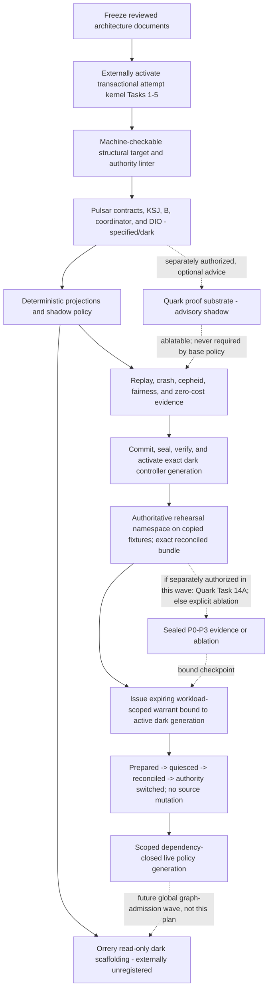

# GALAXY Singularity R3: Pulsar Singularity R1 Implementation Plan

> **For agentic workers:** REQUIRED SUB-SKILL: Use superpowers:subagent-driven-development (recommended) or superpowers:executing-plans to implement this plan task-by-task. Steps use checkbox (`- [ ]`) syntax for tracking.

**Goal:** Build Pulsar Singularity R1 as the deterministic, host-global, transactional scheduling control plane for every 9to5 work source, prove it in trace-only shadow operation, and cut over only the scheduling field family under an externally anchored, expiring GraphWarrant.

**Architecture:** Pulsar is a new external-Singularity authority domain, not a refactor of `TaskState.nextActionable()`. Immutable proposals compile into `WorkContract`s, one host-global SQLite journal owns scheduling facts, and only the external Singularity service can mint the non-serializable `SchedulerStoreAuthority` required to open it. Logical B reserves a closed resource vector inside the same `BEGIN IMMEDIATE` transaction that commits a decision and DIO row; repository/run-loop code uses a request-only client and never receives a database handle. K consumes a one-use launch capability through the already-activated transactional attempt kernel. All forecasting, graph construction, Quark work, and model deliberation stay outside the writer lock and outside the live deterministic dispatcher.

**Tech Stack:** Python 3.11+, stdlib dataclasses/enums/hashlib/json/sqlite3, SQLite WAL, pytest, repository-local simulation and benchmark tools, the externally activated GALAXY/Singularity transactional kernel, existing pre-owned Claude/Codex CLI surfaces, and optional local Ollama. No paid API, hosted inference, recurring SaaS, or new always-on service.

---

## 0. Authorization and dependency boundary

This file is an implementation plan, not implementation authority. The frozen
design still says runtime work is deferred. Do not execute a production-code
step until the user separately authorizes implementation.

The current checkout is intentionally **not ready** to execute this plan. It has
none of the external launch guard, standalone clone transaction, immutable
attempt journal, K issuance registry, GraphWarrant machinery, or scheduler
authority needed here. The dependency order is non-negotiable:



The prerequisite transactional plan is
`docs/superpowers/plans/2026-07-13-galaxy-r3-transactional-kernel.md`.
Its completion must prove, among other things, that collection/promotion and
finalization succeed before a subtask can become terminal `done`; the current
`execute_mixin.py`/`execution.wiring.finalizeQuietly()` order does not prove that.
Pulsar must not hide or route around that prerequisite.

### Frozen invariants this plan may not weaken

- Core topology stays exactly 131 nodes / 250 edges; disabled Voyager boundary is 134 / 256.
- Pulsar contributes exactly 19 purpose-distinct nodes / 68 unique typed edges.
- The only live route is `TWIG -> WCC -> KSJ -> ... -> KHA -> B -> KHA -> KSJ -> DIO -> K`.
- There is no `KHA -> DIO`, `AR -> DIO`, `PDP -> K`, or legacy `TaskState -> executor` bypass.
- `control.db` remains operator command-intent authority until its separate command/effect wave.
- All command/effect variants remain unavailable; initially every contract proves `effect_class = none`.
- KHA proposes; the Singularity coordinator revalidates and commits. DIO is a table, not an actor.
- One external scheduler database owns scheduling facts; repository processes receive no writer handle.
- The K issuance/process registry is physically separate from `singularity_scheduler.db`.
- Models may propose slow-lab policies and counterexamples, but never dispatch, grade, or activate themselves.
- Unknown cost is not zero cost; unknown scope serializes repository-wide; unknown authority blocks.

### Execution and source-update protocol

The checklist below is executable only after Task 1 proves the transactional
kernel. Every source-changing task runs inside one fresh kernel `CloneLease` and
lands through the staged-revision/verification/review/promotion journal. A
shown `git commit` is a candidate-clone checkpoint only; it is never permission
to stage or commit the canonical checkout directly. Stage exactly the paths in
that task's `Files` block. Directory-wide `git add`, wildcard staging, and
staging a dirty documentation file are forbidden. The kernel must report the
exact promoted SHA and source-update receipt before the next task starts.

Each numbered task below is a dependency wave, not one agent-sized coding turn.
Within its `CloneLease`, materialize the checklist as ordered RED/GREEN packets:
one named failing test (or one static fixture) for one stated invariant, one
narrow implementation change, the single-test rerun, then the task's focused
command. A packet may touch at most one production concern and its direct test;
split every comma-separated acceptance list into separate packets. Record the
expected RED failure and GREEN exit code in the staged-revision journal. Do not
batch two numbered tasks, skip a RED observation, or defer a stated case to a
later wave. The shown commit is allowed only after every packet and the full
focused command for that task pass.

Tasks 2-15 and the dark live-path adapters in Task 16 are source construction.
Task 16 lands the final source and generated maps, then uses the installed
external LKG updater to seal, verify, and activate that exact committed
controller generation while Pulsar remains shadow-only. It then runs the
authoritative external rehearsal and, only when selected by the immutable
pre-commit wave decision, the Quark Task 14A checkpoint without source
mutation. Once the dark seal is issued, no target code, test, build, or map tool
runs again. Task 17 is a fresh-namespace service-owned cutover
transaction bound to that rehearsal bundle and makes **no
source, manifest, map, test, or documentation change after
`scheduler_authority_switched`**. A cutover failure advances recovery state; it
never falls back to target code or an uncommitted legacy selector.

## 1. Brownfield decisions

| Live seam | Use | Do not misrepresent it as |
|---|---|---|
| `platform_core/runtime/control_store.py::_connect`, `_tx` | WAL, per-call connections, `BEGIN IMMEDIATE`, busy timeout, concurrency test style | KSJ/B/DIO storage or command-safe outbox semantics |
| `platform_core/orchestration/plan_concurrency.py::normalizePlanConcurrency` | Bounded syntax normalization | Protected scope, resource, cost, or parallelism proof |
| `platform_core/orchestration/parallel_safety.py::disjoint` | Conservative legacy/shadow comparison | Host-global feasibility or atomic CAS |
| `platform_core/orchestration/code_graph.py::tarjan_scc` | Differential fixture for SCC diagnostics | Scheduling authority or direct dependency readiness |
| `platform_core/core/concurrency.py::boundedWorkerBudget` | Evaluation baseline and local thread ceiling | Durable machine capacity or reservation |
| `platform_core/runtime/heartbeat.py` | Liveness observation source | Cancellation, terminal truth, or resource release |
| `learning/outcome_evaluation.py` | Trial/evaluation structure | GraphWarrant or self-promotion authority |
| `notifications/surfaces/webdash.py` | Presentation patterns only | Orrery authority core; it also has control-write routes |

Research is translated into mechanics, not decoration:

- Goal-Autopilot's recent gated-FSM pattern becomes a stateless `tick(snapshot)` proposal API and a hard terminal-verification floor.
- RACE-Sched's dual stream becomes a deterministic, model-free live dispatcher plus a slower sandboxed policy laboratory with atomic generation promotion.
- TaskWeave's dependency-aware trace memory becomes content-addressed KSJ cuts and reason-complete diagnostic traces, not another mutable memory owner.
- Temporal and GitHub WorkQueueOps contribute durable-timer, idempotency, retry, and recovery semantics only; Pulsar does not add a hosted dependency.
- GitHub's explicit steering-versus-queueing distinction becomes closed control-intent variants. No ambiguous mid-flight mutation is accepted.

Discovery pins for design comparison are recorded, not imported as authority:

| Quarry | Discovery commit | License result | Permitted brownfield use |
|---|---|---|---|
| `microsoft/agent-framework` | `4bac2c2c052f4cbb3f6fc4308347eb4274fe3083` | MIT | workflow/event abstractions and deterministic orchestration fixtures |
| `temporalio/temporal` | `f9daf46b4c2e71493aba9931cdb9fec86811a1a3` | MIT | durable timers, histories, retries, and recovery semantics |
| `NousResearch/hermes-agent` | `2ccfdb2db4eedf385f6c5b3fe722e183cee1b6de` | MIT | local-first agent loop and tool-routing comparison |

Before copying any source, re-fetch the exact commit, hash the license file,
record an adaptation receipt, and independently reimplement/review the trusted
kernel. A URL, popularity, or upstream test result is never authority.

## 2. Implementation waves

### Task 1: Prove the prerequisite kernel and freeze an execution baseline

**Files:**

- Verify: `docs/superpowers/plans/2026-07-13-galaxy-r3-transactional-kernel.md`
- Verify: `platform_core/execution/launch_guard.py`
- Verify: `platform_core/runtime/attempt_journal.py`
- Verify: `platform_core/runtime/receipts.py`
- Verify: `platform_core/runtime/controller_state.py`
- Verify: `platform_core/execution/backends/clone.py`
- Verify: `agents/execution/claude_driver.py`
- Verify: `agents/execution/codex_driver.py`
- Verify: `bootstrap/galaxy_launcher/capsule.py`
- Verify: `bootstrap/galaxy_launcher/singularity_admin_client.ps1`
- Verify: `bootstrap/galaxy_launcher/runtime_manifest.py`
- Verify: `tests/execution/test_activation_harness.py`
- Verify: `tests/execution/test_attempt_crash_matrix.py`
- Verify: `tests/execution/test_launch_guard.py`
- Verify: `tests/execution/test_runtime_resource_recovery.py`
- Verify: `tests/orchestration/test_staged_finalization.py`

- [ ] Confirm the transactional-kernel plan's Tasks 1-5 are implemented and its external active-controller receipt resolves to the exact checked-out controller generation.

- [ ] Run the focused safety gates before adding any Pulsar file:

```powershell
python -m pytest -q tests/execution/test_activation_harness.py tests/execution/test_attempt_crash_matrix.py tests/orchestration/test_staged_finalization.py tests/execution/test_launch_guard.py
```

Expected: all pass; every mutating Claude/Codex path has typed transaction authority; collection/promotion failure cannot leave `done`.

- [ ] Verify no legacy provider/environment fallback widens an unavailable capability profile:

```powershell
python -m pytest -q tests/execution/test_execution_router.py tests/execution/test_execution_local.py tests/execution/test_execution_docker.py tests/execution/test_runtime_resource_recovery.py
```

- [ ] Record the exact external controller receipt, source SHA, runtime manifest digest, and baseline ref in the implementation evidence packet. From the same OS-protected active-anchor receipt, bind in the operator-owned shell (never environment/target data) the absolute installed request-only client path/digest, pinned PowerShell path/digest, anchor receipt ID, and its empty external client cwd. Stop if any prerequisite is absent, inside the target checkout, digest-mismatched, or not externally verifiable. Later admin blocks launch only that installed client in a fresh `-NoProfile` host; the tracked `bootstrap/galaxy_launcher/singularity_admin_client.ps1` remains inert build input and is never dot-sourced or executed from the checkout.

- [ ] Treat all following source/test commits as out-of-band developer construction while the verified prior controller generation remains production authority. Do not run production work from the modified checkout and do not pretend the old active-controller receipt covers new Pulsar bytes. The exact final Pulsar SHA is installed and reverified only in Task 16 through the transactional kernel's external LKG controller-update protocol.

No commit is created by this read-only gate.

### Task 2: Add the structural target manifest and external-authority linter

**Files:**

- Create: `platform_core/singularity/__init__.py`
- Create: `platform_core/singularity/topology.py`
- Create: `platform_core/singularity/activation_overlay.py`
- Create: `platform_core/singularity/manifests/galaxy_r3.json`
- Create: `tools/galaxy_topology.py`
- Modify: `tools/affected_tests.py`
- Create: `tests/singularity/test_topology_manifest.py`
- Create: `tests/singularity/test_activation_overlay.py`
- Create: `tests/singularity/fixtures/topology_duplicate_edge.json`
- Create: `tests/singularity/fixtures/topology_authority_escape.json`
- Create: `tests/singularity/fixtures/runtime_overlay_set_incomplete_closure.json`
- Modify: `tests/platform/test_ci_affected.py`

- [ ] Write failing tests that require exact structural target counts, unique node IDs, unique ordered edge pairs, closed schemas, endpoint existence, one ablation key per edge, no source-manifest shadow/qualified/eligible/active field, an externally resolved active-scope count of zero, and no edge into the mutation/execution spine except the frozen authorized route. The new 60-node/155-edge GALAXY overlay starts source maturity `specified`, while the disabled 3-node/6-edge Voyager boundary stays `specified`; tests freeze bucket totals and evidence rules rather than permanently requiring every new GALAXY row to remain specified. The audited 71-node/95-edge base retains independent per-row evidence/maturity and is not declared full-manifest-qualified.

```python
def test_frozen_counts_and_zero_activation(manifest, empty_overlay_set):
    assert manifest.count(scope="core") == (131, 250)
    assert manifest.count(scope="with_disabled_voyager") == (134, 256)
    assert manifest.maturity_bucket_sum(scope="new_galaxy_overlay") == (60, 155)
    assert manifest.count(scope="disabled_voyager_boundary",
                          source_implementation_maturity="specified") == (3, 6)
    assert manifest.maturity_bucket_sum(scope="new_rows") == (63, 161)
    assert manifest.implemented_dark_rows_have_explicit_complete_evidence()
    assert manifest.base_rows_have_individual_evidence(counts=(71, 95))
    assert not manifest.has_runtime_activation_fields()
    assert empty_overlay_set.effective_counts == {
        "qualified": (0, 0),
        "eligible": (0, 0),
        "active": (0, 0),
    }


def test_scheduler_has_one_dispatch_route(manifest):
    assert manifest.edge("PU07").pair == ("TWIG", "WCC")
    assert manifest.edge("PU08").pair == ("WCC", "KSJ")
    assert manifest.edge("PU45").pair == ("KHA", "B")
    assert manifest.edge("PU46").pair == ("B", "KHA")
    assert manifest.edge("PU47").pair == ("KHA", "KSJ")
    assert manifest.edge("PU48").pair == ("KSJ", "DIO")
    assert manifest.edge("PU49").pair == ("DIO", "K")
    assert not manifest.has_pair("KHA", "DIO")
    assert not manifest.has_pair("PDP", "K")


def test_active_overlay_must_be_dependency_closed(manifest, incomplete_overlay_set):
    result = incomplete_overlay_set.validate_scope_activation(
        manifest, scope_id="pulsar.scheduler.r1", policy_id="pulsar.base.r1"
    )
    assert result.ok is False
    assert result.missing == ("RCG", "SEG", "PU33", "PU34")
```

- [ ] Run the tests and confirm RED because the manifest/parser do not exist:

```powershell
python -m pytest -q tests/singularity/test_topology_manifest.py tests/platform/test_ci_affected.py
```

- [ ] Implement strict frozen dataclasses `StructuralTopologyNode`, `StructuralTopologyEdge`, and `StructuralTopologyManifest`. Reject unknown fields, duplicate IDs/pairs, count drift, widened authority, dangling endpoints, missing lifecycle/budget/failure/ablation contracts, and non-disabled Voyager edges. Structural presence and source maturity are not runtime qualification.

- [ ] Populate the immutable target manifest from the reviewed base, overlay, Pulsar, Quark, and disabled Voyager ledgers. New GALAXY and disabled Voyager target rows initially remain `specified`; audited-base rows retain their independent reviewed per-row maturity/evidence. This is structural design truth, never runtime activation authority. Do not parse Markdown at runtime and do not use `.repo-map.json` as qualification evidence.

- [ ] Implement source maturity as the closed `specified | implemented_dark | retired | unavailable` enum. Implement OA-owned `RuntimeActivationOverlaySet` verification with immutable, journaled per-scope entries and generations. Each entry keeps externally `qualified`, `eligible`, and `active` node/edge sets separate and carries an explicit closed `RuntimeAvailabilityState` (`unknown | available | unavailable`); none is inferred from source maturity. `scope_id=pulsar.scheduler.r1` binds source/runtime/topology digests, its parent set CAS, source maturity, runtime dimensions, governing GraphWarrant/activation-root digests, expiry/renewal/revocation generations, and cursor. A repository file cannot create, qualify, or widen an entry. Effective-union validation requires every referenced parent entry to remain current and compatible and the union to be dependency-closed; a later child scope may advance the set journal but cannot replace or mutate the immutable Pulsar parent mapping. The linter reports effective active counts only from a fresh verified set. `validate_scope_activation()` rejects the Pulsar entry unless it contains the complete mandatory TWIG/WCC/KSJ, hard-feasibility, B/coordinator, DIO, K_ACT, recovery, fence, warrant, and rollback closure.

- [ ] Extend `tools/affected_tests.py` so changes to topology manifests, schema files, policy/passport files, and runtime lock manifests select their qualification/replay tests even when no `.py` file changed.

- [ ] Verify GREEN and the CLI:

```powershell
python tools/galaxy_topology.py check platform_core/singularity/manifests/galaxy_r3.json
python -m pytest -q tests/singularity/test_topology_manifest.py tests/singularity/test_activation_overlay.py tests/platform/test_ci_affected.py
```

- [ ] Commit:

```powershell
git add -- platform_core/singularity/__init__.py platform_core/singularity/topology.py platform_core/singularity/activation_overlay.py platform_core/singularity/manifests/galaxy_r3.json tools/galaxy_topology.py tools/affected_tests.py tests/singularity/test_topology_manifest.py tests/singularity/test_activation_overlay.py tests/singularity/fixtures/topology_duplicate_edge.json tests/singularity/fixtures/topology_authority_escape.json tests/singularity/fixtures/runtime_overlay_set_incomplete_closure.json tests/platform/test_ci_affected.py
git commit -m "feat(singularity): qualify the frozen GALAXY topology"
```

### Task 3: Implement canonical artifacts, TWIG, WCC, and immutable WorkContract

**Files:**

- Create: `platform_core/singularity/artifacts.py`
- Create: `platform_core/singularity/pulsar/__init__.py`
- Create: `platform_core/singularity/pulsar/contracts.py`
- Create: `platform_core/singularity/pulsar/edge_contracts.py`
- Create: `platform_core/singularity/pulsar/ingress.py`
- Create: `platform_core/singularity/pulsar/work_contract.py`
- Create: `platform_core/singularity/pulsar/path_identity.py`
- Create: `tests/singularity/pulsar/test_artifacts.py`
- Create: `tests/singularity/pulsar/test_edges.py`
- Create: `tests/singularity/pulsar/test_work_ingress.py`
- Create: `tests/singularity/pulsar/test_work_contract.py`
- Create: `tests/singularity/pulsar/test_path_identity.py`

- [ ] Write strict artifact tests: canonical UTF-8 JSON, no NaN/infinity/floats for authority integers, 64-KiB KH payload ceiling, required causal parents, exact producer/consumer contracts, full digests, expiry, and unknown-field rejection.

- [ ] Write WorkContract tests for every frozen field and fail-closed rule, including unknown cost, empty scope, Windows case/junction/Unicode aliases, unproved `effect_class`, unsupported resources, mutable dependency lists, and elevated free-text service hints.

```python
def test_unknown_cost_and_scope_block_compilation():
    admitted = admitted_proposal(zero_cost_proof_ref=None, mutation_scope=[])
    assert compile_work_contract(admitted).terminal == "blocked_contract"


def test_service_hint_cannot_raise_class():
    contract = compile_ok(service_class_hint="P0", protected_operation_type="ordinary")
    assert contract.service_class_hint == "P0"
    assert "protected_service_class" not in contract.to_canonical_dict()
```

- [ ] Confirm RED:

```powershell
python -m pytest -q tests/singularity/pulsar/test_artifacts.py tests/singularity/pulsar/test_edges.py tests/singularity/pulsar/test_work_ingress.py tests/singularity/pulsar/test_work_contract.py tests/singularity/pulsar/test_path_identity.py
```

- [ ] Implement one canonical encoder/digester shared by Pulsar and Quark:

```python
def canonical_bytes(value: Mapping[str, object]) -> bytes:
    validate_canonical_value(value)
    return json.dumps(value, sort_keys=True, separators=(",", ":"),
                      ensure_ascii=False, allow_nan=False).encode("utf-8")


def digest_artifact(value: Mapping[str, object]) -> str:
    return hashlib.sha256(canonical_bytes(value)).hexdigest()
```

- [ ] Define closed dataclasses/enums for the PU01-PU68 payload unions and the immutable `WorkContract`. Store tuples, not caller-owned lists/dicts; validate bounded integers and canonical IDs at construction.

- [ ] Implement `ProtectedPathIdentityResolver` in `path_identity.py` over the transactional kernel's retained no-follow repository-root handles. It canonicalizes Windows case, separators, Unicode, 8.3 aliases, and junction/reparse identities without following model-provided paths. It returns `UnknownPathIdentity` on any unproved component; WCC converts that to repository-wide conflict rather than string-based disjointness.

- [ ] Implement `admit_proposal()` as TWIG's pure protected PU01-PU06 producer-union gate and `compile_work_contract()` as WCC's pure transform. Neither writes state, reserves, ranks, infers authority, or emits SLC's protected class. Unknown producers and DL command proposals before the command/effect wave return bounded rejection receipts.

- [ ] Differentially exercise existing plan syntax normalization as untrusted input only:

```powershell
python -m pytest -q tests/singularity/pulsar tests/orchestration/test_plan_concurrency.py tests/orchestration/test_plan_shape_check.py
```

- [ ] Commit:

```powershell
git add -- platform_core/singularity/artifacts.py platform_core/singularity/pulsar/__init__.py platform_core/singularity/pulsar/contracts.py platform_core/singularity/pulsar/edge_contracts.py platform_core/singularity/pulsar/ingress.py platform_core/singularity/pulsar/work_contract.py platform_core/singularity/pulsar/path_identity.py tests/singularity/pulsar/test_artifacts.py tests/singularity/pulsar/test_edges.py tests/singularity/pulsar/test_work_ingress.py tests/singularity/pulsar/test_work_contract.py tests/singularity/pulsar/test_path_identity.py
git commit -m "feat(pulsar): add closed work contracts and ingress"
```

### Task 4: Build KSJ and the seven orthogonal state machines

**Files:**

- Create: `platform_core/singularity/pulsar/schema.py`
- Create: `platform_core/singularity/pulsar/state_machines.py`
- Create: `platform_core/singularity/pulsar/store.py`
- Create: `platform_core/singularity/pulsar/cuts.py`
- Create: `platform_core/singularity/pulsar/recovery.py`
- Create: `platform_core/singularity/pulsar/migrations.py`
- Create: `platform_core/singularity/pulsar/backup.py`
- Create: `platform_core/singularity/pulsar/cycle_budget.py`
- Create: `platform_core/singularity/pulsar/service.py`
- Create: `platform_core/singularity/pulsar/client.py`
- Create: `bootstrap/galaxy_launcher/pulsar_backup.ps1`
- Modify: `platform_core/runtime/controller_state.py`
- Modify: `bootstrap/galaxy_launcher/runtime_manifest.py`
- Create: `tests/singularity/pulsar/test_state_machines.py`
- Create: `tests/singularity/pulsar/test_schedule_store.py`
- Create: `tests/singularity/pulsar/test_schedule_store_concurrency.py`
- Create: `tests/singularity/pulsar/test_schedule_store_recovery.py`
- Create: `tests/singularity/pulsar/test_schedule_store_migrations.py`
- Create: `tests/singularity/pulsar/test_schedule_store_backup.py`
- Create: `tests/singularity/pulsar/test_cross_machine_invariants.py`
- Create: `tests/singularity/pulsar/test_cycle_permits.py`
- Create: `tests/singularity/pulsar/test_scheduler_service_boundary.py`
- Create: `tests/singularity/pulsar/test_scheduler_client.py`

- [ ] Write transition-table and cross-machine tests for the run/outcome, work/readiness, attempt, resource/lease, DIO delivery, command, and effect machines. Pin every Section 9 invariant: dispatch requires reservation/fence/DIO/durable issuance, running requires protected bootstrap, retry-wait consumes credit, terminal-link requires protected outcome, and release is idempotent/fenced. Command/effect transitions must be structurally unavailable in R1.

- [ ] Write tests proving only the installed external controller process can open the database. A serialized state-root receipt is evidence, not store authority; copying it into a target process must not permit `_connect()`. The database path never comes from the target repository, cwd, `config.STATE_DIR`, environment, task state, or a model-supplied value.

- [ ] Write concurrency/crash tests for WAL, one `BEGIN IMMEDIATE` writer, immutable contract create-or-return, append-only generation CAS, stable cuts, namespace quotas, integrity failure to `recovery_only`, and zero partial writes.

- [ ] Write migration and backup tests. Migrations are offline, versioned, checksummed, manifest-bound, and reversible only before activation. Backups are created only by the anchor-owned `pulsar_backup.ps1` under OS encryption plus restrictive ACLs, bind scheduler/boot/generation/cursor digests, and restore into a new Singularity generation. Database/WAL/backup/log canaries reject provider credentials, raw prompts, and model transcripts.

- [ ] Write one runtime test for every frozen cycle permit. `RecomputeBudget.consume(work_generation, semantic_digest, monotone_advance)` is create-or-return, excludes timestamps/delivery counters from the semantic digest, requires one named monotone advance, and terminalizes as reason-complete blocked/recovery when credit is exhausted. Pin SRR, TWS, DCF epoch, KHA/B quote, DIO/K, maintenance, LVS oscillation, Supernova, projection, PDP, and optional Quark cycle bounds.

- [ ] Confirm RED:

```powershell
python -m pytest -q tests/singularity/pulsar/test_state_machines.py tests/singularity/pulsar/test_cross_machine_invariants.py tests/singularity/pulsar/test_cycle_permits.py tests/singularity/pulsar/test_schedule_store.py tests/singularity/pulsar/test_schedule_store_concurrency.py tests/singularity/pulsar/test_schedule_store_recovery.py tests/singularity/pulsar/test_schedule_store_migrations.py tests/singularity/pulsar/test_schedule_store_backup.py tests/singularity/pulsar/test_scheduler_service_boundary.py tests/singularity/pulsar/test_scheduler_client.py
```

- [ ] Extend the sealed controller runtime to mint a non-serializable, process-local `SchedulerStoreAuthority` only after the anchor validates the installed runtime and `SingularityStateRootReceipt`. Implement `_connect`, `_tx`, and `_ro` from the proven `control_store` idiom, but require that capability and use a separate `singularity_scheduler.db` with schema/version/manifest checks. A receipt, path, environment variable, pickle, JSON object, target import, or client request can never construct the capability.

- [ ] Implement `PulsarService` inside the installed external controller and a request-only `PulsarClient` for target/orchestrator code. The closed IPC protocol carries bounded canonical requests and receipts only. Add an import-boundary test: target run-loop modules may import the client/contracts, but never `store`, `service`, `capacity_ledger`, `coordinator`, SQLite, or the capability type.

- [ ] Represent transitions as pure tables and guards. Never encode the product state in one giant status string.

```python
def transition(machine: Machine, prior: str, event: str) -> str:
    try:
        return TRANSITIONS[machine][prior][event]
    except KeyError as exc:
        raise InvalidTransition(machine, prior, event) from exc
```

- [ ] Make every read used by a decision produce an immutable `JournalCut` with repository/run cursors, policy generation, outcome-link cursor, timer generation, capacity generation, boot identity, and digest.

- [ ] Add startup integrity/manifest/receipt-chain checks and new-generation restore semantics. TaskState or dashboard data may never reconstruct scheduler authority.

- [ ] Verify:

```powershell
python -m pytest -q tests/singularity/pulsar/test_state_machines.py tests/singularity/pulsar/test_cross_machine_invariants.py tests/singularity/pulsar/test_cycle_permits.py tests/singularity/pulsar/test_schedule_store.py tests/singularity/pulsar/test_schedule_store_concurrency.py tests/singularity/pulsar/test_schedule_store_recovery.py tests/singularity/pulsar/test_schedule_store_migrations.py tests/singularity/pulsar/test_schedule_store_backup.py tests/singularity/pulsar/test_scheduler_service_boundary.py tests/singularity/pulsar/test_scheduler_client.py tests/control/test_control_store.py tests/control/test_control_concurrency.py
```

- [ ] Commit:

```powershell
git add -- platform_core/singularity/pulsar/schema.py platform_core/singularity/pulsar/state_machines.py platform_core/singularity/pulsar/store.py platform_core/singularity/pulsar/cuts.py platform_core/singularity/pulsar/recovery.py platform_core/singularity/pulsar/migrations.py platform_core/singularity/pulsar/backup.py platform_core/singularity/pulsar/cycle_budget.py platform_core/singularity/pulsar/service.py platform_core/singularity/pulsar/client.py platform_core/runtime/controller_state.py bootstrap/galaxy_launcher/runtime_manifest.py bootstrap/galaxy_launcher/pulsar_backup.ps1 tests/singularity/pulsar/test_state_machines.py tests/singularity/pulsar/test_cross_machine_invariants.py tests/singularity/pulsar/test_cycle_permits.py tests/singularity/pulsar/test_schedule_store.py tests/singularity/pulsar/test_schedule_store_concurrency.py tests/singularity/pulsar/test_schedule_store_recovery.py tests/singularity/pulsar/test_schedule_store_migrations.py tests/singularity/pulsar/test_schedule_store_backup.py tests/singularity/pulsar/test_scheduler_service_boundary.py tests/singularity/pulsar/test_scheduler_client.py
git commit -m "feat(pulsar): add the immutable schedule journal"
```

### Task 5: Add logical B `capacity-ledger.v2`, cohort proofs, and DIO append primitives

**Files:**

- Create: `platform_core/singularity/capacity_ledger.py`
- Create: `platform_core/singularity/pulsar/cohort.py`
- Create: `platform_core/singularity/pulsar/outbox.py`
- Create: `tests/singularity/test_capacity_ledger.py`
- Create: `tests/singularity/pulsar/test_cohort_completeness.py`
- Create: `tests/singularity/pulsar/test_dispatch_outbox_schema.py`

- [ ] Write tests for the exact closed `capacity-ledger.v2` resource enum: `cpu`, `ram`, `gpu`, `local_process_slots`, `browser_seats`, `native_ui_seats`, `worktrees`, `verifier_slots`, `preowned_provider_cli_seats`, and `bounded_local_solver_compute`. Reject aliases and unknown members. Human attention is never a capacity unit.

- [ ] Write tests for all-or-none reservation, idempotent release/redeem/revoke/reconcile, generation/fence mismatch, unknown resources, oversubscription, and a lost release response.

- [ ] Write `CohortCompletenessCertificate` tests that reject arbitrary prefixes, missing host namespaces, stale cursors, unproved exclusions, or exclusions that can affect conflict/fairness/deadline/resource closure.

- [ ] Write DIO schema/append tests for the closed `start_attempt | checkpoint_request | drain_request | cancel_request | release_request` union, immutable tuple binding, idempotency key, no delete-before-convergence, and unavailable command/effect variants. This task implements only the pure append primitive over an already-open coordinator transaction; it does not claim, deliver, issue, select, or reserve.

- [ ] Confirm RED:

```powershell
python -m pytest -q tests/singularity/test_capacity_ledger.py tests/singularity/pulsar/test_cohort_completeness.py tests/singularity/pulsar/test_dispatch_outbox_schema.py
```

- [ ] Implement B as a pure transition over the coordinator's already-open SQLite connection. B may mutate only its tables; no external call, model, filesystem, process, provider, network, IPC, or graph build occurs inside the writer transaction.

```python
def reserve_bundle(conn, request: ReserveBundle) -> CapacityReservationReceipt:
    observed = load_capacity_generation(conn, request.capacity_generation)
    validate_closed_bundle(request.resources, observed)
    assert_all_available(conn, request.resources)
    return append_reservation(conn, request)
```

- [ ] Verify B and DIO primitives accept only the service-owned open connection passed by the later coordinator. They cannot open the database, invoke the client, or receive a write-capable repository path:

```powershell
python -m pytest -q tests/singularity/test_capacity_ledger.py tests/singularity/pulsar/test_cohort_completeness.py tests/singularity/pulsar/test_dispatch_outbox_schema.py tests/singularity/pulsar/test_scheduler_service_boundary.py
```

- [ ] Commit:

```powershell
git add -- platform_core/singularity/capacity_ledger.py platform_core/singularity/pulsar/cohort.py platform_core/singularity/pulsar/outbox.py tests/singularity/test_capacity_ledger.py tests/singularity/pulsar/test_cohort_completeness.py tests/singularity/pulsar/test_dispatch_outbox_schema.py
git commit -m "feat(pulsar): add capacity and dispatch journal primitives"
```

### Task 6: Implement CRI, SRR, and TWS over immutable cuts

**Files:**

- Create: `platform_core/singularity/pulsar/readiness.py`
- Create: `platform_core/singularity/pulsar/reconcile.py`
- Create: `platform_core/singularity/pulsar/wakeups.py`
- Modify: `agents/execution/executor_session.py`
- Modify: `agents/execution/executor.py`
- Modify: `platform_core/orchestration/execute_attempt_mixin.py`
- Create: `tests/singularity/pulsar/test_readiness_index.py`
- Create: `tests/singularity/pulsar/test_schedule_reconcile.py`
- Create: `tests/singularity/pulsar/test_temporal_wakeup.py`
- Create: `tests/singularity/pulsar/test_provider_cooldown.py`
- Modify: `tests/execution/test_executor_session_lock.py`

- [ ] Test CRI against a scalar direct-dependency cepheid, cycles, failed ancestors, stale terminal links, corrupt caches, and SCC diagnostics. SCC reachability must never substitute for direct dependency completion.

- [ ] Test SRR's one CAS delta per unseen `(mission_revision, journal_cut, outcome_set)` digest; ambiguous lineage blocks and terminal work never revives.

- [ ] Test TWS at-least-once wake delivery, semantic deduplication, boot change, UTC recalculation, late-wakeup exact rescans, stale timers, bounded backoff, and `recovery_required` expiry. A wake only requests recomputation.

- [ ] Replace `executor_session._waitForSessionReset()` and `executor._retryOnSessionLimit()` with a typed `ProviderCooldownReceipt`; no production branch sleeps or retains a worker/provider reservation. `execute_attempt_mixin` submits that receipt through `PulsarClient.record_provider_cooldown()`, which revalidates the attempt/fence, converges the existing B disposition, appends generation-bound `not_before`, registers a TWS wake, and returns control. Tests monkeypatch `time.sleep` to fail and prove disposition is durable before wake registration.

- [ ] Confirm RED, implement pure/rebuildable projections, then verify:

```powershell
python -m pytest -q tests/singularity/pulsar/test_readiness_index.py tests/singularity/pulsar/test_schedule_reconcile.py tests/singularity/pulsar/test_temporal_wakeup.py tests/singularity/pulsar/test_provider_cooldown.py tests/execution/test_executor_session_lock.py tests/orchestration/test_plan_shape_check.py tests/control/test_control_store.py
```

- [ ] Commit:

```powershell
git add -- platform_core/singularity/pulsar/readiness.py platform_core/singularity/pulsar/reconcile.py platform_core/singularity/pulsar/wakeups.py agents/execution/executor_session.py agents/execution/executor.py platform_core/orchestration/execute_attempt_mixin.py tests/singularity/pulsar/test_readiness_index.py tests/singularity/pulsar/test_schedule_reconcile.py tests/singularity/pulsar/test_temporal_wakeup.py tests/singularity/pulsar/test_provider_cooldown.py tests/execution/test_executor_session_lock.py
git commit -m "feat(pulsar): add causal, revision, and temporal projections"
```

### Task 7: Implement SLC, DCF, and CPS without a model in the hot path

**Files:**

- Create: `platform_core/singularity/pulsar/service_level.py`
- Create: `platform_core/singularity/pulsar/duration_forecast.py`
- Create: `platform_core/singularity/pulsar/critical_path.py`
- Create: `tests/singularity/pulsar/test_service_level.py`
- Create: `tests/singularity/pulsar/test_duration_forecast.py`
- Create: `tests/singularity/pulsar/test_critical_path.py`

- [ ] Test that only a protected service policy assigns P0-P5; `layer`, `effort`, work profile, risk tier, and free text cannot raise class or infer P0.

- [ ] Test DCF with only resolved later-epoch protected outcomes, explicit unknown distributions, calibration bins, censoring, temporal holdouts, and no current attempt's unresolved outcome.

- [ ] Test CPS critical paths, immediate unlocks, deterministic laxity, infeasible/negative laxity incidents, cycles, missing deterministic ceilings, and advisory forecast ablation.

- [ ] Implement integer/fixed-point deterministic calculations. Percentiles may rank conservative tail risk but can never manufacture a hard-deadline ceiling.

- [ ] Verify:

```powershell
python -m pytest -q tests/singularity/pulsar/test_service_level.py tests/singularity/pulsar/test_duration_forecast.py tests/singularity/pulsar/test_critical_path.py tests/orchestration/test_plan_shape_check.py
```

- [ ] Commit:

```powershell
git add -- platform_core/singularity/pulsar/service_level.py platform_core/singularity/pulsar/duration_forecast.py platform_core/singularity/pulsar/critical_path.py tests/singularity/pulsar/test_service_level.py tests/singularity/pulsar/test_duration_forecast.py tests/singularity/pulsar/test_critical_path.py
git commit -m "feat(pulsar): classify service and analyze schedule risk"
```

### Task 8: Implement RO, RCG, FAR, and BSC advisory inputs

**Files:**

- Create: `platform_core/singularity/pulsar/resource_observatory.py`
- Create: `platform_core/singularity/pulsar/resume.py`
- Create: `platform_core/singularity/pulsar/fairness.py`
- Create: `platform_core/singularity/pulsar/backpressure.py`
- Create: `tests/singularity/pulsar/test_resource_observatory.py`
- Create: `tests/singularity/pulsar/test_resume_compatibility.py`
- Create: `tests/singularity/pulsar/test_fairness.py`
- Create: `tests/singularity/pulsar/test_backpressure.py`

- [ ] Test RO freshness and explicit unknowns across provider circuits, B facts, controller inventory, and every exact `capacity-ledger.v2` resource member. Observation never changes capacity and a stale/unknown value is ineligible.

- [ ] Test RCG across provider, driver, model, mode, session, repository/base, policy, checkpoint, sandbox, and attempt generations. Cross-provider resume and guessing are rejected.

- [ ] Test FAR's journaled class deficits, mission weighted dominant-resource fairness debt, capped age, bounded neutral debt for missing history, and starvation alarms. Worker-local counters and fabricated service are rejected.

- [ ] Test BSC's admission pressure, queue stability, contention, saturation, conservative backfill ceiling, and drain advice. Unknown stability narrows admission. BSC cannot reserve, preempt, cancel, or sleep a worker.

- [ ] Verify:

```powershell
python -m pytest -q tests/singularity/pulsar/test_resource_observatory.py tests/singularity/pulsar/test_resume_compatibility.py tests/singularity/pulsar/test_fairness.py tests/singularity/pulsar/test_backpressure.py tests/control/test_parallel_safety.py tests/execution/test_execution_router.py
```

- [ ] Commit:

```powershell
git add -- platform_core/singularity/pulsar/resource_observatory.py platform_core/singularity/pulsar/resume.py platform_core/singularity/pulsar/fairness.py platform_core/singularity/pulsar/backpressure.py tests/singularity/pulsar/test_resource_observatory.py tests/singularity/pulsar/test_resume_compatibility.py tests/singularity/pulsar/test_fairness.py tests/singularity/pulsar/test_backpressure.py
git commit -m "feat(pulsar): add resource, resume, fairness, and stability inputs"
```

### Task 9: Implement SEG, deterministic KHA, and the sole Singularity coordinator

**Files:**

- Create: `platform_core/singularity/pulsar/eligibility.py`
- Create: `platform_core/singularity/pulsar/scope.py`
- Create: `platform_core/singularity/pulsar/policy.py`
- Create: `platform_core/singularity/pulsar/arbiter.py`
- Create: `platform_core/singularity/pulsar/coordinator.py`
- Create: `tests/singularity/pulsar/test_scope_identity.py`
- Create: `tests/singularity/pulsar/test_eligibility_gate.py`
- Create: `tests/singularity/pulsar/test_policy.py`
- Create: `tests/singularity/pulsar/test_arbiter.py`
- Create: `tests/singularity/pulsar/test_atomic_claim.py`
- Create: `tests/singularity/pulsar/test_atomic_claim_crash_matrix.py`
- Create: `tests/slow/singularity/pulsar/test_scheduler_cepheid.py`

- [ ] Test Windows scope identity with no-follow root receipts, junctions, 8.3 aliases, separator/case/Unicode normalization, and unknown path identity. Unknown means repository-wide conflict.

- [ ] Test every `F_pre` term independently and in combination. Every emitted candidate carries a reason-complete predicate vector and a verified host-global cohort certificate; `CAP_OBSERVED`/`RESOURCE_OBSERVED` are never upgraded to reserved.

```python
def evaluate_eligibility(snapshot: EligibilitySnapshot) -> EligibilityReceipt:
    cohort = verify_cohort_certificate(snapshot.cohort_certificate, snapshot.host_cursor)
    terms = {name: checker(snapshot) for name, checker in PRECONDITION_CHECKERS.items()}
    eligible = cohort.valid and all(value is Truth.TRUE for value in terms.values())
    return EligibilityReceipt(eligible=eligible, terms=terms, cohort=cohort)
```

- [ ] Write exact tiny-state cepheid tests and property tests for the frozen hierarchy:

  1. ordinary P0 recovery/cancel/release/consistency work;
  2. feasible hard deadlines by least non-negative deterministic laxity;
  3. P1-P4 deficit scheduling with bounded replenishment;
  4. mission weighted dominant-resource fairness debt;
  5. exact sequential lexicographic comparison;
  6. P5 residual capacity only.

- [ ] Test capped aging, starvation bounds, priority donation chain limits/cycle checks/revocation, backfill conservative ceiling, all-or-none resource ordering, and no worker sleep while holding provider capacity.

- [ ] Reject an unconstrained weighted mega-score. Mixed-radix encoding is eligible only when each radix proof dominates the maximum total lower-order contribution; default to sequential comparison.

- [ ] Use LPT, FIFO, authored-first-ready, random, shortest-job, critical-path, HEFT-like, MLFQ/LAS, and DRF-only as evaluation baselines. LPT's `O(n log n)` invariant is “each eligible lane appears exactly once”; it is not the live policy.

- [ ] Implement KHA as a stateless pure proposal function. Capacity quote input is expiring advice and holds nothing.

```python
def choose(snapshot: ArbiterSnapshot) -> ScheduleDecisionProposal | NoDecision:
    if not snapshot.cohort.verify(snapshot.host_cursor):
        raise IncompleteCohort("host cursor or exclusion proof is not current")
    stratum = select_protected_stratum(snapshot)
    winner = sequential_lexicographic_min(stratum, key=order_key)
    return proposal_for(winner, snapshot)
```

- [ ] Write atomic-claim crash injection around each of the eight frozen steps. `SingularityCoordinator.commit_decision()` runs only inside `PulsarService` with `SchedulerStoreAuthority`: it re-reads the exact contract/cut/cohort/policy/repository/boot/emergency/warrant generations, recomputes bounded sealed predicates and the deterministic order key, invokes B's pure all-or-none transition, allocates attempt/fence, appends feasibility/decision receipts and the Task-5 DIO primitive, then commits once. After every failpoint, either none or the complete reservation/attempt/decision/DIO tuple exists.

- [ ] Enforce `writer_lock_budget_ms` with monotonic checkpoints and rollback. Forecasting, graph/index construction, models, Quark, provider/network/IPC, filesystem, and process work are statically and dynamically forbidden while the transaction is open. Timeout returns a recomputation request after rollback; it never calls TWS while holding the lock.

- [ ] Verify byte-identical decisions under input permutation and repeated serialization:

```powershell
python -m pytest -q tests/singularity/pulsar/test_scope_identity.py tests/singularity/pulsar/test_eligibility_gate.py tests/singularity/pulsar/test_policy.py tests/singularity/pulsar/test_arbiter.py tests/singularity/pulsar/test_atomic_claim.py tests/singularity/pulsar/test_atomic_claim_crash_matrix.py tests/singularity/pulsar/test_fairness.py tests/singularity/pulsar/test_backpressure.py tests/slow/singularity/pulsar/test_scheduler_cepheid.py
```

- [ ] Commit:

```powershell
git add -- platform_core/singularity/pulsar/eligibility.py platform_core/singularity/pulsar/scope.py platform_core/singularity/pulsar/policy.py platform_core/singularity/pulsar/arbiter.py platform_core/singularity/pulsar/coordinator.py tests/singularity/pulsar/test_scope_identity.py tests/singularity/pulsar/test_eligibility_gate.py tests/singularity/pulsar/test_policy.py tests/singularity/pulsar/test_arbiter.py tests/singularity/pulsar/test_atomic_claim.py tests/singularity/pulsar/test_atomic_claim_crash_matrix.py tests/slow/singularity/pulsar/test_scheduler_cepheid.py
git commit -m "feat(pulsar): atomically choose reserve and journal dispatch"
```

### Task 10: Implement DIO and the independent K issuance/process registry

**Files:**

- Modify: `platform_core/singularity/pulsar/outbox.py`
- Create: `platform_core/runtime/issuance_registry.py`
- Modify: `platform_core/execution/launch_guard.py`
- Modify: `platform_core/execution/router.py`
- Modify: `platform_core/execution/wiring.py`
- Modify: `platform_core/execution/backends/local.py`
- Modify: `platform_core/execution/backends/docker.py`
- Modify: `platform_core/execution/backends/clone.py`
- Modify: `platform_core/execution/backends/remote.py`
- Modify: `platform_core/orchestration/execute_mixin.py`
- Modify: `platform_core/orchestration/society/worker.py`
- Modify: `agents/execution/executor_stream.py`
- Modify: `agents/execution/claude_driver.py`
- Modify: `agents/execution/codex_driver.py`
- Modify: `agents/execution/browser_executor.py`
- Modify: `agents/execution/native_executor.py`
- Create: `tests/singularity/pulsar/test_dispatch_outbox.py`
- Create: `tests/singularity/pulsar/test_outbox_crash_matrix.py`
- Create: `tests/execution/test_issuance_registry.py`
- Modify: `tests/execution/test_launch_guard.py`
- Modify: `tests/execution/test_executor_stream.py`
- Modify: `tests/execution/test_browser_executor.py`
- Modify: `tests/orchestration/test_native_executor_cleanup.py`
- Modify: `tests/orchestration/test_society_worker.py`
- Create: `tests/singularity/pulsar/test_no_execution_bypass.py`

- [ ] Test the DIO lifecycle, leased claim, bounded pre-issuance redelivery, create-or-return issuance, independent registry corruption, K_ACT failure, cancellation, expiry, lost B disposition, `launch_unknown`, containment, and fresh identities on safe retry.

- [ ] Test that the K registry uses a separately attested database/root and that neither scheduler DB corruption nor projection state can fabricate issuance/process truth.

- [ ] Implement DIO claim/delivery/convergence as request-only service operations over the Task-5 append schema. A claim lease/fence may be redelivered only before durable issuance. `issuance_recorded` requires the separately persisted K registry receipt; PU50/PU51 convergence re-reads the matching B disposition. DIO remains a table and cannot invoke K itself.

- [ ] Bind the current governing GraphWarrant generation/digest, governing graph schema plus all relevant node/edge contract digests, immutable `pulsar.scheduler.r1` activation-root entry and current successor generation/digest, current compatible overlay-set journal head, workload/budget scope, scheduler/capacity/cutover/activation/emergency generations, expiry, renewal generation, and revocation generation into the policy receipt, journal cut, DIO tuple, durable issuance receipt, and one-use launch capability. Implement the full K_ACT guard twice: immediately before durable issuance and at every deepest process/resource launch lock where the one-use capability is consumed. Revalidate the unique current root chosen by the latest valid initial-switch or fresh-reactivation join under the durable switch anchor, then its unique unbroken current descendant; expiry, a branch/gap/rewind, stale root/join, or a newer emergency/activation/revocation generation closes the same gate before containment.

- [ ] Require a typed `KActivationContext` as the literal first statement of `_executeSubtask()` and at Society worker entry. Change `_launchClaude()`, Codex, browser, native, environment provisioning, and every backend's deepest spawn/resource boundary to require its matching live `OneUseLaunchCapability`. Reject raw dicts, environment variables, task fields, direct legacy callers, or DIO certificate booleans.

- [ ] Add a repository-wide AST/call-graph inventory test proving there is no `TaskState -> executor`, Society, browser/native, provider-driver, environment-router, or subprocess/resource launch bypass around K/DIO.

- [ ] Never return `launch_unknown` to `pending`. Containment terminalizes the old tuple; retry allocates new attempt/reservation/fence/idempotency/DIO identities.

- [ ] Verify:

```powershell
python -m pytest -q tests/singularity/pulsar/test_dispatch_outbox_schema.py tests/singularity/pulsar/test_dispatch_outbox.py tests/singularity/pulsar/test_outbox_crash_matrix.py tests/singularity/pulsar/test_no_execution_bypass.py tests/execution/test_issuance_registry.py tests/execution/test_launch_guard.py tests/execution/test_executor_stream.py tests/execution/test_browser_executor.py tests/orchestration/test_native_executor_cleanup.py tests/orchestration/test_society_worker.py
```

- [ ] Commit:

```powershell
git add -- platform_core/singularity/pulsar/outbox.py platform_core/runtime/issuance_registry.py platform_core/execution/launch_guard.py platform_core/execution/router.py platform_core/execution/wiring.py platform_core/execution/backends/local.py platform_core/execution/backends/docker.py platform_core/execution/backends/clone.py platform_core/execution/backends/remote.py platform_core/orchestration/execute_mixin.py platform_core/orchestration/society/worker.py agents/execution/executor_stream.py agents/execution/claude_driver.py agents/execution/codex_driver.py agents/execution/browser_executor.py agents/execution/native_executor.py tests/singularity/pulsar/test_dispatch_outbox.py tests/singularity/pulsar/test_outbox_crash_matrix.py tests/singularity/pulsar/test_no_execution_bypass.py tests/execution/test_issuance_registry.py tests/execution/test_launch_guard.py tests/execution/test_executor_stream.py tests/execution/test_browser_executor.py tests/orchestration/test_native_executor_cleanup.py tests/orchestration/test_society_worker.py
git commit -m "feat(pulsar): fence durable dispatch issuance"
```

### Task 11: Add SCR, PDP, and LVS without granting direct control authority

**Files:**

- Create: `platform_core/singularity/pulsar/checkpoint.py`
- Create: `platform_core/singularity/pulsar/preemption.py`
- Create: `platform_core/singularity/pulsar/liveness.py`
- Create: `tests/singularity/pulsar/test_checkpoint_registrar.py`
- Create: `tests/singularity/pulsar/test_preemption_planner.py`
- Create: `tests/singularity/pulsar/test_liveness_goldstone.py`

- [ ] Test semantic checkpoint schema/digest/base/repository/attempt generation, resumability class, and immutable artifact binding. SCR validates; it never pauses or asserts resume safety.

- [ ] Test PDP's checkpoint-only cooperative preemption, drain-only opaque Claude/Codex behavior, bounded donation, and exact `(attempt fence, decision generation, checkpoint digest)` re-entry rule. PDP emits a journal plan, never a signal.

- [ ] Test LVS bootstrap/start/heartbeat/terminal deadlines, zombie and leaked-reservation observations, oscillation cap, newer-generation recovery, and `unknown` rather than inferred success. LVS may append an anomaly and signal K only.

- [ ] Verify against the transactional kernel's candidate/receipt/heartbeat seams:

```powershell
python -m pytest -q tests/singularity/pulsar/test_checkpoint_registrar.py tests/singularity/pulsar/test_preemption_planner.py tests/singularity/pulsar/test_liveness_goldstone.py tests/control/test_heartbeat.py tests/execution/test_attempt_journal.py tests/orchestration/test_branch_runner.py
```

- [ ] Commit:

```powershell
git add -- platform_core/singularity/pulsar/checkpoint.py platform_core/singularity/pulsar/preemption.py platform_core/singularity/pulsar/liveness.py tests/singularity/pulsar/test_checkpoint_registrar.py tests/singularity/pulsar/test_preemption_planner.py tests/singularity/pulsar/test_liveness_goldstone.py
git commit -m "feat(pulsar): register checkpoints and plan safe recovery"
```

### Task 12: Integrate trace-only ingestion and shadow ticks across every queue source

**Files:**

- Create: `platform_core/singularity/pulsar/legacy_adapter.py`
- Create: `platform_core/singularity/pulsar/shadow.py`
- Modify: `platform_core/orchestration/run_phase_mixin.py`
- Modify: `platform_core/orchestration/dual_ledger_planner.py`
- Modify: `platform_core/orchestration/run_loop.py`
- Modify: `platform_core/orchestration/run_loop_mixin.py`
- Modify: `platform_core/orchestration/run_loop_replan_mixin.py`
- Modify: `platform_core/orchestration/control_ops.py`
- Modify: `platform_core/orchestration/society/society_batch.py`
- Modify: `platform_core/orchestration/society/coordinator.py`
- Modify: `platform_core/orchestration/solution_space.py`
- Modify: `platform_core/cli/main_cli.py`
- Create: `tests/singularity/pulsar/test_legacy_adapter.py`
- Create: `tests/singularity/pulsar/test_shadow_invariance.py`
- Create: `tests/singularity/pulsar/test_ingress_inventory.py`
- Modify: `tests/orchestration/test_society_off_invariance.py`

- [ ] Build a static closed inventory of every `TaskState.addSubtask()`, pending-reset, retry, maintenance, Supernova, and run-admission call site. Map normal planner, `dual_ledger_planner`, replan, and horizon-fill proposals to G/PU01; bound failure retries to FC/PU03; Supernova trials to CR/PU04; externally warranted controller maintenance to K/PU05; and run admission to RA/PU06. DL/PU02 operator-add remains a traced rejection until the separately activated command/effect wave. CLI retry must carry the same protected failure receipt as FC. Society and solution-space/tournament code reuse the original admitted WorkContract and are asserted **not** to become TWIG producers.

- [ ] Implement a stateless `shadow_tick(snapshot) -> ShadowDecisionRecord`. It may append only through an external `ShadowReceiptAuthority` into a physically/logically separate non-authoritative receipt namespace excluded from KSJ, B, DIO, host cursors, cohort certificates, and writer-lock accounting. It has no B reservation, DIO, K, command, effect, TaskState mutation, provider-call, or `SchedulerStoreAuthority` capability.

- [ ] Write paired-run tests that run identical seeded simulations with shadow disabled/enabled and assert identical TaskState bytes, scheduler/KSJ/B/DIO bytes and cursors, subprocess calls, worktree/clone actions, commands, effects, and terminal outcomes. Only external shadow receipts may differ. `test_ingress_inventory.py` parses the repository and fails if the discovered producer/reset call-site set differs from the closed provenance map.

- [ ] Preserve the legacy selector as the live path in this task. Any shadow exception is recorded but cannot change selection. Qualification, eligibility, and activation remain absent unless an external `RuntimeActivationOverlaySet` resolves a current compatible scope entry; source maturity alone never selects a path.

- [ ] Verify:

```powershell
python -m pytest -q tests/singularity/pulsar/test_legacy_adapter.py tests/singularity/pulsar/test_shadow_invariance.py tests/singularity/pulsar/test_ingress_inventory.py tests/orchestration/test_society_off_invariance.py tests/execution/test_dry_run.py
```

- [ ] Leave all incomplete Pulsar rows at source maturity `specified` in this task. Record per-row source evidence, but do not claim `implemented_dark` before the later activation, cutover, and Orrery bytes/tests exist. Do not rewrite the audited 71/95 base or disabled Voyager rows, and do not write shadow, qualified, eligible, active, or dependency-closure state into the source manifest.

- [ ] Commit:

```powershell
git add -- platform_core/singularity/pulsar/legacy_adapter.py platform_core/singularity/pulsar/shadow.py platform_core/orchestration/run_phase_mixin.py platform_core/orchestration/dual_ledger_planner.py platform_core/orchestration/run_loop.py platform_core/orchestration/run_loop_mixin.py platform_core/orchestration/run_loop_replan_mixin.py platform_core/orchestration/control_ops.py platform_core/orchestration/society/society_batch.py platform_core/orchestration/society/coordinator.py platform_core/orchestration/solution_space.py platform_core/cli/main_cli.py tests/singularity/pulsar/test_legacy_adapter.py tests/singularity/pulsar/test_shadow_invariance.py tests/singularity/pulsar/test_ingress_inventory.py tests/orchestration/test_society_off_invariance.py
git commit -m "feat(pulsar): shadow every scheduling source"
```

### Task 13: Build Supernova policy trials, replay evidence, and promotion gates

**Files:**

- Create: `platform_core/singularity/pulsar/policy_dsl.py`
- Create: `platform_core/singularity/pulsar/lab.py`
- Create: `platform_core/singularity/pulsar/replay.py`
- Create: `platform_core/singularity/pulsar/activation.py`
- Create: `bootstrap/galaxy_launcher/pulsar_admin_protocol.py`
- Modify: `bootstrap/galaxy_launcher/capsule.py`
- Modify: `bootstrap/galaxy_launcher/singularity_admin_client.ps1`
- Modify: `bootstrap/galaxy_launcher/runtime_manifest.py`
- Create: `tests/singularity/pulsar/test_policy_dsl.py`
- Create: `tests/singularity/pulsar/test_lab_independence.py`
- Create: `tests/singularity/pulsar/test_activation.py`
- Create: `tests/singularity/pulsar/test_warrant_runtime_disposition.py`
- Create: `tests/singularity/pulsar/test_reactivation.py`
- Create: `tests/execution/test_pulsar_admin_protocol.py`
- Create: `tests/slow/singularity/pulsar/test_replay_campaign.py`
- Create: `tests/slow/singularity/pulsar/test_adversarial_snapshots.py`
- Create: `tests/slow/singularity/pulsar/test_crash_campaign.py`

- [ ] Define a total, bounded policy DSL with no arbitrary code, I/O, clock, network, randomness, or unbounded loop. Static validation computes a hard operation ceiling.

- [ ] Implement immutable `LabBaseline` assignment of Claude/Codex proposer, falsifier, cepheid-builder, and failure-minimizer roles. Balance and swap provider roles; clean-room review receives artifacts/receipts, not the peer transcript.

- [ ] Keep A/A calibration and shared-queue interference checks mandatory. Task-level A/B is rejected when interference breaks independence.

- [ ] Run the frozen evidence campaigns from pinned seed `pulsar-r1-v1`: exhaustive tiny cepheids, exactly enumerated lifecycle failpoints with at least 1,000 crash cases, at least one million bounded adversarial snapshots, deterministic replay, monotonic metamorphic constraints, fairness/starvation bounds, zero-cost-route proof, and scheduler p99 below the declared budget and one percent of wall time. Each test writes a content-addressed summary containing seed, generator/version digest, case count, resource budget, endpoint values, and failure corpus; a count below the bound fails rather than skips.

- [ ] Compare against all frozen baselines under identical local resources and preregister hard-first decision rules. A simpler policy wins when there is no material verified gain.

- [ ] Define one canonical pre-issuance `ActivationProposal` and its `activation_binding_digest` in the installed OA/anchor service. Its closed content is exact source/controller/runtime/topology/schema/policy generations; the governing graph schema and every node/edge contract digest in the requested dependency closure; the expected parent `RuntimeActivationOverlaySet` journal CAS; one proposed immutable `scope_id=pulsar.scheduler.r1` entry with entry generation, stable activation-root ID, separate qualified/eligible/active sets, typed runtime availability, complete dependency closure, parent-scope roots, and explicit ablations; workload family, repository/run namespaces, limits, resource budgets, deterministic estimates, zero-cost proof, replay/crash/cepheid/fairness/crossover evidence, rollback generation/target, controller/contracts, issuer, a unique nonce, `not_before`, absolute expiry, maximum lifetime, renewal policy/generation, and scheduler/capacity/cutover/activation/emergency/revocation generations. Canonical immutable content digests are computable before issuance; the proposal contains **no digest or ID of a receipt that does not yet exist**.

- [ ] Implement GraphWarrant **issuance, renewal, and revocation only in the installed OA/anchor service** through `pulsar_admin_protocol.py`, the sealed capsule, and the request-only PowerShell client. The target `activation.py` is a pure verifier/resolver and has no issue/renew/revoke/persist/reactivate method. The create-or-return GraphWarrant references the proposal's exact `activation_binding_digest` and immutable content digests. Only after warrant issuance may OA attest the proposed overlay entry; that attestation references the same activation binding plus the issued warrant receipt and still does not install the entry. The later atomic switch emits a final `ActivationJoinReceipt` over the resulting warrant, attested entry, overlay-set install CAS, and switch receipt. This ordered join avoids cyclic final-receipt digests. The warrant authorizes a bounded request but does not itself create source, overlay-set, phase, or runtime activation state.

- [ ] Add external protocol tests for copied/forged warrant bytes, stale cursor, wrong workload or repository, source/runtime drift, expiry at the boundary, renewal before/at/after the allowed window, renewal-generation races or changed bindings, revocation before issue/use, revocation racing K_ACT, response loss, and create-or-return replay. Exercise proposal/warrant/entry order inversions, mismatched activation bindings, substituted content digests, and every partial-persistence boundary; no not-yet-issued receipt digest may appear in a proposal. Add a **disjoint, presealed fixture-scope** post-switch disposition campaign proving expiry/revocation closes new TWIG admission, coordinator commit, DIO issuance, and both K_ACT checks while existing fixture attempts enter only bounded drain/containment/recovery. It must not advance or revoke the live `pulsar.scheduler.r1` governing generation. Issuance and renewal re-read every evidence artifact and current generation under the OA lock; renewal creates a new bounded generation and never extends expired/revoked bytes in place. Only the external service may persist the warrant or mint the non-serializable one-use cutover capability; target JSON, environment, `FULL_STACK`, TaskState, model output, or local files can never activate it.

- [ ] Define the external atomic renewal-only successor for `pulsar.scheduler.r1`. The initial switch/join anchors its initial `activation_root_overlay_entry_digest/generation`; absent a valid fresh-reactivation join, runtime resolution accepts only the unique OA-attested current descendant of that root. Renewal derives a new canonical activation binding from the currently joined root and exact current leaf, then in one OA transaction joins a new governing-warrant generation and successor overlay entry. The successor preserves scope ID, activation root and switch anchor, qualified/eligible/active sets, runtime availability, controller/contracts, parent-scope references, workload/budgets/estimates/evidence/rollback, and may advance only permitted warrant lifetime/renewal/revocation bindings. Reject widening, branch, gap, rewind, stale parent, changed root, response-loss duplication, binding mismatch, or partial warrant/entry write. Crash/race/idempotency tests cover every boundary. Revocation/expiry closes admission/commit/DIO/K_ACT and may enter recovery, but never selects legacy field ownership.

- [ ] Implement installed-OA `CreateOrReturnPulsarReactivation` for a lineage that is already expired or revoked; dead bytes are never renewed. It takes a new proposal, nonce, current evidence, and fresh governing warrant and performs one per-scope overlay-set journal CAS from the inert old root/leaf to a **fresh activation root**, leaving the old lineage terminal. Its reactivation join selects that fresh root under the durable `switch_anchor_digest` without rewriting the historical switch receipt. Anchor reuse is allowed only when the full phase ancestry, controller, scheduler/TaskState stores, schemas, writer matrix, reconciled state, and field ownership still exact-match; otherwise it appends/retains `recovery_required` and requires a new reconciliation/cutover. Old child scopes remain inert and never auto-follow the fresh parent root. Test expiry, revocation, stale switch bindings, parent/child behavior, response loss, concurrent reactivation, no authority widening, and all-or-none fresh warrant/root/join persistence.

- [ ] Verify:

```powershell
python -m pytest -q tests/singularity/pulsar/test_policy_dsl.py tests/singularity/pulsar/test_lab_independence.py tests/singularity/pulsar/test_activation.py tests/singularity/pulsar/test_warrant_runtime_disposition.py tests/singularity/pulsar/test_reactivation.py tests/execution/test_pulsar_admin_protocol.py tests/slow/singularity/pulsar/test_replay_campaign.py tests/slow/singularity/pulsar/test_adversarial_snapshots.py tests/slow/singularity/pulsar/test_crash_campaign.py
```

- [ ] Commit:

```powershell
git add -- platform_core/singularity/pulsar/policy_dsl.py platform_core/singularity/pulsar/lab.py platform_core/singularity/pulsar/replay.py platform_core/singularity/pulsar/activation.py bootstrap/galaxy_launcher/pulsar_admin_protocol.py bootstrap/galaxy_launcher/capsule.py bootstrap/galaxy_launcher/singularity_admin_client.ps1 bootstrap/galaxy_launcher/runtime_manifest.py tests/singularity/pulsar/test_policy_dsl.py tests/singularity/pulsar/test_lab_independence.py tests/singularity/pulsar/test_activation.py tests/singularity/pulsar/test_warrant_runtime_disposition.py tests/singularity/pulsar/test_reactivation.py tests/execution/test_pulsar_admin_protocol.py tests/slow/singularity/pulsar/test_replay_campaign.py tests/slow/singularity/pulsar/test_adversarial_snapshots.py tests/slow/singularity/pulsar/test_crash_campaign.py
git commit -m "feat(pulsar): qualify scheduler policies through Supernova"
```

### Task 14: Implement and rehearse the field-level TaskState cutover

**Files:**

- Create: `platform_core/singularity/pulsar/cutover.py`
- Create: `platform_core/singularity/pulsar/task_projection.py`
- Create: `platform_core/singularity/pulsar/task_field_matrix.py`
- Create: `platform_core/singularity/pulsar/task_state_cas_client.py`
- Create: `platform_core/singularity/pulsar/task_state_compatibility.py`
- Create: `platform_core/singularity/pulsar/task_state_access_inventory.py`
- Modify: `bootstrap/galaxy_launcher/pulsar_admin_protocol.py`
- Create: `bootstrap/galaxy_launcher/task_state_cas_protocol.py`
- Modify: `bootstrap/galaxy_launcher/capsule.py`
- Modify: `bootstrap/galaxy_launcher/singularity_admin_client.ps1`
- Modify: `bootstrap/galaxy_launcher/runtime_manifest.py`
- Modify: `main.py`
- Modify: `orchestrator.py`
- Modify: `check_code_changes.py`
- Modify: `agents/execution/executor.py`
- Modify: `agents/hook_handlers/obsidian.py`
- Modify: `agents/hook_handlers/selfmod.py`
- Modify: `agents/planning/clarification_gate.py`
- Modify: `agents/planning/council_seam.py`
- Modify: `learning/feedback/wisdom.py`
- Modify: `memory/ledger/core.py`
- Modify: `memory/ledger/runs.py`
- Modify: `memory/ledger/subtasks.py`
- Modify: `memory/stores/obsidian.py`
- Modify: `notifications/ask.py`
- Modify: `notifications/brain_dialogue.py`
- Modify: `notifications/briefing.py`
- Modify: `notifications/command_bot.py`
- Modify: `notifications/commands.py`
- Modify: `notifications/council_transcript.py`
- Modify: `notifications/instinct.py`
- Modify: `notifications/jerry_client.py`
- Modify: `notifications/metrics.py`
- Modify: `notifications/ops.py`
- Modify: `notifications/psyche_cog.py`
- Modify: `notifications/slash.py`
- Modify: `notifications/bot/core.py`
- Modify: `notifications/bot/cogs/admin.py`
- Modify: `notifications/bot/cogs/ask_cog.py`
- Modify: `notifications/bot/cogs/control_cog.py`
- Modify: `notifications/bot/cogs/engagement_cog.py`
- Modify: `notifications/bot/cogs/observe_cog.py`
- Modify: `notifications/bot/cogs/ops_cog.py`
- Modify: `notifications/bot/cogs/plan_cog.py`
- Modify: `notifications/bot/cogs/runs_cog.py`
- Modify: `notifications/bot/ui/dynamic.py`
- Modify: `notifications/discord/embeds.py`
- Modify: `notifications/presentation/branding.py`
- Modify: `notifications/presentation/views_control.py`
- Modify: `notifications/presentation/visuals_cards.py`
- Modify: `notifications/runtime/tunnel.py`
- Modify: `notifications/runtime/run_arc.py`
- Modify: `notifications/runtime/reflection_post.py`
- Modify: `notifications/runtime/work_launcher.py`
- Modify: `notifications/surfaces/dashboard.py`
- Modify: `notifications/surfaces/console_hud.py`
- Modify: `notifications/surfaces/cv2.py`
- Modify: `notifications/surfaces/health_galaxy.py`
- Modify: `notifications/surfaces/webdash.py`
- Modify: `state/task.py`
- Modify: `state/task_schema.py`
- Modify: `state/task_io.py`
- Modify: `platform_core/core/lifecycle.py`
- Modify: `platform_core/runtime/resilience.py`
- Modify: `platform_core/cli/main_cli.py`
- Modify: `platform_core/execution/router.py`
- Modify: `platform_core/execution/wiring.py`
- Modify: `platform_core/execution/backends/worktree.py`
- Modify: `platform_core/ops/codenames.py`
- Modify: `platform_core/orchestration/adversary_loop.py`
- Modify: `platform_core/orchestration/control_mixin.py`
- Modify: `platform_core/orchestration/control_ops.py`
- Modify: `platform_core/orchestration/control_review_mixin.py`
- Modify: `platform_core/orchestration/dual_ledger_planner.py`
- Modify: `platform_core/orchestration/dual_ledger_replan.py`
- Modify: `platform_core/orchestration/evidence_gate.py`
- Modify: `platform_core/orchestration/execute_attempt_mixin.py`
- Modify: `platform_core/orchestration/execute_delegates_mixin.py`
- Modify: `platform_core/orchestration/execute_mixin.py`
- Modify: `platform_core/orchestration/github.py`
- Modify: `platform_core/orchestration/llm_mixin.py`
- Modify: `platform_core/orchestration/plan_mixin.py`
- Modify: `platform_core/orchestration/review_mixin.py`
- Modify: `platform_core/orchestration/safety_mixin.py`
- Modify: `platform_core/orchestration/step_sink.py`
- Modify: `platform_core/orchestration/run_loop.py`
- Modify: `platform_core/orchestration/run_loop_mixin.py`
- Modify: `platform_core/orchestration/run_loop_replan_mixin.py`
- Modify: `platform_core/orchestration/run_phase_mixin.py`
- Modify: `platform_core/orchestration/run_phase_outcome.py`
- Modify: `platform_core/orchestration/run_phase_surface_mixin.py`
- Modify: `platform_core/orchestration/solution_space.py`
- Modify: `platform_core/orchestration/subtask.py`
- Modify: `platform_core/orchestration/task_ledger.py`
- Modify: `platform_core/orchestration/work_profile.py`
- Modify: `platform_core/orchestration/society/coordinator.py`
- Modify: `platform_core/orchestration/society/society_batch.py`
- Modify: `platform_core/orchestration/society/worker.py`
- Modify: `human_nature/faculties/runtime/integration.py`
- Modify: `human_nature/faculties/identity/self_state.py`
- Modify: `human_nature/faculties/runtime/consolidation.py`
- Modify: `human_nature/faculties/runtime/psyche_runtime.py`
- Modify: `human_nature/faculties/runtime/run_events.py`
- Modify: `human_nature/faculties/signals/instinct.py`
- Modify: `human_nature/faculties/signals/scar_graph.py`
- Modify: `platform_core/orchestration/human_nature_bridge/_common.py`
- Modify: `platform_core/orchestration/human_nature_bridge/affect.py`
- Modify: `platform_core/orchestration/human_nature_bridge/instinct.py`
- Modify: `platform_core/orchestration/human_nature_bridge/inventor.py`
- Modify: `platform_core/orchestration/human_nature_bridge/lifecycle.py`
- Modify: `platform_core/orchestration/human_nature_bridge/planning.py`
- Modify: `platform_core/orchestration/human_nature_bridge/society.py`
- Modify: `platform_core/orchestration/human_nature_bridge/verification.py`
- Modify: `platform_core/simulator/bot_replay.py`
- Modify: `platform_core/simulator/testing/e2e.py`
- Modify: `platform_core/simulator/testing/outcome_runner.py`
- Modify: `platform_core/simulator/testing/operator.py`
- Modify: `platform_core/runtime/worktree.py`
- Modify: `tools/elaborator_eval.py`
- Modify: `platform_core/orchestration/parallel_safety.py`
- Modify: `platform_core/orchestration/step_resume.py`
- Create: `tests/singularity/pulsar/test_task_state_normalization.py`
- Create: `tests/singularity/pulsar/test_task_state_cutover.py`
- Create: `tests/singularity/pulsar/test_cutover_rehearsal_bundle.py`
- Create: `tests/singularity/pulsar/test_task_projection.py`
- Create: `tests/singularity/pulsar/test_task_field_matrix.py`
- Create: `tests/singularity/pulsar/test_task_state_access_inventory.py`
- Create: `tests/singularity/pulsar/fixtures/task_state_access_inventory.json`
- Create: `tests/execution/test_scheduler_cutover_admin.py`
- Create: `tests/execution/test_task_state_cas_protocol.py`
- Modify: `tests/execution/test_activation_harness.py`
- Modify: `tests/control/test_task_io_single_writer.py`

- [ ] Define this closed post-cutover writer matrix and map today's conflated subtask status into the seven machines. Unknown/mixed vocabulary blocks reconciliation. Legacy `meta.status`, subtask `status`, and `completed_at` freeze at cutover and are never rewritten as scheduler truth; do not migrate `status` wholesale.

| Writer capability | Exact writable TaskState fields after switch | Explicitly forbidden |
|---|---|---|
| `SchedulerProjectionWriter` | `meta.scheduler_projection.{journal_cut,projection_generation,run_state,stall_count}` and `plan.subtasks[*].scheduler_projection.{work_generation,work_state,readiness_state,attempt_generation,attempt_state,resource_lease_state,dio_delivery_state,not_before,retry_remaining,reservation_ref,dio_ref,checkpoint_ref,session_ref,projection_cursor}`, all derived from one KSJ/protected-receipt cursor | legacy `meta.status`; top-level subtask `status`, `completed_at`, or `terminal_outcome_ref`; authored mission/work fields; command/effect, evidence, or presentation fields |
| `MissionWriter` | `meta.{goal_raw,goal_elaborated}` and `plan.architect_design_doc` | every scheduling projection, command/effect, terminal, or evidence field; alias `plan.architect_doc` is rejected |
| `EvidenceWriter` | `plan.subtasks[*].{output_ref,github_pr,verify,verify_result}` and top-level `adversary_reviews` | `status`, dependencies, retry/timer/attempt/reservation/DIO/session fields, terminalization, or alias `reviews` |
| `ProtectedOutcomeLinker` | `plan.subtasks[*].terminal_outcome_ref` exactly once, from the matching immutable protected outcome-link receipt | overwrite/delete, `status`, `completed_at`, scheduling projection, evidence, mission, or presentation fields |
| `PresentationWriter` | none; it maps current legacy `notifications`, `context_handoffs`, `obsidian`, `dashboard_events`, and `meta.{dashboard_message_id,pre_execution_council,tunnel_url}` only into the separately protected presentation sidecar | every TaskState byte and guessed aliases such as `notification`, `handoffs`, or top-level `dashboard_message_id` |
| `AdvisoryEvidenceSidecarWriter` | none; exact inventoried legacy `meta.{innovative_changes,instinct_flags,task_ledger,code_diverged}` move to a separately protected advisory/evidence sidecar | every TaskState byte, scheduling decision, mission field, command/effect, terminal link, or unlisted metadata path |
| `LegacyCommandEffectCASWriter` | exact existing legacy intent paths `meta.{control_mode,user_intents,injected_context,deadline_at,run_effort_override}` and `plan.subtasks[*].effort_override` until the separate command/effect cutover; alternatively only an independently activated command/effect sidecar for the same operation generation, never both | scheduling projection, add/remove/status/retry/attempt/reservation/DIO/session/terminal paths, mission/evidence/presentation paths, whole-document save, or an unactivated sidecar |

Every TaskState writer presents a non-serializable writer capability, exact
allowed field mask, **expected TaskState generation and expected preimage
digest**, plus the current scheduler-projection digest. Sidecar-only writers
receive capabilities that cannot address TaskState. Unknown writer IDs, unknown
fields, overlapping masks, stale generation or digest, list-index drift, or a
changed KSJ-projected byte fail closed. No generic `TaskState.save()` overload
remains after switch. The command/effect writer additionally binds the exact
legacy path-matrix generation and operation generation; legacy CAS and an
independently activated sidecar are mutually exclusive for one operation.

- [ ] Extend the already installed OA/controller capsule with `TaskStateFieldCASService`; it alone opens the authoritative TaskState files after switch. The sealed capsule/runtime manifest allowlists the exact service/protocol/client digests, and the activation harness proves a target checkout import cannot instantiate the service or obtain its file handle. At controller launch, the external authority issues short-lived, boot/controller/task/path-matrix/operation-generation-bound, non-serializable leases for each exact writer role and injects only a request-only `TaskStateFieldCASClient` into the reviewed component constructor or callback. A lease is never stored in TaskState, JSON, environment, a module global, or a generic service locator; target code cannot mint, select, duplicate, widen, or deserialize one. `TaskState.save()` and direct `task_io.save()` remain pre-switch compatibility calls only and fail closed post-switch. Legitimate post-switch callers submit an exact preimage digest, expected generation, field mask, and typed patch to the injected client; the external service reclassifies the diff and rejects a claimed writer ID that does not match the lease.

- [ ] Freeze a reviewed AST/static `TaskStateAccessInventory` covering every direct assignment, nested/in-place mutation, generic save/patch, mutator call, alias, background thread, simulator namespace, dynamic `addSubtask`/`updateSubtask` field, full authored subtask record, `env_handle_meta`, and reader of TaskState/meta/subtask fields. The scanner discovers the checkout surface, but cannot authorize it: a human-reviewed hard-coded fixture must exact-match the scan. In addition to the table paths, it explicitly classifies current `meta.{work_profile,run_intent_policy,run_pid,elaboration_status,elaboration_error,elaboration_human_edited,elaboration_stance,elaboration,status,blocked_reason,goal_elaborated,work_dir,is_self_referential,self_ref_branch,universe,epoch,subtask_seq,dashboard_message_id,pre_execution_council,tunnel_url,stall_count,discovery_report,invention_routes,innovative_changes,instinct_flags,code_diverged,task_ledger,arc,posted_surfaces,self_state,autonomy,hn_event_log,hn_behavior,hn_instinct,hn_inventor,hn_opinions,hn_votes,hn_debate,hn_verify_deepen,hn_scar_analysis}`, top-level `notifications`, `context_handoffs`, `dashboard_events`, `obsidian`, `adversary_reviews`, `plan.architect_design_doc`, and all authored/dynamic `plan.subtasks[*]` fields. Each access is exactly one of: pre-switch-only frozen, one matrix-owned protected CAS path, one named sidecar, a KSJ/protected-outcome compatibility projection, or read-only historical evidence. The role table is therefore a summary of the generated exact path matrix, not an illustrative allowlist. Unknown paths, unowned writes, mixed roles, or a newly discovered caller block rehearsal. Update every inventoried production caller in the Files list to receive the exact injected client/reader; `bot_replay.py` plus `simulator/testing/{e2e.py,outcome_runner.py,operator.py}` receive only isolated non-live fixture namespaces, while `tools/elaborator_eval.py` and `check_code_changes.py` are offline/historical readers with no live import path. Tests prove legitimate role calls work and forged writer IDs, copied/serialized leases, direct imports, generic saves, nested-diff smuggling, alias/in-place mutation, and wrong-role methods cannot acquire authority.

- [ ] Inventory and migrate **readers** with the same closure. At `quiesced`, seal a one-time content-addressed snapshot/cursor and exact backfill into each named sidecar; `reconciled` binds the backfill and reader-mapping digests. `TaskStateCompatibilityReader` phase-selects one source: before switch, the exact legacy TaskState generation; after switch, the exact current KSJ/protected-outcome projection and named sidecar generations. Frozen legacy `meta.status`, subtask `status`, `completed_at`, retry/attempt/session fields, and presentation bytes are historical only after switch and cannot drive readiness, terminality, recovery, command handling, or UI state. No reader may merge old/new values, prefer a convenient non-null value, or silently fall back; unknown cursor, mixed generation, stale sidecar, or unmapped read fails closed. Presentation may render the compatibility projection but gains no authority.

- [ ] Implement issuance of `SchedulerCutoverPhaseReceipt` only in the installed OA service by extending the Task-13 admin protocol. The target `cutover.py` can verify/resolve receipts but cannot issue, persist, advance, revoke, or recover them. Every receipt carries the closed `phase_mode = rehearsal | live_cutover`, a mode-specific phase generation, and a disjoint external namespace. Phase entries are non-expiring immutable ledger facts with no renewal/revocation operation; currentness means exact current generation/head/controller/store binding plus verified receipt ancestry. Rehearsal permits only `prepared -> quiesced -> reconciled`; it can never append or be accepted as `scheduler_authority_switched`/`projection_enabled`, even if bytes are copied into the live namespace. Live cutover owns `prepared -> quiesced -> reconciled -> scheduler_authority_switched -> projection_enabled`, plus pre-switch terminal `aborted_pre_switch` and externally owned `recovery_required`. The first successful switch creates a durable `switch_anchor_digest`; every `projection_enabled` or `recovery_required` descendant carries that exact anchor. The field selector is Pulsar when that anchored switch is in the verified ancestry of the current switch/projection/recovery head, even after the head advances. `recovery_required` closes new work but never restores legacy field ownership; warrant/overlay/controller expiry has the same no-revert rule.

- [ ] Make `prepared` seal only immutable identities and expectations: phase mode/generation/namespace, exact per-writer/path-matrix and reviewed reader/writer-inventory digests, sidecar schema generations, active controller/source/runtime generations, scheduler and TaskState schema digests, scheduler-store identity/schema/migration digest, and expected starting TaskState generation. Live `prepared` additionally seals the governing GraphWarrant activation binding and prior authoritative `SchedulerCutoverRehearsalBundle` digest. `quiesced` extends that parent seal with the frozen legacy TaskState generation, cursor, snapshot-state digest, and quiescence proof. `reconciled` extends both parents with exact KSJ generation/state digest, sidecar backfill generations/digests, reader-source mapping digest, and the one-to-one work/state mapping or bijection digest. Every later phase re-reads its full ancestry.

- [ ] `scheduler_authority_switched` accepts only `live_cutover` and, under the same fence as the switch, fresh-reads the current legacy TaskState and KSJ stores and exact-matches the prepared, quiesced, and reconciled cumulative seals. Any pre-switch drift appends `aborted_pre_switch`; any mismatch observed after an existing switch appends `recovery_required`. No prepared-only identity digest is misrepresented as a quiesced/reconciled state digest.

- [ ] Crash-test every write boundary of the switch transaction using Task 13's non-cyclic issuance order. The canonical `ActivationProposal` fixes the activation binding and proposed entry; the GraphWarrant references that binding; the overlay-entry attestation references the binding plus issued warrant. Under one fence, the service validates the expected overlay-set journal CAS and all cumulative cutover seals, appends that exact immutable `pulsar.scheduler.r1` entry and `scheduler_authority_switched`, then emits the final `ActivationJoinReceipt` over the resulting warrant/entry/install/switch artifacts, all-or-none. After any failpoint, either prior set/phase heads both remain or the complete joined artifacts exist; no partial entry, order inversion, binding mismatch, unbound phase receipt, independently generated scope, or whole-set replacement is observable.

- [ ] Add field-mask CAS/sidecar persistence implementing the matrix above. Exact legacy command/effect TaskState paths remain protected-CAS writable until their separate cutover; an already independently activated sidecar is a mutually exclusive alternative for the same operation generation, never a default or dual-write. Map the exact current presentation paths to the presentation sidecar and reject guessed aliases. Whole-document save, unmasked nested-dict replacement, or list replacement that can overwrite migrated bytes is rejected.

- [ ] Test every `TaskState` mutator plus Society, resume, recovery, control operations, run lifecycle, evidence, and dashboards against the closed matrix. After switch, direct scheduling-field changes fail; before switch, KSJ is trace-only. Never dual-write and never same-run revert after switch.

- [ ] Build and fixture-test the rehearsal harness in this task, but do not claim an authoritative rehearsal before the exact dark controller is externally active. On copied legacy fixtures, require one-to-one mapping for work, dependency, retry, timer, attempt, reservation reference, and outcome link, with independently matching digests. The canonical `SchedulerCutoverRehearsalBundle` is a read-only target view over externally issued rehearsal-mode `prepared`, `quiesced`, and `reconciled` phase receipts plus a fresh external no-switch proof. Its verified phase-ledger head must be exactly `reconciled`; reject `aborted_pre_switch`, `recovery_required`, any unknown/terminal value, `scheduler_authority_switched`, `projection_enabled`, or any later phase. It is not a parallel TaskState receipt, cannot advance a phase, is namespace-ineligible for live cutover, and is invalid if any seal digest differs. Task 16 performs the authoritative external rehearsal.

- [ ] Verify:

```powershell
python -m pytest -q tests/singularity/pulsar/test_task_state_normalization.py tests/singularity/pulsar/test_task_state_cutover.py tests/singularity/pulsar/test_cutover_rehearsal_bundle.py tests/singularity/pulsar/test_task_projection.py tests/singularity/pulsar/test_task_field_matrix.py tests/singularity/pulsar/test_task_state_access_inventory.py tests/execution/test_scheduler_cutover_admin.py tests/execution/test_task_state_cas_protocol.py tests/control/test_task_io_single_writer.py tests/control/test_task.py tests/execution/test_step_resume.py tests/orchestration/test_control_ops.py
```

- [ ] Commit the mechanism while leaving the external switch unissued:

```powershell
git add -- platform_core/singularity/pulsar/cutover.py platform_core/singularity/pulsar/task_projection.py platform_core/singularity/pulsar/task_field_matrix.py platform_core/singularity/pulsar/task_state_cas_client.py platform_core/singularity/pulsar/task_state_compatibility.py platform_core/singularity/pulsar/task_state_access_inventory.py
git add -- bootstrap/galaxy_launcher/pulsar_admin_protocol.py bootstrap/galaxy_launcher/task_state_cas_protocol.py bootstrap/galaxy_launcher/capsule.py bootstrap/galaxy_launcher/singularity_admin_client.ps1 bootstrap/galaxy_launcher/runtime_manifest.py main.py orchestrator.py check_code_changes.py
git add -- agents/execution/executor.py agents/hook_handlers/obsidian.py agents/hook_handlers/selfmod.py agents/planning/clarification_gate.py agents/planning/council_seam.py learning/feedback/wisdom.py memory/ledger/core.py memory/ledger/runs.py memory/ledger/subtasks.py memory/stores/obsidian.py
git add -- notifications/ask.py notifications/brain_dialogue.py notifications/briefing.py notifications/command_bot.py notifications/commands.py notifications/council_transcript.py notifications/instinct.py notifications/jerry_client.py notifications/metrics.py notifications/ops.py notifications/psyche_cog.py notifications/slash.py notifications/bot/core.py notifications/bot/cogs/admin.py notifications/bot/cogs/ask_cog.py notifications/bot/cogs/control_cog.py notifications/bot/cogs/engagement_cog.py notifications/bot/cogs/observe_cog.py notifications/bot/cogs/ops_cog.py notifications/bot/cogs/plan_cog.py notifications/bot/cogs/runs_cog.py notifications/bot/ui/dynamic.py notifications/discord/embeds.py notifications/presentation/branding.py notifications/presentation/views_control.py notifications/presentation/visuals_cards.py notifications/runtime/tunnel.py notifications/runtime/run_arc.py notifications/runtime/reflection_post.py notifications/runtime/work_launcher.py notifications/surfaces/dashboard.py notifications/surfaces/console_hud.py notifications/surfaces/cv2.py notifications/surfaces/health_galaxy.py notifications/surfaces/webdash.py
git add -- state/task.py state/task_schema.py state/task_io.py platform_core/core/lifecycle.py platform_core/runtime/resilience.py platform_core/runtime/worktree.py platform_core/cli/main_cli.py platform_core/execution/router.py platform_core/execution/wiring.py platform_core/execution/backends/worktree.py platform_core/ops/codenames.py
git add -- platform_core/orchestration/adversary_loop.py platform_core/orchestration/control_mixin.py platform_core/orchestration/control_ops.py platform_core/orchestration/control_review_mixin.py platform_core/orchestration/dual_ledger_planner.py platform_core/orchestration/dual_ledger_replan.py platform_core/orchestration/evidence_gate.py platform_core/orchestration/execute_attempt_mixin.py platform_core/orchestration/execute_delegates_mixin.py platform_core/orchestration/execute_mixin.py platform_core/orchestration/github.py platform_core/orchestration/llm_mixin.py platform_core/orchestration/plan_mixin.py platform_core/orchestration/review_mixin.py platform_core/orchestration/safety_mixin.py platform_core/orchestration/step_sink.py platform_core/orchestration/run_loop.py platform_core/orchestration/run_loop_mixin.py platform_core/orchestration/run_loop_replan_mixin.py platform_core/orchestration/run_phase_mixin.py platform_core/orchestration/run_phase_outcome.py platform_core/orchestration/run_phase_surface_mixin.py platform_core/orchestration/solution_space.py platform_core/orchestration/subtask.py platform_core/orchestration/task_ledger.py platform_core/orchestration/work_profile.py platform_core/orchestration/parallel_safety.py platform_core/orchestration/step_resume.py platform_core/orchestration/society/coordinator.py platform_core/orchestration/society/society_batch.py platform_core/orchestration/society/worker.py
git add -- human_nature/faculties/runtime/integration.py human_nature/faculties/identity/self_state.py human_nature/faculties/runtime/consolidation.py human_nature/faculties/runtime/psyche_runtime.py human_nature/faculties/runtime/run_events.py human_nature/faculties/signals/instinct.py human_nature/faculties/signals/scar_graph.py platform_core/orchestration/human_nature_bridge/_common.py platform_core/orchestration/human_nature_bridge/affect.py platform_core/orchestration/human_nature_bridge/instinct.py platform_core/orchestration/human_nature_bridge/inventor.py platform_core/orchestration/human_nature_bridge/lifecycle.py platform_core/orchestration/human_nature_bridge/planning.py platform_core/orchestration/human_nature_bridge/society.py platform_core/orchestration/human_nature_bridge/verification.py
git add -- platform_core/simulator/bot_replay.py platform_core/simulator/testing/e2e.py platform_core/simulator/testing/outcome_runner.py platform_core/simulator/testing/operator.py tools/elaborator_eval.py
git add -- tests/singularity/pulsar/test_task_state_normalization.py tests/singularity/pulsar/test_task_state_cutover.py tests/singularity/pulsar/test_cutover_rehearsal_bundle.py tests/singularity/pulsar/test_task_projection.py tests/singularity/pulsar/test_task_field_matrix.py tests/singularity/pulsar/test_task_state_access_inventory.py tests/singularity/pulsar/fixtures/task_state_access_inventory.json tests/execution/test_scheduler_cutover_admin.py tests/execution/test_task_state_cas_protocol.py tests/execution/test_activation_harness.py tests/control/test_task_io_single_writer.py
git commit -m "feat(pulsar): prepare scheduler field authority cutover"
```

### Task 15: Add Orrery through a dedicated read-only endpoint and DTO

**Files:**

- Create: `platform_core/singularity/pulsar/orrery.py`
- Create: `platform_core/singularity/pulsar/orrery_dto.py`
- Create: `platform_core/singularity/pulsar/orrery_read_client.py`
- Modify: `platform_core/singularity/pulsar/service.py`
- Create: `notifications/orrery.py`
- Create: `notifications/surfaces/orrery_endpoint.py`
- Create: `notifications/surfaces/orrery_markup.py`
- Create: `notifications/surfaces/orrery_script.py`
- Create: `notifications/surfaces/orrery_styles.py`
- Create: `tests/singularity/pulsar/test_orrery_projection.py`
- Create: `tests/singularity/pulsar/test_orrery_dto.py`
- Create: `tests/notifications/test_orrery_endpoint.py`
- Create: `tests/notifications/test_orrery_full_path_purity.py`

- [ ] Define a frozen, versioned `OrrerySnapshotDTO`. It exposes three non-interchangeable blocks: immutable structural target/count truth; source maturity buckets (`specified | implemented_dark | retired | unavailable`); and externally resolved `RuntimeActivationOverlaySet` truth (per-scope qualified/eligible/active sets, typed `RuntimeAvailabilityState`, scope currentness, and effective union). Tests reject one flattened status/boolean, inferred promotion from source maturity, a full-manifest-qualified claim for the evidence-audited base, or source-manifest activation fields. The DTO otherwise contains only canonical scalar/list/map projections, the structural topology generation, KSJ/protected-receipt cursors, per-value freshness, and explicit `known | stale | unknown`; it contains no capability, callback, store object, task object, or mutable model reference.

- [ ] Add one bounded, read-only `orrery_snapshot` operation to `PulsarService` and build the projection from its single immutable query cut. The endpoint/read client do not import the service implementation, and the service operation accepts no mutation variant or generic client envelope. Render current node/edge, queue position, blockers, class, fairness debt, reservation, attempt generation, provider route, checkpoint, DIO state, verification, and recovery path. Missing or cursor-inconsistent data renders `unknown`; projection lag cannot feed an input back into RO, BSC, KHA, DIO, K, or any writer.

- [ ] Implement the dedicated listener/route as fixture and dark scaffolding (`GET /orrery/v1/snapshot` and `GET /orrery/`) rather than inside `webdash.py` or any mutable dashboard handler. Do **not** add a CLI, orchestrator startup call, mutable-dashboard route, or production listener registration anywhere in this Pulsar plan; a repository-wide call-graph test requires zero production callers. The external overlay set has no active Orrery scope. Registration belongs to the later global graph-admission/activation wave after the remaining GALAXY surface is qualified. `orrery_read_client.py` exposes only `get_snapshot(cursor)` over the bounded request protocol and does not import `client.py`, `service.py`, `store.py`, `TaskState`, ControlBus, or an admin client. The fixture endpoint rejects `POST`, `PUT`, `PATCH`, `DELETE`, WebSocket upgrade, and unknown methods with `405`; its browser script performs GET polling only.

- [ ] Prove full-path purity from DTO -> projection -> read client -> endpoint -> markup/script. A transitive AST/import/call-graph test rejects ControlBus, generic `PulsarClient`, TaskState load/save, enqueue, reprioritize, cancel, retry, reserve, terminalize, admin operations, command/effect writes, cookies carrying an authority token, and outbound methods other than the one query RPC. The query service accepts a read-scoped nonce only; a serialized admin or scheduler receipt never upgrades it.

- [ ] Verify the dedicated endpoint and DTO, including stale/missing cursors, malformed query responses, oversized payloads, disconnect/reconnect, method rejection, and byte-for-byte scheduler/TaskState invariance:

```powershell
python -m pytest -q tests/singularity/pulsar/test_orrery_projection.py tests/singularity/pulsar/test_orrery_dto.py tests/notifications/test_orrery_endpoint.py tests/notifications/test_orrery_full_path_purity.py
```

- [ ] Commit only this read surface; do not touch the mutable web dashboard:

```powershell
git add -- platform_core/singularity/pulsar/orrery.py platform_core/singularity/pulsar/orrery_dto.py platform_core/singularity/pulsar/orrery_read_client.py platform_core/singularity/pulsar/service.py notifications/orrery.py notifications/surfaces/orrery_endpoint.py notifications/surfaces/orrery_markup.py notifications/surfaces/orrery_script.py notifications/surfaces/orrery_styles.py tests/singularity/pulsar/test_orrery_projection.py tests/singularity/pulsar/test_orrery_dto.py tests/notifications/test_orrery_endpoint.py tests/notifications/test_orrery_full_path_purity.py
git commit -m "feat(orrery): add a read-only scheduler projection endpoint"
```

### Task 16: Land dark live-path adapters and activate the exact LKG generation

**Files:**

- Modify: `platform_core/orchestration/run_loop.py`
- Modify: `platform_core/orchestration/run_loop_mixin.py`
- Modify: `platform_core/orchestration/run_phase_mixin.py`
- Modify: `platform_core/orchestration/run_loop_replan_mixin.py`
- Modify: `platform_core/orchestration/dual_ledger_planner.py`
- Modify: `platform_core/orchestration/control_ops.py`
- Modify: `platform_core/orchestration/subtask.py`
- Modify: `platform_core/orchestration/parallel_safety.py`
- Modify: `platform_core/orchestration/society/society_batch.py`
- Modify: `platform_core/orchestration/society/coordinator.py`
- Modify: `platform_core/orchestration/solution_space.py`
- Modify: `platform_core/cli/main_cli.py`
- Modify: `platform_core/singularity/pulsar/legacy_adapter.py`
- Create: `platform_core/singularity/pulsar/work_ingress_client.py`
- Modify: `platform_core/singularity/manifests/galaxy_r3.json`
- Modify: `tests/singularity/test_topology_manifest.py`
- Modify: `tests/singularity/pulsar/test_legacy_adapter.py`
- Modify: `tests/singularity/pulsar/test_ingress_inventory.py`
- Create: `tests/singularity/pulsar/test_no_legacy_dispatch.py`
- Create: `tests/singularity/pulsar/test_live_tick.py`
- Create: `tests/singularity/pulsar/test_dark_controller_activation.py`
- Modify: `.repo-map.json`
- Modify: `.llm-map.json`

- [ ] First write failing selector tests. Every run loop resolves the externally anchored `SchedulerCutoverPhaseReceipt` on each scheduling boundary: before `scheduler_authority_switched`, the legacy selector remains live and Pulsar is trace/shadow only; after it, the already-installed adapter uses only the external Pulsar tick/coordinator/DIO response. No source edit, environment flag, cached module global, or target-owned manifest can flip the selector.

- [ ] Reject `TaskState.nextActionable()`, `_readySet()`, `selectSafeBatch()`, dual-ledger local selection, and Society's local claim as post-switch dispatch authorities. Keep compatibility helpers only for the pre-switch path and fixtures, and statically prove they cannot reach `_executeSubtask`, Society worker entry, Claude/Codex/browser/native launch, an environment lock, or any backend without the exact current `K_ACT` tuple.

- [ ] Convert every producer in Task 12's frozen inventory to one phase-selected `WorkIngressAdapter` using an injected request-only `WorkIngressClient`. Before the switch, it performs the exact legacy TaskState mutation and trace/shadow append. After the switch, it leaves every TaskState scheduling byte unchanged and sends exactly one create-or-return PU01-PU06 request to the external Pulsar service; success returns the admitted-proposal receipt, immutable WorkContract digest, and KSJ generation before the caller proceeds. The stable idempotency key binds protected producer provenance, proposal revision, run/work identity, and governing activation leaf, so restart or response loss cannot duplicate or lose work. Cover new plan, replan, horizon fill, FC and CLI retry, Supernova, controller maintenance, run admission, restart, and response loss. Society and solution-space continue to reuse the original WorkContract, while DL/PU02 remains a traced rejection until the separate command/effect activation. The closed AST test fails if any inventoried call site can mutate TaskState directly post-switch, bypass `WorkIngressClient`, or silently drop a proposal.

- [ ] Run the dark/live selector, no-bypass, DIO, issuance, and deepest-launch tests before any activation:

```powershell
python -m pytest -q tests/singularity/pulsar/test_no_legacy_dispatch.py tests/singularity/pulsar/test_live_tick.py tests/singularity/pulsar/test_dark_controller_activation.py tests/singularity/pulsar/test_legacy_adapter.py tests/singularity/pulsar/test_ingress_inventory.py tests/singularity/pulsar/test_task_state_cutover.py tests/singularity/pulsar/test_dispatch_outbox.py tests/singularity/pulsar/test_no_execution_bypass.py tests/execution/test_launch_guard.py tests/execution/test_issuance_registry.py tests/execution/test_executor_stream.py tests/execution/test_browser_executor.py tests/orchestration/test_native_executor_cleanup.py tests/orchestration/test_society_worker.py
```

- [ ] Before the final commit, resolve the activation-wave decision and retain its external `$immutableWaveDecisionReceipt` in the operator-owned shell. If Quark is included, its separately reviewed Task-13 source, manifest rows, tests, and sealed source evidence must already be present in this candidate clone and pass its pre-activation gates; the final commit/seal is one combined KH+DA dark LKG. If Quark is excluded, bind an explicit source/runtime ablation before sealing and do not attempt Task 14A or 14B later. The wave decision cannot change after the source commit.

- [ ] After every source/test gate is green, transition **all** frozen Pulsar R1 rows from `specified` to `implemented_dark`. `test_topology_manifest.py` hard-codes `EXPECTED_PULSAR_DARK_NODE_IDS = {TWIG, WCC, KSJ, TWS, CRI, SRR, SLC, CPS, DCF, FAR, RO, SEG, RCG, KHA, BSC, DIO, SCR, PDP, LVS}` and every edge ID `PU01` through `PU68`; neither set is derived from the manifest under test. Any missing row or evidence blocks sealing. SP/CT and disabled Voyager remain `specified` (Voyager exactly 3/6). Quark rows equal the exact sealed Task-13 manifest contribution when included and otherwise remain `specified` under the explicit ablation. Assert the new-GALAXY maturity buckets still total exactly 60/155 (63/161 with Voyager), no runtime field exists, and the closed per-row evidence map covers Tasks 2-15 plus this task's adapters without altering audited-base maturity.

- [ ] This is the final source-changing checkpoint. Regenerate the machine maps before committing, check them, stage only the listed implementation/test files and the two tracked maps, and require a clean candidate clone:

```powershell
python tools/repo_map.py --no-headers
python tools/repo_map.py --check
git add -- platform_core/orchestration/run_loop.py platform_core/orchestration/run_loop_mixin.py platform_core/orchestration/run_phase_mixin.py platform_core/orchestration/run_loop_replan_mixin.py platform_core/orchestration/dual_ledger_planner.py platform_core/orchestration/control_ops.py platform_core/orchestration/subtask.py platform_core/orchestration/parallel_safety.py platform_core/orchestration/society/society_batch.py platform_core/orchestration/society/coordinator.py platform_core/orchestration/solution_space.py platform_core/cli/main_cli.py platform_core/singularity/pulsar/legacy_adapter.py platform_core/singularity/pulsar/work_ingress_client.py platform_core/singularity/manifests/galaxy_r3.json tests/singularity/test_topology_manifest.py tests/singularity/pulsar/test_legacy_adapter.py tests/singularity/pulsar/test_ingress_inventory.py tests/singularity/pulsar/test_no_legacy_dispatch.py tests/singularity/pulsar/test_live_tick.py tests/singularity/pulsar/test_dark_controller_activation.py .repo-map.json .llm-map.json
git commit -m "feat(pulsar): land receipt-selected scheduling adapters"
$candidateSha = (git rev-parse HEAD).Trim()
$candidateTree = (git rev-parse 'HEAD^{tree}').Trim()
if (git status --porcelain --untracked-files=all) { throw "candidate clone is not clean" }
```

- [ ] Re-run the exact Task 1 kernel gates and exact Task 14 harness/rehearsal gate against this exact committed SHA. These begin the final target-Python/test/dev/map qualification block. If any gate fails, create a new source checkpoint and repeat this step; do not seal or activate a partially qualified generation:

```powershell
python -m pytest -q tests/execution/test_activation_harness.py tests/execution/test_attempt_crash_matrix.py tests/orchestration/test_staged_finalization.py tests/execution/test_launch_guard.py
python -m pytest -q tests/execution/test_execution_router.py tests/execution/test_execution_local.py tests/execution/test_execution_docker.py tests/execution/test_runtime_resource_recovery.py
python -m pytest -q tests/singularity/pulsar/test_task_state_normalization.py tests/singularity/pulsar/test_task_state_cutover.py tests/singularity/pulsar/test_cutover_rehearsal_bundle.py tests/singularity/pulsar/test_task_projection.py tests/singularity/pulsar/test_task_field_matrix.py tests/singularity/pulsar/test_task_state_access_inventory.py tests/execution/test_scheduler_cutover_admin.py tests/execution/test_task_state_cas_protocol.py tests/control/test_task_io_single_writer.py tests/control/test_task.py tests/execution/test_step_resume.py tests/orchestration/test_control_ops.py
```

- [ ] Still before sealing, run the final focused, affected-test, static, fast-lane, and full-suite gates. An empty changed set/selector is a hard failure; map generation already happened before the final commit, so this block uses `--check` only. These are the **last** target-code executions in the plan:

```powershell
python -m pytest -q tests/singularity tests/execution/test_activation_harness.py tests/execution/test_launch_guard.py tests/execution/test_issuance_registry.py tests/execution/test_executor_stream.py tests/execution/test_browser_executor.py tests/orchestration/test_native_executor_cleanup.py tests/orchestration/test_society_worker.py tests/control/test_task_io_single_writer.py tests/orchestration/test_society_off_invariance.py tests/notifications/test_orrery_endpoint.py tests/notifications/test_orrery_full_path_purity.py
$changed = @(git diff --name-only refs/9to5/baselines/galaxy-r3-qualified...HEAD)
if ($LASTEXITCODE -ne 0 -or $changed.Count -eq 0) { throw "no changed-file set for affected-test gate" }
$targetLine = (& python tools/affected_tests.py @changed)
if ($LASTEXITCODE -ne 0) { throw "affected-test selection failed" }
$targets = @($targetLine -split '\s+' | Where-Object { $_ })
if ($targets.Count -eq 0) { throw "affected-test selector returned no tests" }
& python -m pytest -q @targets
if ($LASTEXITCODE -ne 0) { throw "affected tests failed" }
$pythonChanged = @(git diff --name-only refs/9to5/baselines/galaxy-r3-qualified...HEAD -- '*.py')
if ($LASTEXITCODE -ne 0 -or $pythonChanged.Count -eq 0) { throw "no Python change set for static gates" }
python -m compileall -q agents bootstrap notifications platform_core state tools
python -m ruff check @pythonChanged
python -m mypy --ignore-missing-imports --follow-imports=skip --no-error-summary @pythonChanged
python tools/galaxy_topology.py check platform_core/singularity/manifests/galaxy_r3.json
python tools/repo_map.py --check
git diff --check refs/9to5/baselines/galaxy-r3-qualified...HEAD
python tools/dev.py fast
python -m pytest -n auto -q
```

- [ ] Immediately after the final local gate and before any seal request, perform a second full source-identity gate. Tests may not leave tracked or untracked artifacts, move `HEAD`, or alter the committed tree:

```powershell
if (git status --porcelain --untracked-files=all) { throw "final local qualification changed the source tree" }
if ((git rev-parse HEAD).Trim() -ne $candidateSha -or (git rev-parse 'HEAD^{tree}').Trim() -ne $candidateTree) { throw "candidate identity moved after final local qualification" }
```

- [ ] Only after all source gates pass, use the installed external admin protocol to seal and activate the exact commit as a **dark** LKG controller generation. These commands mutate external controller state only; target code can verify their receipts but cannot issue them:

```powershell
$repoRoot = (git rev-parse --show-toplevel).Trim()
$clientFull = [IO.Path]::GetFullPath($singularityClient)
$repoPrefix = [IO.Path]::GetFullPath($repoRoot).TrimEnd('\') + '\'
if ($clientFull.StartsWith($repoPrefix, [StringComparison]::OrdinalIgnoreCase)) { throw "admin client resolves inside target checkout" }
if ((Get-FileHash -Algorithm SHA256 -LiteralPath $singularityClient).Hash.ToLowerInvariant() -ne $singularityClientDigest.ToLowerInvariant()) { throw "installed admin client digest mismatch" }
if ((Get-FileHash -Algorithm SHA256 -LiteralPath $pinnedPowerShell).Hash.ToLowerInvariant() -ne $pinnedPowerShellDigest.ToLowerInvariant()) { throw "pinned PowerShell digest mismatch" }
function Invoke-SingularityAdmin {
    param([Parameter(Mandatory=$true)][string]$Operation, [hashtable]$Arguments = @{})
    $json = $Arguments | ConvertTo-Json -Compress -Depth 16
    $encoded = [Convert]::ToBase64String([Text.Encoding]::UTF8.GetBytes($json)).TrimEnd('=').Replace('+','-').Replace('/','_')
    Push-Location -LiteralPath $singularityClientEmptyCwd
    try {
        & $pinnedPowerShell -NoLogo -NoProfile -NonInteractive -ExecutionPolicy Bypass -File $singularityClient --request-only --operation $Operation --arguments-object-base64url $encoded --anchor-receipt $singularityAnchorReceipt --require-self-digest $singularityClientDigest --require-server-validated-client-digest --require-closed-cwd-env
    } finally {
        Pop-Location
    }
}
$sourceSha = (git rev-parse HEAD).Trim()
$sourceTree = (git rev-parse 'HEAD^{tree}').Trim()
if ($sourceSha -ne $candidateSha -or $sourceTree -ne $candidateTree) { throw "seal request does not match final qualified candidate" }
$current = Invoke-SingularityAdmin -Operation GetActiveController | ConvertFrom-Json
$qualification = Invoke-SingularityAdmin -Operation SealControllerQualificationHarness -Arguments @{ source_sha = $sourceSha; source_tree = $sourceTree; baseline_ref = 'refs/9to5/baselines/galaxy-r3-qualified'; staged_revision_receipt = $finalStagedRevisionReceipt; immutable_wave_decision_receipt = $immutableWaveDecisionReceipt } | ConvertFrom-Json
if ($qualification.source_sha -ne $sourceSha -or $qualification.source_tree -ne $sourceTree -or -not $qualification.task1_gate_digest -or -not $qualification.task14_gate_digest -or -not $qualification.final_preseal_gate_digest -or -not $qualification.immutable_wave_decision_digest) { throw "qualification harness receipt incomplete" }
$sealed = Invoke-SingularityAdmin -Operation SealDarkController -Arguments @{ source_sha = $sourceSha; source_tree = $sourceTree; qualification_harness_receipt = $qualification.receipt_id; immutable_wave_decision_digest = $qualification.immutable_wave_decision_digest; expected_active_generation = $current.controller_generation } | ConvertFrom-Json
if ($sealed.source_sha -ne $candidateSha -or $sealed.source_tree -ne $candidateTree -or $sealed.mode -ne 'dark') { throw "sealed candidate identity mismatch" }
$activated = Invoke-SingularityAdmin -Operation ActivateSealedController -Arguments @{ seal_receipt = $sealed.receipt_id; expected_active_generation = $current.controller_generation } | ConvertFrom-Json
$observed = Invoke-SingularityAdmin -Operation GetActiveController | ConvertFrom-Json
if ($observed.controller_generation -ne $activated.controller_generation -or $observed.source_sha -ne $sourceSha -or $observed.source_tree -ne $sourceTree -or $observed.immutable_wave_decision_digest -ne $qualification.immutable_wave_decision_digest) { throw "external controller activation mismatch" }
if ($observed.mode -ne 'dark' -or $observed.ingress_open -or @($observed.active_overlay_set.effective_active_scopes).Count -ne 0 -or $observed.cutover_phase -eq 'scheduler_authority_switched') { throw "controller is not dark" }
if ($observed.scheduler_store_authority_location -ne 'external_service' -or $observed.scheduler_store_authority_serializable) { throw "scheduler store authority escaped" }
```

- [ ] Now run the authoritative scheduler rehearsal through the installed OA service against copied, content-addressed legacy fixtures. Only the exact externally active dark controller may enter the `rehearsal` namespace. It must emit fresh `prepared`, `quiesced`, and `reconciled` receipts from one rehearsal generation and resolve the canonical read-only bundle; it cannot quiesce production, install an overlay, switch, or project:

```powershell
$dark = Invoke-SingularityAdmin -Operation GetActiveController | ConvertFrom-Json
$rPrepared = Invoke-SingularityAdmin -Operation BeginSchedulerCutoverRehearsal -Arguments @{ phase_mode = 'rehearsal'; controller_generation = $dark.controller_generation; source_sha = $dark.source_sha; source_tree = $dark.source_tree; fixture_set = 'qualified_legacy_task_corpus_v1' } | ConvertFrom-Json
$rQuiesced = Invoke-SingularityAdmin -Operation QuiesceSchedulerRehearsal -Arguments @{ rehearsal_generation = $rPrepared.phase_generation; phase_namespace = $rPrepared.phase_namespace; expected_phase = 'prepared' } | ConvertFrom-Json
$rReconciled = Invoke-SingularityAdmin -Operation ReconcileSchedulerRehearsal -Arguments @{ rehearsal_generation = $rPrepared.phase_generation; phase_namespace = $rPrepared.phase_namespace; expected_phase = 'quiesced' } | ConvertFrom-Json
$rehearsalBundle = Invoke-SingularityAdmin -Operation GetSchedulerCutoverRehearsalBundle -Arguments @{ rehearsal_generation = $rPrepared.phase_generation; expected_head = 'reconciled' } | ConvertFrom-Json
if ($rehearsalBundle.phase_mode -ne 'rehearsal' -or $rehearsalBundle.phase_head -ne 'reconciled' -or -not $rehearsalBundle.no_switch_proof -or $rehearsalBundle.controller_generation -ne $dark.controller_generation -or $rehearsalBundle.source_sha -ne $dark.source_sha -or $rehearsalBundle.source_tree -ne $dark.source_tree -or $rehearsalBundle.immutable_wave_decision_digest -ne $dark.immutable_wave_decision_digest) { throw "authoritative rehearsal bundle mismatch" }
if (git status --porcelain --untracked-files=all) { throw "source changed during authoritative rehearsal" }
```

- [ ] Pause at the cross-plan checkpoint. If Task 16's immutable pre-commit wave decision included the already sealed Quark Task-13 bytes, execute Task 14A now against this exact combined dark-controller receipt and rehearsal bundle: real `integration_shadow` through QK01-QK10, QK12-only output, and external P0-P3 evidence, with order/reservation/DIO/K/TaskState/subprocess invariance and no source mutation. Continue only with its sealed passing evidence. If the pre-commit decision was the explicit Quark ablation, re-resolve that same receipt and do not run Task 14A or claim Quark eligible/live. The branches are XOR and cannot change here; Task 17's activation proposal and warrant bind the immutable decision plus its Task-14A evidence or ablation digest.

- [ ] Record the controller generation, source SHA/tree, runtime/topology/schema generations, boot identity, seal receipt, prior LKG rollback target, authoritative rehearsal bundle, and Quark Task-14A evidence-or-ablation in the external evidence store. Source construction is now closed. Any post-rehearsal finding that requires a source, test, generated-map, manifest, or documentation change aborts this rehearsal generation: return to source construction, activate a new exact dark LKG generation, and rerun the authoritative rehearsal (and Task 14A if applicable). Never patch between rehearsal and live cutover.

### Task 17: Perform the service-owned scheduler cutover with no source commit

**Files:**

- Verify: `bootstrap/galaxy_launcher/pulsar_admin_protocol.py`
- Verify: `bootstrap/galaxy_launcher/singularity_admin_client.ps1`
- Verify: `platform_core/singularity/pulsar/activation.py`
- Verify: `platform_core/singularity/pulsar/cutover.py`
- Verify: `platform_core/singularity/pulsar/task_field_matrix.py`
- Verify: `tests/execution/test_activation_harness.py`
- Verify: `tests/execution/test_scheduler_cutover_admin.py`
- Verify: `tests/singularity/pulsar/test_task_state_cutover.py`
- Verify: `tests/singularity/pulsar/test_cutover_rehearsal_bundle.py`
- Verify: `tests/singularity/pulsar/test_warrant_runtime_disposition.py`

- [ ] Begin from Task 16's externally observed dark receipt. Require a clean tree whose `HEAD`, tree digest, controller generation, runtime/topology/schema/policy generations, and boot identity exactly match that receipt. Do not proceed from a rebuilt, merely equivalent, or locally selected controller:

```powershell
$repoRoot = (git rev-parse --show-toplevel).Trim()
$clientFull = [IO.Path]::GetFullPath($singularityClient)
$repoPrefix = [IO.Path]::GetFullPath($repoRoot).TrimEnd('\') + '\'
if ($clientFull.StartsWith($repoPrefix, [StringComparison]::OrdinalIgnoreCase)) { throw "admin client resolves inside target checkout" }
if ((Get-FileHash -Algorithm SHA256 -LiteralPath $singularityClient).Hash.ToLowerInvariant() -ne $singularityClientDigest.ToLowerInvariant()) { throw "installed admin client digest mismatch" }
if ((Get-FileHash -Algorithm SHA256 -LiteralPath $pinnedPowerShell).Hash.ToLowerInvariant() -ne $pinnedPowerShellDigest.ToLowerInvariant()) { throw "pinned PowerShell digest mismatch" }
function Invoke-SingularityAdmin {
    param([Parameter(Mandatory=$true)][string]$Operation, [hashtable]$Arguments = @{})
    $json = $Arguments | ConvertTo-Json -Compress -Depth 16
    $encoded = [Convert]::ToBase64String([Text.Encoding]::UTF8.GetBytes($json)).TrimEnd('=').Replace('+','-').Replace('/','_')
    Push-Location -LiteralPath $singularityClientEmptyCwd
    try {
        & $pinnedPowerShell -NoLogo -NoProfile -NonInteractive -ExecutionPolicy Bypass -File $singularityClient --request-only --operation $Operation --arguments-object-base64url $encoded --anchor-receipt $singularityAnchorReceipt --require-self-digest $singularityClientDigest --require-server-validated-client-digest --require-closed-cwd-env
    } finally {
        Pop-Location
    }
}
if (git status --porcelain --untracked-files=all) { throw "source changed after dark activation" }
$dark = Invoke-SingularityAdmin -Operation GetActiveController | ConvertFrom-Json
if ($dark.source_sha -ne (git rev-parse HEAD).Trim() -or $dark.source_tree -ne (git rev-parse 'HEAD^{tree}').Trim() -or $dark.mode -ne 'dark') { throw "dark generation no longer matches source" }
$rehearsalBundle = Invoke-SingularityAdmin -Operation GetLatestSchedulerCutoverRehearsalBundle -Arguments @{ controller_generation = $dark.controller_generation } | ConvertFrom-Json
if ($rehearsalBundle.phase_mode -ne 'rehearsal' -or $rehearsalBundle.phase_head -ne 'reconciled' -or -not $rehearsalBundle.no_switch_proof -or $rehearsalBundle.controller_generation -ne $dark.controller_generation -or $rehearsalBundle.source_sha -ne $dark.source_sha -or $rehearsalBundle.source_tree -ne $dark.source_tree -or $rehearsalBundle.immutable_wave_decision_digest -ne $dark.immutable_wave_decision_digest) { throw "no exact authoritative rehearsal bundle" }
$daCheckpoint = Invoke-SingularityAdmin -Operation GetQuarkPreCutoverCheckpoint -Arguments @{ controller_generation = $dark.controller_generation; rehearsal_bundle = $rehearsalBundle.bundle_digest } | ConvertFrom-Json
$hasDaEvidence = -not [string]::IsNullOrWhiteSpace([string]$daCheckpoint.task14a_evidence_digest)
$hasDaAblation = -not [string]::IsNullOrWhiteSpace([string]$daCheckpoint.explicit_ablation_receipt)
if ($hasDaEvidence -eq $hasDaAblation -or $daCheckpoint.immutable_wave_decision_digest -ne $dark.immutable_wave_decision_digest) { throw "Quark evidence versus ablation must be exactly one immutable wave decision" }
$qualification = Invoke-SingularityAdmin -Operation GetInstalledQualificationHarnessReceipt -Arguments @{ controller_generation = $dark.controller_generation; source_sha = $dark.source_sha; source_tree = $dark.source_tree } | ConvertFrom-Json
if ($qualification.source_sha -ne $dark.source_sha -or $qualification.source_tree -ne $dark.source_tree -or $qualification.immutable_wave_decision_digest -ne $dark.immutable_wave_decision_digest -or -not $qualification.task1_gate_digest -or -not $qualification.task14_gate_digest -or -not $qualification.final_preseal_gate_digest) { throw "installed qualification harness receipt mismatch" }
```

Task 17 never imports or executes target Python, pytest, `dev.py`, or map tooling.
It resolves the installed sealed-harness receipts produced before Task 16's
dark seal. Any later finding that requires source change invalidates the
rehearsal generation and returns to Task 16 source construction, exact dark
activation, and authoritative rehearsal. Do not patch or regenerate artifacts
between the rehearsal bundle and live cutover.

- [ ] Request the canonical `ActivationProposal` from the installed OA/anchor service, never from `activation.py` or target code. Its `activation_binding_digest` covers Task 13's full governing schema, exact source/controller/runtime/topology/schema/policy and contract generations, evidence and budgets, immutable wave-decision digest, expected parent overlay-set journal CAS, and the proposed immutable `scope_id=pulsar.scheduler.r1` entry with entry digest/generation, stable activation-root ID, separate qualified/eligible/active sets, typed runtime availability, dependency closure, and explicit Orrery ablation. It contains no future receipt digest. OA then issues the GraphWarrant referencing that binding and only afterward attests the entry referencing binding plus warrant. The target verifier checks signature, anchor chain, every binding, current time/lifetime/renewal, nonce, and revocation immediately before each phase. Copy, replay, omitted field, order inversion, scope/generation drift, expiry, revocation, or unknown dependency aborts before the switch.

- [ ] Through the external admin protocol, execute the exact cumulative order `prepared -> quiesced -> reconciled`. `prepared` seals immutable identities and expectations. Only then quiesce admission and legacy scheduling writers; `quiesced` seals the frozen TaskState generation/cursor/snapshot and proof. `reconciled` seals the KSJ generation/state, sidecar backfills/read mappings, and one-to-one work/dependency/retry/timer/attempt/reservation/outcome bijection. The installed service, holding `SchedulerStoreAuthority`, performs and independently re-reads every phase; the target receives receipts only.

- [ ] Recheck source identity, then invoke the one-use, non-serializable cutover capability inside OA. Direction is fixed and non-cyclic: proposal binding -> issued warrant -> attested entry -> atomic overlay-set install and switch receipt -> final `ActivationJoinReceipt` over the resulting artifact digests. Under one fence the service exact-matches the expected parent overlay-set journal CAS and all prepared/quiesced/reconciled seals, appends the exact entry and `scheduler_authority_switched`, and persists the join all-or-none. It cannot synthesize another scope or replace the whole set. A serialized warrant, entry, phase, or join receipt is evidence only. Before the switch receipt, failure appends `aborted_pre_switch` and keeps legacy live; after it, failure advances forward recovery on the anchored new authority with no same-run legacy revert.

```powershell
$proposal = Invoke-SingularityAdmin -Operation ResolveActivationProposal -Arguments @{ controller_generation = $dark.controller_generation; source_sha = $dark.source_sha; source_tree = $dark.source_tree; scope_id = 'pulsar.scheduler.r1'; workload_family = 'qualified_pulsar_r1'; evidence_set = 'pulsar_r1_final'; rehearsal_bundle = $rehearsalBundle.bundle_digest; immutable_wave_decision = $daCheckpoint.immutable_wave_decision_digest } | ConvertFrom-Json
if (-not $proposal.activation_binding_digest -or $proposal.scope_id -ne 'pulsar.scheduler.r1' -or -not $proposal.dependency_closed -or -not $proposal.expected_parent_overlay_set_journal_cas -or -not $proposal.proposed_overlay_entry_digest -or $null -eq $proposal.proposed_overlay_entry_generation -or -not $proposal.activation_root_id) { throw "activation proposal is incomplete" }
if ($proposal.orrery_active -or -not $proposal.orrery_ablation_explicit -or $proposal.immutable_wave_decision_digest -ne $daCheckpoint.immutable_wave_decision_digest) { throw "activation proposal violated the immutable wave decision" }
$warrant = Invoke-SingularityAdmin -Operation IssueGraphWarrant -Arguments @{ activation_proposal = $proposal.receipt_id; expected_activation_binding_digest = $proposal.activation_binding_digest; expected_proposal_content_digest = $proposal.content_digest } | ConvertFrom-Json
if ($warrant.activation_binding_digest -ne $proposal.activation_binding_digest -or $warrant.proposal_content_digest -ne $proposal.content_digest -or $warrant.controller_generation -ne $dark.controller_generation) { throw "governing GraphWarrant binding mismatch" }
$entryAttestation = Invoke-SingularityAdmin -Operation AttestRuntimeActivationOverlaySetEntry -Arguments @{ activation_proposal = $proposal.receipt_id; graph_warrant = $warrant.receipt_id; expected_parent_overlay_set_journal_cas = $proposal.expected_parent_overlay_set_journal_cas } | ConvertFrom-Json
if ($entryAttestation.install_state -ne 'attested_not_installed' -or $entryAttestation.activation_binding_digest -ne $proposal.activation_binding_digest -or $entryAttestation.graph_warrant_receipt_digest -ne $warrant.receipt_digest -or $entryAttestation.entry_digest -ne $proposal.proposed_overlay_entry_digest -or $entryAttestation.entry_generation -ne $proposal.proposed_overlay_entry_generation -or $entryAttestation.activation_root_id -ne $proposal.activation_root_id) { throw "overlay-entry attestation mismatch" }
$prepared = Invoke-SingularityAdmin -Operation PrepareSchedulerCutover -Arguments @{ phase_mode = 'live_cutover'; activation_proposal = $proposal.receipt_id; graph_warrant = $warrant.receipt_id; overlay_entry_attestation = $entryAttestation.receipt_id; rehearsal_bundle = $rehearsalBundle.bundle_digest; expected_controller_generation = $dark.controller_generation } | ConvertFrom-Json
if ($prepared.phase_mode -ne 'live_cutover' -or $prepared.phase_namespace -eq $rehearsalBundle.phase_namespace -or $prepared.phase_generation -eq $rehearsalBundle.phase_generation) { throw "live cutover reused rehearsal namespace or generation" }
$preparedExpected = @{
    writer_matrix_digest = $proposal.writer_matrix_digest
    reader_writer_inventory_digest = $proposal.reader_writer_inventory_digest
    sidecar_schema_generations_digest = $proposal.sidecar_schema_generations_digest
    controller_digest = $proposal.controller_digest
    source_sha = $dark.source_sha
    source_tree = $dark.source_tree
    runtime_generation = $proposal.runtime_generation
    scheduler_schema_digest = $proposal.scheduler_schema_digest
    taskstate_schema_digest = $proposal.taskstate_schema_digest
    scheduler_store_identity_digest = $proposal.scheduler_store_identity_digest
    scheduler_store_schema_digest = $proposal.scheduler_store_schema_digest
    scheduler_store_migration_digest = $proposal.scheduler_store_migration_digest
    expected_taskstate_generation = $proposal.expected_taskstate_generation
    activation_binding_digest = $proposal.activation_binding_digest
    graph_warrant_receipt_digest = $warrant.receipt_digest
    rehearsal_bundle_digest = $rehearsalBundle.bundle_digest
    immutable_wave_decision_digest = $daCheckpoint.immutable_wave_decision_digest
}
foreach ($entry in $preparedExpected.GetEnumerator()) {
    $property = $prepared.PSObject.Properties[$entry.Key]
    if ($null -eq $property -or $property.Value -ne $entry.Value) { throw "prepared seal mismatch: $($entry.Key)" }
}
if ($prepared.phase -ne 'prepared' -or -not $prepared.seal_digest) { throw "prepared receipt missing seal" }
$quiesced = Invoke-SingularityAdmin -Operation QuiesceSchedulerWriters -Arguments @{ cutover_id = $prepared.cutover_id; phase_mode = 'live_cutover'; phase_generation = $prepared.phase_generation; phase_namespace = $prepared.phase_namespace; expected_phase = 'prepared'; expected_prepared_seal = $prepared.seal_digest } | ConvertFrom-Json
if ($quiesced.phase -ne 'quiesced' -or $quiesced.parent_prepared_seal_digest -ne $prepared.seal_digest -or $null -eq $quiesced.legacy_taskstate_generation -or $null -eq $quiesced.legacy_cursor -or -not $quiesced.legacy_snapshot_state_digest -or -not $quiesced.quiescence_proof_digest -or -not $quiesced.seal_digest) { throw "quiesced cumulative seal mismatch" }
$reconciled = Invoke-SingularityAdmin -Operation ReconcileSchedulerState -Arguments @{ cutover_id = $prepared.cutover_id; phase_mode = 'live_cutover'; phase_generation = $prepared.phase_generation; phase_namespace = $prepared.phase_namespace; expected_phase = 'quiesced'; expected_prepared_seal = $prepared.seal_digest; expected_quiesced_seal = $quiesced.seal_digest } | ConvertFrom-Json
if ($reconciled.phase -ne 'reconciled' -or $reconciled.parent_prepared_seal_digest -ne $prepared.seal_digest -or $reconciled.parent_quiesced_seal_digest -ne $quiesced.seal_digest -or $null -eq $reconciled.ksj_generation -or -not $reconciled.ksj_state_digest -or -not $reconciled.mapping_digest -or -not $reconciled.sidecar_backfill_digest -or -not $reconciled.reader_source_mapping_digest -or -not $reconciled.seal_digest) { throw "reconciled cumulative seal mismatch" }
if (git status --porcelain --untracked-files=all) { throw "source changed during cutover preparation" }
$switched = Invoke-SingularityAdmin -Operation SwitchSchedulerAuthority -Arguments @{ cutover_id = $prepared.cutover_id; phase_mode = 'live_cutover'; phase_generation = $prepared.phase_generation; phase_namespace = $prepared.phase_namespace; expected_phase = 'reconciled'; activation_proposal = $proposal.receipt_id; graph_warrant = $warrant.receipt_id; overlay_entry_attestation = $entryAttestation.receipt_id; expected_parent_overlay_set_journal_cas = $proposal.expected_parent_overlay_set_journal_cas; expected_prepared_seal = $prepared.seal_digest; expected_quiesced_seal = $quiesced.seal_digest; expected_reconciled_seal = $reconciled.seal_digest } | ConvertFrom-Json
if ($switched.phase -ne 'scheduler_authority_switched' -or $switched.controller_generation -ne $dark.controller_generation -or $switched.activation_binding_digest -ne $proposal.activation_binding_digest -or $switched.activation_root_overlay_entry_digest -ne $entryAttestation.entry_digest -or $switched.activation_root_overlay_entry_generation -ne $entryAttestation.entry_generation -or $switched.parent_prepared_seal_digest -ne $prepared.seal_digest -or $switched.parent_quiesced_seal_digest -ne $quiesced.seal_digest -or $switched.parent_reconciled_seal_digest -ne $reconciled.seal_digest -or -not $switched.switch_anchor_digest -or -not $switched.overlay_set_install_cas -or -not $switched.phase_receipt_id -or -not $switched.activation_join_receipt_id) { throw "activation artifacts did not commit all-or-none" }
$join = Invoke-SingularityAdmin -Operation GetActivationJoinReceipt -Arguments @{ receipt_id = $switched.activation_join_receipt_id; expected_switch_anchor = $switched.switch_anchor_digest } | ConvertFrom-Json
if ($join.activation_binding_digest -ne $proposal.activation_binding_digest -or $join.graph_warrant_receipt_digest -ne $warrant.receipt_digest -or $join.overlay_entry_digest -ne $entryAttestation.entry_digest -or $join.overlay_set_install_cas -ne $switched.overlay_set_install_cas -or $join.switch_phase_receipt_id -ne $switched.phase_receipt_id) { throw "final activation join receipt mismatch" }
```

- [ ] At the cross-plan post-switch checkpoint, if the immutable wave decision contains passing Quark Task-14A evidence, execute Task 14B/P4 only through its installed external OA flow. It appends an immutable child-scope entry referencing the exact current `pulsar.scheduler.r1` activation root and current parent-authority digest under the next expected overlay-set journal CAS. The effective union is accepted only while the parent remains current, compatible, and dependency-closed; the child never replaces, mutates, or invalidates the scheduler entry. If the wave decision is the explicit ablation, append no child entry and prove the effective set preserves that ablation. A later child entry may advance the set journal head, but the switch receipt stays bound to the scheduler activation-root entry rather than to one forever-frozen whole-set digest. Neither branch permits a source change.

- [ ] Through the **installed sealed qualification harness**, exercise the selector/DIO/K_ACT fault campaign against isolated simulator namespaces bound to the switched generation. Verify direct legacy selection, stale K_ACT, duplicate delivery, response loss, provider cooldown, process restart, browser/native/environment/backend bypass, and TaskState scheduling writes all fail closed. No target Python or checkout test code runs. Then run one live qualified zero-cost canary using only the current unrevoked governing warrant and ask OA to append `projection_enabled` after a verified KSJ-to-TaskState rebuild, sidecar-reader audit, and field-mask CAS audit.

- [ ] Run installed-OA `RunIsolatedWarrantDispositionCampaign` only over Task 13's presealed, disjoint fixture-scope subordinate root/warrant. Expire/revoke that fixture lineage and verify new TWIG admission, coordinator commit, DIO issuance, pre-issuance K_ACT, and every deepest launch/resource-lock K_ACT close while fixture attempts enter bounded drain/containment/recovery. The campaign cannot write the live overlay-set journal or advance/expire/revoke the governing `pulsar.scheduler.r1` root, leaf, or live workload warrant. Re-resolve live authority afterward and require the exact root/leaf to remain current, unexpired, and unrevoked before the live canary.

```powershell
if (git status --porcelain --untracked-files=all) { Invoke-SingularityAdmin -Operation EnterSchedulerRecoveryRequired -Arguments @{ cutover_id = $prepared.cutover_id; reason = 'tracked_source_changed_after_switch' } | Out-Null; throw "source changed after switch" }
$disposition = Invoke-SingularityAdmin -Operation RunIsolatedWarrantDispositionCampaign -Arguments @{ sealed_qualification_harness = $qualification.receipt_id; fixture_scope = 'isolated.pulsar.disposition.v1'; live_switch_anchor_digest = $switched.switch_anchor_digest; live_activation_root_entry_digest = $switched.activation_root_overlay_entry_digest; require_no_live_overlay_write = $true } | ConvertFrom-Json
if (-not $disposition.twig_closed -or -not $disposition.coordinator_closed -or -not $disposition.dio_closed -or -not $disposition.preissuance_k_act_closed -or -not $disposition.deepest_k_act_closed -or -not $disposition.no_live_overlay_write) { throw "isolated warrant disposition campaign failed" }
$liveAuthority = Invoke-SingularityAdmin -Operation GetCurrentPulsarAuthority -Arguments @{ switch_anchor_digest = $switched.switch_anchor_digest } | ConvertFrom-Json
if ($liveAuthority.activation_root_overlay_entry_digest -ne $switched.activation_root_overlay_entry_digest -or -not $liveAuthority.current -or $liveAuthority.expired -or $liveAuthority.revoked) { throw "isolated disposition changed live governing authority" }
$faults = Invoke-SingularityAdmin -Operation RunSealedSchedulerFaultCampaign -Arguments @{ sealed_qualification_harness = $qualification.receipt_id; switch_anchor_digest = $switched.switch_anchor_digest; activation_join_receipt = $switched.activation_join_receipt_id; require_isolated_simulators = $true } | ConvertFrom-Json
if (-not $faults.all_expected_fail_closed -or -not $faults.no_target_checkout_execution -or -not $faults.no_live_state_mutation) { throw "sealed scheduler fault campaign failed" }
$canary = Invoke-SingularityAdmin -Operation RunQualifiedZeroCostCanary -Arguments @{ graph_warrant = $warrant.receipt_id; cutover_id = $prepared.cutover_id; expected_phase = 'scheduler_authority_switched' } | ConvertFrom-Json
if (-not $canary.terminal_verified -or -not $canary.used_pulsar_dio -or -not $canary.used_k_act -or $canary.switch_anchor_digest -ne $switched.switch_anchor_digest -or $canary.paid_route_count -ne 0) { throw "live Pulsar canary did not prove the full path" }
$projected = Invoke-SingularityAdmin -Operation EnableTaskStateProjection -Arguments @{ cutover_id = $prepared.cutover_id; expected_phase = 'scheduler_authority_switched'; expected_switch_anchor = $switched.switch_anchor_digest; expected_prepared_seal = $prepared.seal_digest; expected_quiesced_seal = $quiesced.seal_digest; expected_reconciled_seal = $reconciled.seal_digest; rebuild_digest = $switched.rebuild_digest } | ConvertFrom-Json
if ($projected.phase -ne 'projection_enabled' -or $projected.switch_anchor_digest -ne $switched.switch_anchor_digest) { throw "projection was not enabled on the durable switch anchor" }
$orrery = Invoke-SingularityAdmin -Operation GetSurfaceRegistration -Arguments @{ surface = 'orrery' } | ConvertFrom-Json
if ($orrery.registered -or $orrery.active) { throw "Orrery must remain externally unregistered in Pulsar R1" }
if (git status --porcelain --untracked-files=all) { Invoke-SingularityAdmin -Operation EnterSchedulerRecoveryRequired -Arguments @{ cutover_id = $prepared.cutover_id; switch_anchor_digest = $switched.switch_anchor_digest; reason = 'source_identity_changed_after_switch' } | Out-Null; throw "source changed after switch" }
if ((git rev-parse HEAD).Trim() -ne $dark.source_sha -or (git rev-parse 'HEAD^{tree}').Trim() -ne $dark.source_tree) { throw "source identity diverged from active LKG" }
```

There is deliberately no `git add`, map generation, target-code execution,
source mutation, or commit in this task. Every command after the dark seal is
either a read-only Git identity check or an installed external service
transition. A required source fix starts a new out-of-band
controller generation and a new warrant; it never patches the active run.

## 3. Final post-switch completion evidence

- [ ] After Task 17, execute no target Python, pytest, `dev.py`, compiler, linter, type checker, topology/map tool, or checkout script. Resolve only sealed external receipts and perform read-only Git identity checks, then export the completion packet to the external evidence store:

```powershell
if (git status --porcelain --untracked-files=all) { throw "post-switch source tree is not byte-identical to the sealed candidate" }
$active = Invoke-SingularityAdmin -Operation GetActiveController | ConvertFrom-Json
if ((git rev-parse HEAD).Trim() -ne $active.source_sha -or (git rev-parse 'HEAD^{tree}').Trim() -ne $active.source_tree) { throw "post-switch checkout does not match active LKG" }
$completion = Invoke-SingularityAdmin -Operation ResolveSchedulerCompletion -Arguments @{ controller_generation = $active.controller_generation; expected_switch_anchor = $switched.switch_anchor_digest; activation_join_receipt = $switched.activation_join_receipt_id; projection_receipt = $projected.receipt_id; qualification_harness = $qualification.receipt_id; isolated_disposition_campaign = $disposition.receipt_id; sealed_fault_campaign = $faults.receipt_id; zero_cost_canary = $canary.receipt_id } | ConvertFrom-Json
if (-not $completion.current -or $completion.switch_anchor_digest -ne $switched.switch_anchor_digest -or $completion.activation_join_receipt_id -ne $switched.activation_join_receipt_id -or $completion.source_sha -ne $active.source_sha -or $completion.source_tree -ne $active.source_tree) { throw "completion receipts are not current for the sealed LKG" }
$activeSet = Invoke-SingularityAdmin -Operation ResolveRuntimeActivationOverlaySet -Arguments @{ expected_pulsar_activation_root = $switched.activation_root_overlay_entry_digest; expected_switch_anchor = $switched.switch_anchor_digest } | ConvertFrom-Json
if (-not $activeSet.current -or -not $activeSet.dependency_closed -or $activeSet.pulsar_activation_root_entry_digest -ne $switched.activation_root_overlay_entry_digest -or $activeSet.orrery_active) { throw "runtime activation overlay set is not the expected dependency-closed state" }
$evidence = Invoke-SingularityAdmin -Operation ExportActivationEvidence -Arguments @{ completion_receipt = $completion.receipt_id; destination = 'external_evidence_store'; require_no_checkout_write = $true } | ConvertFrom-Json
if (-not $evidence.persisted_external -or $evidence.checkout_write_count -ne 0 -or $evidence.source_sha -ne $active.source_sha -or $evidence.source_tree -ne $active.source_tree) { throw "external completion evidence export failed" }
if (git status --porcelain --untracked-files=all) { throw "evidence export changed the source tree" }
if ((git rev-parse HEAD).Trim() -ne $active.source_sha -or (git rev-parse 'HEAD^{tree}').Trim() -ne $active.source_tree) { throw "source identity changed during completion evidence export" }
```

The external packet contains exact source/tree/controller/runtime/topology/schema/policy generations, boot identity, authoritative `SchedulerCutoverRehearsalBundle`, disjoint rehearsal/live phase generations and namespaces, every cumulative phase seal and durable switch anchor, immutable Quark wave decision plus Task-14A/14B evidence or explicit ablation, canonical activation proposal/binding, governing GraphWarrant and renewal/revocation lineage, attested Pulsar root/current leaf, final activation join, externally resolved dependency-closed `RuntimeActivationOverlaySet`, isolated disposition and fault-campaign receipts, replay/crash/cepheid/fairness/crossover results, zero-cost canary, sealed qualification harness, rollback/reactivation target, externally active node/edge counts, explicit Orrery ablation/unregistered proof, all pre-seal gate command lines, and their exit codes.

Completion means the warranted scheduler is materially better under identical local resources **and** has zero authority, stale-generation, scope, duplicate-dispatch, false-terminal, duplicate-effect, or paid-route violations. If those claims are not machine-supported, keep Pulsar dark and retain the simpler policy; if authority already switched, advance the externally defined recovery machine without a same-run source or legacy-selector fallback.
