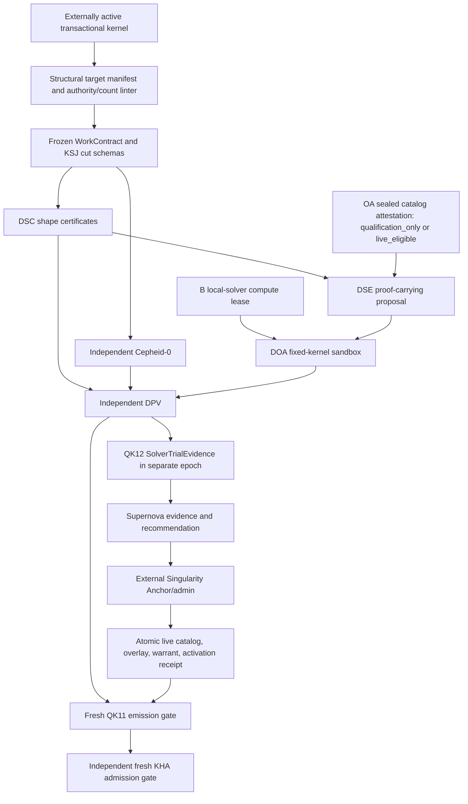

# GALAXY Singularity R3: Quark Portfolio R2 Implementation Plan

> **For agentic workers:** REQUIRED SUB-SKILL: Use superpowers:subagent-driven-development (recommended) or superpowers:executing-plans to implement this plan task-by-task. Steps use checkbox (`- [ ]`) syntax for tracking.

**Goal:** Build Quark Portfolio R2 as a proof-carrying, deterministic solver substrate that certifies problem shape, runs only bounded local kernels, independently verifies every candidate, and supplies stale-able advisory schedules to Pulsar without gaining dispatch or promotion authority.

**Architecture:** Quark is three structurally independent paths: DSC/DSE/DOA produce shape-bound candidates; `quark_verifier` parses and verifies them through a separately built encoding; and Cepheid-0 is a third exhaustive reference for certified `J <= 8`, `K <= 3` cohorts. The sole SingularityCoordinator routes QK01-QK10 and atomically owns joins, replay identity, and retry-credit redemption without running solver work under its writer transaction. Logical B launches every sealed DOA worker and owns every solver-compute lease and terminal disposition. KHA may consume only DPV's closed QK11 advisory after an external warrant gate and independent live Pulsar revalidation.

**Tech Stack:** Python 3.11+, stdlib dataclasses/enums/hashlib/json/heapq/itertools, exact Python integers, pytest, seeded repository-local generators, `time.perf_counter_ns`, the activated Singularity/Pulsar artifact and capacity contracts, and optional future local accelerators only after measured admission. No paid API, hosted inference, arbitrary shell, dynamic package installation, or network-capable solver runtime.

---

## 0. Authorization and dependency boundary

This plan does not authorize runtime implementation. The frozen Quark design
keeps all four nodes and every backend `specified` until a separate implementation
approval and the promotion protocol complete.

Quark depends on the following Pulsar/Singularity contracts but not on live
Pulsar activation:



Required external symbols from the Pulsar plan are:

- `platform_core.singularity.artifacts::{canonical_bytes,digest_artifact,parse_closed_envelope}`;
- immutable `WorkContract`, `JournalCut`, and `CohortCompletenessCertificate` schemas;
- `platform_core.singularity.capacity_ledger::{reserve_solver_compute,create_or_return_solver_disposition,reconcile_solver_lease}`;
- `platform_core.singularity.pulsar.coordinator.SingularityCoordinator` as the sole journal writer and Quark artifact router;
- `platform_core.singularity.pulsar.cutover::{SchedulerCutoverRehearsalBundle,SchedulerCutoverPhaseReceipt}` from Pulsar Tasks 16/17, with exact `SchedulerCutoverPhaseReceipt(phase=scheduler_authority_switched)` ancestry and current live head restricted to `scheduler_authority_switched | projection_enabled`;
- protected Singularity Anchor catalog-generation, `RuntimeActivationOverlaySet`, and GraphWarrant attestations;
- `PulsarArbiter.accept_solver_advisory()`;
- a separate Supernova trial consumer; and
- the transactional kernel's protected `SingularityAnchorReceipt`, `SingularityBootReceipt`, exact-final `RevisionVerificationReceipt`, bound `ReviewReceipt`, and persisted/re-read external controller-activation receipt.

The first Quark slice may run in parallel with later Pulsar projections only
after those shared schemas are frozen. QK11 remains structurally disconnected
through qualification and integration shadow and opens only under Task 14B's
external P4 transaction plus fresh DPV-emission and KHA-admission gates.

### Closed catalog states and shadow route mode

`catalog_state` is the closed enum `qualification_only | live_eligible`.
`integration_shadow` is not a catalog state or authority upgrade; it is the only
declared shadow `route_mode`, consumes a `qualification_only` catalog, and does
not create another topology node or edge:

| Catalog state / route | Permitted behavior | Required external evidence | Forbidden behavior |
|---|---|---|---|
| `qualification_only`, no shadow route | Pure contract, solver, Cepheid-0, DPV, Supernova, and bounded DOA qualification in B's explicitly quota-bounded qualification namespace | frozen shared schema digests, QK04 `SealedAlgorithmCatalogAttestationRef(catalog_state=qualification_only)`, and an exact current transactional-kernel receipt chain for every spawned worker | QK11 emission, KHA delivery, live B-capacity substitution, DIO/K/TaskState/command/effect access |
| `qualification_only` with `route_mode=integration_shadow` | Route QK01-QK10 through the real coordinator and emit external comparison/trial evidence only as a QK12-tagged payload in a separate experiment epoch | same qualification catalog, exact current external LKG receipt, current read-only `SchedulerCutoverRehearsalBundle`, exact qualification generation of `scope_id=quark.portfolio.r2` in the OA overlay set, and expiring governing qualification GraphWarrant | QK11 serialization, an unledgered comparison edge, changing order/reservation/TaskState/DIO/K/commands/effects, provider work, or conversion to `live_eligible` |
| `live_eligible`, no shadow route | Permit one closed QK11 advisory to reach KHA for a matching invocation | exact-final controller receipt; current live phase-ledger head `scheduler_authority_switched | projection_enabled` with the exact switch receipt in ancestry; exact current per-scope descendant of `pulsar.scheduler.r1`; and current `quark.portfolio.r2` descendant, catalog, and GraphWarrant joined directionally under one `activation_binding_digest` and final activation receipt | `route_mode=integration_shadow`, caller or Quark promotion, cached/global receipt widening, replacement of the scheduler activation root, whole-overlay-set generation pinning, circular receipt digests, or bypass of DPV/KHA fresh co-resolution |

Qualification has its own terminal lifecycle. Before expiry, OA may create one
atomic renewal-only successor that preserves the catalog, passport, algorithm,
qualified set, empty eligible/active sets, route, controller/contracts,
evidence, budgets, rollback, and absence of a scheduler parent byte-for-byte;
only permitted lifetime/nonce/renewal/revocation cursors and monotone
leaf/attestation generations advance. Expiry, revocation, or changed
qualification content forbids renewal and requires a fresh externally
CAS-created `qualification_only` root with current dark-LKG, rehearsal, and
sealed source/passport/fixture/budget/authority evidence plus a preregistered
P0-P3 protocol. The predecessor may be a terminal qualification root or an
exact terminal live root. Q-root-bound P0-P3 and integration-shadow evidence is
then rerun under the new root. That transition is not P4. P4 can start only from
the exact current valid qualification root and atomically retires it.

A local Boolean, environment flag, source-manifest edit, passing test, benchmark
result, or repository JSON file cannot change catalog state or route mode. The
external controller derives and binds both from protected receipts and exact
digests on every invocation; Quark can only validate them.

Every live check resolves the exact external
`SchedulerCutoverPhaseReceipt(phase=scheduler_authority_switched)` in ancestry
and the exact current live-cutover head, which must be only
`scheduler_authority_switched | projection_enabled`. It exact-matches phase
generation and ancestry, controller/runtime digests, store identity/schema/state
digests, field-matrix and live-state bindings, and issuer/signature authenticity.
`recovery_required`, an unknown head, a different generation/store, or missing
switch ancestry is inert for QK11. Phase entries are immutable, non-expiring
ledger facts: they are never renewed or revoked. Expiry or revocation of the
controller, overlay, catalog, or warrant closes new Quark work without
expiring phase history or restoring legacy scheduler ownership.

Immediately before QK11 emission and again independently under KHA's admission
lock, the corresponding gate freshly co-resolves that switch receipt and the
exact current per-scope descendant of scheduler activation root
`scope_id=pulsar.scheduler.r1` in the OA `RuntimeActivationOverlaySet` with the
current exact dependency-closed descendant of Quark activation root
`scope_id=quark.portfolio.r2` and activation receipt,
the current/unexpired/unrevoked matching live catalog, and the current/unexpired/
unrevoked matching workload GraphWarrant. Resolution exact-matches each current
per-scope digest, generation, lineage, and currentness; it never pins the mutable
whole-overlay-set generation. P4 may add only that child scope; it cannot replace
or invalidate the scheduler activation root. Parent-lineage drift, expiry, or
revocation makes Quark inert. The
catalog and warrant must share one revocation generation; drift at either gate
makes the advisory inert.

Expiry or revocation of a live Quark warrant, catalog attestation, child leaf,
or activation receipt permanently terminates that live activation lineage.
Renewal cannot revive it. Returning to service requires a fresh externally
authorized `qualification_only` root CAS-created from the exact terminal live
predecessor, new Q-root-bound P0-P3 and integration-shadow evidence, and only
then a fresh P4 live root CAS-created from that current valid qualification
root. Direct terminal-live -> live reactivation is rejected; no artifact or
QK11 from the terminal lineage follows automatically.

The transactional-kernel prerequisite is an exact content-addressed receipt
chain, never a `kernel_active` Boolean. It binds the current anchor/boot,
controller source SHA, runtime/image/security manifests, activation and
revocation generations, watchdog/boot identity, and the exact Quark worker
and verifier artifact digests. A modified checkout remains development input
until the external LKG controller-update protocol verifies and activates that
exact final generation.

### Frozen authority ceilings

- Quark adds exactly 4 nodes / 12 unique typed edges; total core remains 131 / 250.
- DSC certifies shape only; DSE proposes only; DOA executes fixed bounded kernels only; DPV verifies only.
- No Quark edge reaches DIO, K, mutation, effects, repository terminal truth, or policy activation.
- QK04 is the only catalog-reference edge. OA supplies `SealedAlgorithmCatalogAttestationRef` with exact `catalog_state=qualification_only | live_eligible`; route guards determine qualification, shadow, or live use. No direct qualification-catalog input or bypass edge exists. OA never supplies a score, utility, candidate bytes, or per-task algorithm choice.
- B owns grant, expiry, release, and reconciled terminal disposition of solver compute.
- DPV unavailable/disagreement means no candidate; KHA's simpler deterministic policy remains.
- Probabilistic/heuristic methods are proposal-only; optimality is never inferred.
- Pure Python stays the permanent semantic reference.
- The invention loop, `invention_seeding.py`, and `ledger_bridge.py` remain outside this trust boundary.
- Quark validates activation evidence but never issues a GraphWarrant, seals or advances a protected catalog generation, changes catalog state or route mode, or writes an activation state.
- Source manifests contain only `source_implementation_maturity = specified | implemented_dark | retired | unavailable`. This field describes bytes only; all runtime qualification, eligibility, route, and activation state exists solely in the external OA-owned overlay and never in a source manifest.

## 1. Brownfield and research ledger

Existing code is useful as quarry or fixture, not as scheduling authority:

| Live seam | Permitted use | Authority defect to preserve as a negative test |
|---|---|---|
| `developer_tools/refactoring/cycle_detect.py::_tarjanSccs` | deterministic Tarjan reference | developer-tools dependency cannot enter sealed Singularity runtime |
| `platform_core/orchestration/code_graph.py::tarjan_scc` | differential fixtures | fail-open graph build and non-canonical traversal |
| `platform_core/orchestration/conflict_sim.py::RollbackDSU` | sealed offline undirected-lifetime experiments | no directed causality or completeness proof |
| `platform_core/orchestration/portfolio_optimizer.py` | closure graph fixtures | float/EPS capacities and greedy conflict repair |
| `platform_core/orchestration/emitter_scheduler.py` | placement-network fixtures | float/SPFA/EPS semantics |
| `platform_core/orchestration/qd_emitters.py::match_parents` | greedy negative control | not exact matching |
| `tools/affected_tests.py` | Python-int bitset pattern | needs certified universe/bit-width and scalar equality |
| `agents/review/verification.py` | strict downgrade/timeout/receipt patterns | arbitrary command/path execution is forbidden in DOA |
| `platform_core/runtime/control_store.py` | WAL/transaction implementation idiom | wrong database and wrong authority |

Repository quarries are pinned as discovery evidence:

| Quarry | Discovery commit | License discovery | Allowed use |
|---|---|---|---|
| `atcoder/ac-library` | `864245a00b00dd008d1abfdc239618fdb7d139da` | CC0-1.0 | data layout, invariants, adversarial fixtures |
| `cheran-senthil/PyRival` | `6a87b91b385a70cd2765d34ace5017f991a47130` | Apache-2.0 | algorithm structure and test cases |
| `networkx/networkx` | `b1f956344071ba1adfad17d56d62a7a78dfd37e6` | GitHub API returned `NOASSERTION` | cepheid comparison only until exact license evidence is resolved |
| `alphastrata/fast_sssp` | `28bd63b4d13e90d88c71daa9e4f335ef82363f7c` | MIT | research fixtures and crossover methodology |
| `DiogoRibeiro7/bmssp` | `ba12a8b559ab2aa63b2bef8771b7d2c579426cc8` | MIT | differential research backend only |

Before any source adaptation, re-fetch the exact commit, hash its license, record
source and artifact digests, normalize/reimplement the kernel, and perform an
independent review. Upstream code never enters an activated passport merely
because it is fast or popular.

The directed SSSP research is used narrowly:

- [Duan et al. 2025](https://arxiv.org/abs/2504.17033) is a research/differential backend for nonnegative directed SSSP, never forced into small cohorts.
- The 2026 faster directed SSSP result is a later large-sparse candidate only.
- Neither result proves dynamic reuse across residual augmentations; rebuild the frontier after every augmentation.
- Indexed-heap Dijkstra remains the exact target reference and fallback.

## 2. Implementation waves

### Task 1: Revalidate Singularity/Pulsar prerequisites and DA topology

**Files:**

- Verify: `platform_core/singularity/artifacts.py`
- Verify: `platform_core/singularity/manifests/galaxy_r3.json`
- Verify: `platform_core/singularity/capacity_ledger.py`
- Verify: `platform_core/singularity/pulsar/contracts.py`
- Verify: `platform_core/singularity/pulsar/cuts.py`
- Verify: `platform_core/singularity/pulsar/coordinator.py`
- Verify: `platform_core/singularity/pulsar/cutover.py`
- Verify: `platform_core/runtime/receipts.py`
- Verify: `tests/singularity/test_topology_manifest.py`
- Verify: `tests/singularity/test_capacity_ledger.py`
- Verify: `tests/singularity/pulsar/test_task_state_cutover.py`
- Verify: `tests/execution/test_activation_harness.py`

- [ ] Resolve and independently re-hash the protected `SingularityAnchorReceipt`, `SingularityBootReceipt`, exact-current `RevisionVerificationReceipt`, bound `ReviewReceipt`, and external controller-activation receipt. Exact-match source SHA, runtime/image/security manifests, boot identity, activation/revocation generations, watchdog, and expiry. A Boolean, target JSON, target test result, or stale receipt is not evidence.

- [ ] Verify the exact target-topology counts, every Quark source row has `source_implementation_maturity=specified`, the source manifest contains no runtime eligibility/activation field, the fresh OA-owned runtime overlay reports zero qualified/eligible/active Quark nodes and edges, the WorkContract/KSJ-cut schema digests are frozen, and B exposes `bounded_local_solver_compute`. Confirm `reserve_solver_compute`, `create_or_return_solver_disposition`, and `reconcile_solver_lease` are real B-owned operations rather than test fakes.

- [ ] Record whether the current Pulsar `SchedulerCutoverRehearsalBundle` exists: a read-only view over externally issued, persisted/re-read `prepared -> quiesced -> reconciled` `SchedulerCutoverPhaseReceipt`s from one cutover generation. A valid bundle exact-matches controller, schema, store, field-matrix, fixture/input, and cursor digests; its phase-ledger head is exactly `reconciled`; and cursor-bound proof excludes `aborted_pre_switch`, `recovery_required`, unknown terminal state, `scheduler_authority_switched`, and every later phase. Target code cannot mint or persist the bundle. Its absence does not block dark source construction in Tasks 2-13, but it blocks Task 14's pre-switch integration-shadow execution.

```powershell
python tools/galaxy_topology.py check platform_core/singularity/manifests/galaxy_r3.json
python -m pytest -q tests/execution/test_activation_harness.py tests/singularity/test_topology_manifest.py tests/singularity/test_capacity_ledger.py tests/singularity/pulsar/test_work_contract.py tests/singularity/pulsar/test_schedule_store.py tests/singularity/pulsar/test_task_state_cutover.py
```

Expected: all available prerequisite tests pass. Stop all work if a shared
schema/kernel/capacity prerequisite is absent or drifted, the exact controller
generation is not externally verifiable, any source maturity is outside
`specified | implemented_dark | retired | unavailable`, or the external overlay
reports any Quark scope qualified, eligible, or active.
If only the rehearsal bundle is absent, record external integration as
unavailable and continue dark source construction through Tasks 2-13. Do not
exercise a real coordinator route until Task 14A resolves the post-Task-16 bundle.

This gate permits plan execution and `qualification_only` construction. It does
not make the modified checkout production authority. Before `integration_shadow`
or `live_eligible`, the external LKG updater must create and re-read a new exact-
final receipt chain covering the installed Quark, verifier, Cepheid-0, worker,
catalog, manifest, dependency-lock, and build-receipt bytes.

No commit is created by this read-only gate.

### Task 2: Add QK01-QK12 contracts and exact edge parsers

**Files:**

- Create: `platform_core/singularity/quark/__init__.py`
- Create: `platform_core/singularity/quark/contracts.py`
- Create: `platform_core/singularity/quark/edge_contracts.py`
- Create: `tests/singularity/quark/test_contracts.py`
- Create: `tests/singularity/quark/test_edges.py`
- Create: `tests/singularity/quark/test_edge_ablations.py`

- [ ] Write failing tests for every DA artifact and edge: exact producer/consumer, parents, work/cut/catalog/lease generations, canonical digest, expiry, closed catalog state and optional route mode, exact catalog-state/route-mode guards, 256-KiB payload ceiling, unknown-field/version/backend/predicate rejection, and one ablation key per edge. Explicitly reject JSON `NaN`/`Infinity`, floats in exact-integer fields, EPS/tolerance fields, unknown-as-zero defaults, duplicate semantic parents, catalog-state or route-mode widening, and non-canonical map/set ordering.

```python
@pytest.mark.parametrize("edge_id", [f"DA{i:02d}" for i in range(1, 13)])
def test_each_edge_has_one_closed_parser(edge_id, frozen_payloads):
    parsed = parse_edge(edge_id, frozen_payloads[edge_id])
    assert parsed.edge_id == edge_id
    with pytest.raises(ClosedSchemaError):
        parse_edge(edge_id, {**frozen_payloads[edge_id], "surprise": True})
```

- [ ] Confirm RED:

```powershell
python -m pytest -q tests/singularity/quark/test_contracts.py tests/singularity/quark/test_edges.py tests/singularity/quark/test_edge_ablations.py
```

- [ ] Implement immutable closed dataclasses/enums for `FrozenSolverProblem`, `ImmutableScheduleCut`, `ShapeCertificate`, `PredicateBinding`, `AlgorithmPassport`, `SealedAlgorithmCatalogAttestationRef`, `ProofCarryingSolverCandidate`, DOA requests/leases/evidence, `RetryCredit`, `RetryCreditRedemptionReceipt`, `KernelExecutionReceipt`, counterexamples, attestation, QK11 verdict, QK12 trial evidence, `CatalogState(qualification_only | live_eligible)`, and optional `QuarkRouteMode(integration_shadow)`. Catalog-bearing artifacts require an explicit state; no parser supplies a default or upgrades state/mode.

- [ ] Implement `parse_da01()` through `parse_da12()` as explicit functions. `parse_da04()` accepts the frozen `SealedAlgorithmCatalogAttestationRef` in either exact catalog state: `qualification_only` is valid for isolated qualification or `route_mode=integration_shadow`, while `live_eligible` requires no shadow mode and the live receipt guards. Do not add a qualification-catalog parameter, direct DSE input, permissive generic dict merge, or caller-selected parser.

- [ ] Verify and commit:

```powershell
python -m pytest -q tests/singularity/quark/test_contracts.py tests/singularity/quark/test_edges.py tests/singularity/quark/test_edge_ablations.py
git add platform_core/singularity/quark tests/singularity/quark
git commit -m "feat(quark): add closed solver edge contracts"
```

### Task 3: Build the protected AlgorithmPassport catalog and quarry receipts

**Files:**

- Create: `platform_core/singularity/quark/catalog.py`
- Create: `platform_core/singularity/quark/catalog_receipts.py`
- Create: `platform_core/singularity/quark/source_receipts.py`
- Create: `platform_core/singularity/quark/passports/cepheid0.v1.json`
- Create: `platform_core/singularity/quark/passports/bitset.v1.json`
- Create: `platform_core/singularity/quark/passports/scc.v1.json`
- Create: `platform_core/singularity/quark/passports/mcf-johnson-ssp.v1.json`
- Create: `platform_core/singularity/quark/passports/max-closure.v1.json`
- Create: `platform_core/singularity/quark/passports/hopcroft-karp.v1.json`
- Create: `platform_core/singularity/quark/passports/two-sat.v1.json`
- Create: `platform_core/singularity/quark/research_ledger.v1.json`
- Create: `tests/singularity/quark/test_catalog.py`
- Create: `tests/singularity/quark/test_catalog_sealing.py`
- Create: `tests/singularity/quark/test_source_receipts.py`
- Create: `tests/singularity/quark/test_passports.py`

- [ ] Write tests requiring source commit/artifact digests, license evidence, family, required/forbidden predicates, numeric domain, exact complexity/memory expressions, exactness class, witness contract, closed IR templates, backend allowlist, independent cepheid, deterministic fallback, fixtures, crossover buckets, activation and revocation generations.

- [ ] Test that repository passport JSON is build input and cannot satisfy QK04. OA emits the frozen `SealedAlgorithmCatalogAttestationRef` over an immutable content-addressed entry binding passport, implementation/runtime, dependency-build-receipt, catalog-generation, exact `catalog_state=qualification_only | live_eligible`, activation/revocation, issuance/expiry, and signature digests. Both states travel only on QK04: qualification and `integration_shadow` consume `qualification_only`; live consumes `live_eligible`. No undeclared qualification input, direct DSE parameter, score, workload-specific algorithm choice, candidate bytes, or authority upgrade is accepted.

- [ ] Test that `NOASSERTION`, missing license files, mutable branch names, unpinned dependencies, and revoked/expired generations make an upstream adaptation ineligible.

- [ ] Represent every ShapeCertificate claim as an exact tri-state `PredicateBinding(predicate_id, subject_ref, typed_parameters, truth_value, proof_kind, witness_digest, checker_id, checker_version)`. Missing and `unknown` are distinct from proved `false`. A required predicate must exact-match a proved-true binding; a forbidden predicate must exact-match a proved-false binding. Absence never proves a negative.

- [ ] Implement a sealed-generation resolver plus deterministic selection. The protected generation contains one immutable `selection_order` per certified workload bucket; DSE uses that order and then `(algorithm_id, algorithm_version, passport_digest)` as its canonical tie-break. OA attests this pre-existing policy but cannot alter it per task:

```python
def eligible_passports(shape: ShapeCertificate,
                       attestation: SealedAlgorithmCatalogAttestationRef,
                       route_mode: QuarkRouteMode | None,
                       warrant: GraphWarrant | None) -> tuple[AlgorithmPassport, ...]:
    generation = resolve_attested_generation(attestation)
    verify_sealed_catalog_attestation_ref(attestation, generation)
    state = attestation.catalog_state
    if route_mode is QuarkRouteMode.INTEGRATION_SHADOW:
        if state is not CatalogState.QUALIFICATION_ONLY:
            return ()
    elif route_mode is not None:
        return ()
    if state is CatalogState.LIVE_ELIGIBLE:
        if warrant is None:
            return ()
    elif warrant is not None:
        return ()
    claims = {binding.exact_key(): binding for binding in shape.shape_claims}
    admitted: list[AlgorithmPassport] = []
    for passport in generation.passports:
        required = [claims.get(predicate.exact_key()) for predicate in passport.required]
        forbidden = [claims.get(predicate.exact_key()) for predicate in passport.forbidden]
        if any(binding is None or binding.truth_value is not TruthValue.TRUE
               for binding in required):
            continue
        if any(binding is None or binding.truth_value is not TruthValue.FALSE
               for binding in forbidden):
            continue
        if not generation.entry_is_current_for(passport, state):
            continue
        if (state is CatalogState.LIVE_ELIGIBLE
                and not warrant.exactly_matches(passport, generation, shape)):
            continue
        admitted.append(passport)
    rank = generation.selection_rank(shape.workload_bucket)
    return tuple(sorted(admitted,
                        key=lambda p: (rank[p.algorithm_id], p.algorithm_id,
                                       p.algorithm_version, p.passport_digest)))
```

- [ ] `select_passport()` returns the first eligible passport and its protected rank witness; `fallback_passports()` returns the remaining canonical order. A missing bucket/rank, duplicate rank, unknown predicate, expired signature, revoked generation, or warrant mismatch returns no candidate.

- [ ] Store research/dormant mechanisms as separate closed rows in `research_ledger.v1.json`, one algorithm/backend/version/status/reason/predicate-gap tuple per row. This ledger is not an `AlgorithmPassport`, cannot be sealed into an executable generation, and creates no kernel-registry entry. Every implemented kernel has its own passport; do not aggregate unrelated mechanisms into a reserve passport.

- [ ] Verify and commit:

```powershell
python -m pytest -q tests/singularity/quark/test_catalog.py tests/singularity/quark/test_catalog_sealing.py tests/singularity/quark/test_source_receipts.py tests/singularity/quark/test_passports.py
git add platform_core/singularity/quark tests/singularity/quark
git commit -m "feat(quark): attest proof-carrying algorithm passports"
```

### Task 4: Implement DSC shape certification

**Files:**

- Create: `platform_core/singularity/quark/dsc.py`
- Create: `platform_core/singularity/quark/shape_predicates.py`
- Create: `tests/singularity/quark/test_dsc.py`
- Create: `tests/singularity/quark/test_shape_predicates.py`

- [ ] Test exact joins of one WorkContract and one immutable KSJ cut, including host-global cohort completeness. An arbitrary first-eight window, stale cursor, mutable read, or exclusion without conflict/resource/fairness/deadline closure returns `uncertified`.

- [ ] Test proof kinds `syntactic`, `constructive_witness`, `exact_reduction`, and `exhaustive`. Sampling, models, unrelated benchmarks, or WorkContract assumptions stay in `unproven_assumptions` and cannot satisfy a required predicate.

- [ ] Cover graph shape, size/density/universe/capacity/bit-width, operation regime, exact numeric domain, additive/separable objective, independence/2-CNF/flow-integrality/residual-cost facts, resource bounds, and required witness.

- [ ] Implement a closed checker-ID/version registry in `shape_predicates.py`. Each checker emits a full `PredicateBinding` with explicit `true | false | unknown`; it cannot infer false from absence, copy a WorkContract assumption into `shape_claims`, or accept an unbounded typed parameter. Unknown checker/version or malformed witness returns `uncertified`.

- [ ] Implement `QuarkShapeCertifier.certify(problem, cut)` as a stateless pure transform. It cannot select an algorithm, run code, reserve, verify implementation correctness, or schedule.

- [ ] Verify monotonicity: strengthening constraints cannot add a proved shape fact unless a new witness explicitly establishes it.

```powershell
python -m pytest -q tests/singularity/quark/test_dsc.py tests/singularity/quark/test_shape_predicates.py tests/singularity/pulsar/test_cohort_completeness.py
```

- [ ] Commit:

```powershell
git add platform_core/singularity/quark tests/singularity/quark
git commit -m "feat(quark): certify exact solver problem shapes"
```

### Task 5: Implement Cepheid-0 as the permanent third reference

**Files:**

- Create: `platform_core/singularity/quark_cepheid0/__init__.py`
- Create: `platform_core/singularity/quark_cepheid0/reference.py`
- Create: `platform_core/singularity/quark_cepheid0/scalar_predicates.py`
- Create: `platform_core/singularity/quark/kernels/enumerative_solver.py`
- Create: `platform_core/singularity/quark/kernels/bitsets.py`
- Create: `tests/singularity/quark/test_cepheid0.py`
- Create: `tests/singularity/quark/test_bitsets.py`
- Create: `tests/slow/singularity/quark/test_cepheid0_differential.py`

- [ ] Write exact count tests for every `J=0..8`, `K=0..3`:

```python
def homogeneous_count(j: int, k: int) -> int:
    return sum(math.comb(j, used) for used in range(min(j, k) + 1))


def labelled_count(j: int, k: int) -> int:
    return sum(math.comb(k, used) * math.perm(j, used)
               for used in range(min(j, k) + 1))


def test_frozen_maxima():
    assert homogeneous_count(8, 3) == 93
    assert labelled_count(8, 3) == 529
```

- [ ] Reject `J>8`, `K>3`, incomplete cohorts, unknown interactions, unbounded integers, or truncated enumeration. Emit actual formula inputs, universe count/hash, every rejection reason, selected assignment, and deterministic tie witness.

- [ ] Implement `quark_cepheid0` without importing DSE/DOA/DPV or their encodings. Implement the candidate enumerator separately so equality is differential, not shared-code tautology.

- [ ] Add Python-int unary masks only with a certified universe/bit-width/memory ceiling. For initial job-seat positions, prove at most 24 bits. Pair conflicts remain explicit adjacency checks; compare every reason mask to the scalar cepheid.

- [ ] Run exhaustive and permutation campaigns:

```powershell
python -m pytest -q tests/singularity/quark/test_cepheid0.py tests/singularity/quark/test_bitsets.py tests/slow/singularity/quark/test_cepheid0_differential.py
```

- [ ] Commit:

```powershell
git add platform_core/singularity/quark_cepheid0 platform_core/singularity/quark/kernels tests/singularity/quark tests/slow/singularity/quark
git commit -m "feat(quark): add exhaustive Cepheid-0 reference"
```

### Task 6: Build structurally independent DPV

**Files:**

- Create: `platform_core/singularity/quark_verifier/__init__.py`
- Create: `platform_core/singularity/quark_verifier/parser.py`
- Create: `platform_core/singularity/quark_verifier/normalizer.py`
- Create: `platform_core/singularity/quark_verifier/encoding.py`
- Create: `platform_core/singularity/quark_verifier/invariants.py`
- Create: `platform_core/singularity/quark_verifier/backends/__init__.py`
- Create: `platform_core/singularity/quark_verifier/backends/allocation.py`
- Create: `platform_core/singularity/quark_verifier/dependency_lock.json`
- Create: `platform_core/singularity/quark_verifier/verifier_manifest.json`
- Create: `platform_core/singularity/quark_verifier/build_receipt.py`
- Create: `platform_core/singularity/quark_verifier/activation_gate.py`
- Create: `platform_core/singularity/quark_verifier/dpv.py`
- Create: `tests/singularity/quark/test_dpv.py`
- Create: `tests/singularity/quark/test_dpv_emission_gate.py`
- Create: `tests/singularity/quark/test_import_boundaries.py`
- Create: `tests/singularity/quark/test_verifier_build_receipt.py`
- Create: `tests/singularity/quark/test_witness_corruption.py`

- [ ] Write an AST/import test with a positive allowlist containing only data-only canonical frozen schema declarations plus primitive `hashlib`/canonical-byte routines. Explicitly reject `parse_closed_envelope`, DSE, DOA, solver kernels, Cepheid-0, residual graph builders, tie-break encoders, witness parsers, candidate normalizers, dynamically computed imports, and calls through a shared parser facade.

- [ ] Implement `quark_verifier.parser.parse_verifier_envelope(raw: bytes)` from raw canonical bytes without calling the producer parser. Implement separate normalization, problem encoding, reduction, witness decoding, and invariant checks. The verifier package is built and sealed independently from DSE/DOA and receives only bounded raw artifacts plus data-only schema constants.

- [ ] Implement `create_verifier_build_receipt()` and `verify_verifier_build_receipt()` over `dependency_lock.json` and `verifier_manifest.json`. `VerifierBuildReceipt` binds exact verifier source/build/runtime/dependency/schema digests, compiler/interpreter and stdlib manifest, source-provenance closure, installed artifact digest, activation/revocation generation, and the explicit absence of producer-kernel dependencies. A repository test result or mutable lock file is not a build receipt.

- [ ] Test a distinct parser, normalizer, problem encoding, reduction path, dependency lock, build artifact, version digest, and provenance closure. Machine-detect shared critical files, identical critical-function hashes, producer dependencies, missing lock entries, and stale build receipts.

- [ ] Test every mandatory precondition binding, exact witness, resource ceiling, candidate allocation predicate, unresolved assumption, cepheid mismatch, stale input, unknown B disposition, and verifier-unavailable path.

- [ ] Implement `QuarkProofVerifier.verify(candidate_bytes, shape_ref_bytes, cepheid_evidence_bytes, verifier_build_receipt)` with the closed verdict `certified_candidate | no_certified_candidate | unavailable`. Verification may run under `qualification_only`, but `to_schedule_advisory()` structurally rejects both `qualification_only` and `route_mode=integration_shadow`; disagreement never goes to model or majority adjudication.

- [ ] Implement `quark_verifier.activation_gate.resolve_current_da11_emission_tuple()` as a fresh external OA-state read immediately before each QK11 serialization. It co-resolves together: (1) the unique exact `SchedulerCutoverPhaseReceipt(phase=scheduler_authority_switched)` switch anchor in ancestry plus exact current live head `scheduler_authority_switched | projection_enabled`, binding live-cutover generation, controller/runtime digests, store identity/schema/state digests, field-matrix/live-state bindings, and issuer/signature authenticity, with no phase expiry, renewal, or revocation semantics; (2) the exact current per-scope descendant of scheduler activation root `scope_id=pulsar.scheduler.r1`; (3) the current exact dependency-closed descendant of Quark activation root `scope_id=quark.portfolio.r2`; (4) the current, unexpired, unrevoked exact matching `SealedAlgorithmCatalogAttestationRef(catalog_state=live_eligible)`; (5) the current, unexpired, unrevoked exact matching workload-scoped GraphWarrant; and (6) the final activation join receipt. Resolve each overlay entry by exact per-scope root, descendant lineage, digest, generation, and currentness, never by whole-overlay-set generation. Verify the directional chain: warrant -> `activation_binding_digest` plus immutable catalog content; catalog attestation and child leaf -> binding plus warrant receipt; final join receipt -> exact resulting artifacts. The live catalog and warrant carry the same revocation generation. Recovery/unknown phase head or overlay-lineage drift/expiry/revocation makes Quark inert without changing phase history or restoring legacy ownership. Bind the complete resolved receipt set into `AttestedScheduleCandidate`; cached success, separately timed reads, caller flags, circular digest construction, or target-owned state cannot satisfy emission.

- [ ] Test DPV emission races and corruption: allowed `projection_enabled` head with exact switch ancestry, recovery/unknown head, missing/cross-generation switch ancestry, controller/runtime/store drift, scheduler-parent or Quark-child branch/gap/rewind/drift/expiry/revocation, per-scope CAS or activation-receipt mismatch, catalog replacement/expiry/revocation, warrant replacement/expiry/revocation, revocation-generation mismatch, or any change between verification and emission. Only the fully current tuple emits QK11; qualification and shadow results may proceed only to QK12 in a separate experiment epoch.

- [ ] Corrupt each witness field and prove rejection:

```powershell
python -m pytest -q tests/singularity/quark/test_dpv.py tests/singularity/quark/test_dpv_emission_gate.py tests/singularity/quark/test_import_boundaries.py tests/singularity/quark/test_verifier_build_receipt.py tests/singularity/quark/test_witness_corruption.py
```

- [ ] Commit:

```powershell
git add platform_core/singularity/quark_verifier tests/singularity/quark
git commit -m "feat(quark): independently verify solver witnesses"
```

### Task 7: Implement DSE candidate composition and bounded counterexample revision

**Files:**

- Create: `platform_core/singularity/quark/dse.py`
- Create: `platform_core/singularity/quark/closed_ir.py`
- Create: `tests/singularity/quark/test_dse.py`
- Create: `tests/singularity/quark/test_closed_ir.py`
- Create: `tests/singularity/quark/test_retry_credit_contract.py`

- [ ] Test that every passport precondition binds to a specific proved ShapeCertificate predicate; assumptions cannot select a passport or discharge an obligation.

- [ ] Test closed algorithm DAG/IR, exact numeric/overflow policy, deterministic seed policy, complexity/memory ceilings, witness obligations, fallback chain, and immutable digest.

- [ ] Test QK10 artifact semantics: DPV issues one candidate/attempt/parent-bound `RetryCredit`; revision requires the exact `RetryCreditRedemptionReceipt`, strictly decreasing compute budget, attempt number at most three, and a new semantic digest. Missing, unconsumed, stale-parent, cross-work, cross-cut, repeated, widened-budget, catalog-state-mismatched, or route-mode-mismatched credits reject. The coordinator—not stateless DSE—owns atomic single-use redemption.

- [ ] Implement `QuarkSolverEngine.propose(shape, sealed_catalog_ref, route_mode=None)` using `select_passport()` and `QuarkSolverEngine.revise(previous, counterexample, redemption_receipt)` as stateless candidate transforms. The catalog input is exactly QK04's frozen `SealedAlgorithmCatalogAttestationRef`; there is no second qualification input. DSE validates its exact catalog state, optional route mode, protected selection-rank witness, and redemption receipt but cannot mint/redeem credits, execute, inspect verifier internals, reserve, persist schedule state, change catalog state or route mode, or dispatch.

- [ ] Verify:

```powershell
python -m pytest -q tests/singularity/quark/test_dse.py tests/singularity/quark/test_closed_ir.py tests/singularity/quark/test_retry_credit_contract.py tests/singularity/quark/test_dpv.py
```

- [ ] Commit:

```powershell
git add platform_core/singularity/quark tests/singularity/quark
git commit -m "feat(quark): compose bounded proof-carrying candidates"
```

### Task 8: Implement DOA under B-owned fixed-kernel solver leases

**Files:**

- Create: `platform_core/singularity/quark/doa.py`
- Create: `platform_core/singularity/quark/kernel_registry.py`
- Create: `platform_core/singularity/quark/sandbox.py`
- Create: `platform_core/singularity/quark/worker.py`
- Create: `platform_core/singularity/quark/ipc.py`
- Create: `platform_core/singularity/quark/worker_manifest.json`
- Create: `tests/singularity/quark/test_doa.py`
- Create: `tests/singularity/quark/test_kernel_execution_receipt.py`
- Create: `tests/singularity/quark/test_doa_hostile_canaries.py`
- Create: `tests/singularity/quark/test_capacity_lease_lifecycle.py`
- Create: `tests/slow/singularity/quark/test_doa_crash_matrix.py`

- [ ] Test the closed modes `exact_cepheid`, `candidate_execution`, `accelerator_equivalence`, and `resource_probe`.

- [ ] Define closed length-prefixed canonical request/result frames in `ipc.py`. Each request binds mode, problem/candidate/shape/catalog/kernel/IR/runtime digests, deterministic seed, exact `catalog_state`, optional `route_mode`, B lease/fence/boot/expiry, CPU/RAM/process/output/deadline ceilings, and sandbox profile. Unknown frame/version/field, extra frame, oversized output, or response digest mismatch kills the worker and returns unavailable.

- [ ] Reject shell, URI, arbitrary path, network, package installation, ambient credentials, caller executable/import, provider/Claude/Codex capacity, kernel digest mismatch, repository/current-directory mount, home/profile mount, inherited handles, proxy/DNS configuration, dynamic loader override, and child-process escape.

- [ ] Test B-owned lease grant, boot/fence/expiry, registered process subtree, evidence creation, solver crash/timeout/cancel/process loss, idempotent disposition, and capacity remaining unavailable while terminal disposition is unknown. `qualification_only` leases use a separately quota-bounded B purpose and can never substitute for or consume a `live_eligible` reservation.

- [ ] Implement `KernelRegistry.resolve(kernel_id, kernel_digest, catalog_state, route_mode)` as a lookup into the sealed `worker_manifest.json`. The controller receives only an opaque worker entry ID and never imports or calls a kernel. Inside the fixed worker process, the manifest maps that ID to an exact sealed module/function digest; no caller path or import string crosses IPC. Resolution exact-matches the QK04-bound catalog state and optional route mode and cannot widen either.

- [ ] Implement `BoundedSolverSandbox.launch_via_b(request, lease)` so B launches the exact sealed `worker.py` entrypoint in a no-breakaway Job Object/cgroup with a closed empty working directory, no repository/profile/credential mounts, network and DNS disabled, a closed environment/import root, one request/result pipe, and enforced CPU/RAM/process/output/deadline ceilings. DOA does not call `subprocess` directly and cannot register, release, or reconcile its own subtree.

- [ ] Emit an immutable `KernelExecutionReceipt` binding request/candidate/problem/shape/catalog/kernel/IR/worker/runtime/dependency/sandbox digests, exact catalog state and optional route mode, deterministic seed, exact input/output hashes, measured CPU/RAM/process/output/deadline use, B lease/fence/boot identity, terminal observation, and B-owned `SolverLeaseDispositionReceipt`. QK09 exact-matches this receipt; a target log, exit code, or DOA-authored release claim is insufficient.

- [ ] Do not emit QK09 until it references B's terminal `SolverLeaseDispositionReceipt` for the exact request/candidate/input/runtime dependency tuple.

- [ ] Accelerator failure or mismatch may select the pure-Python fallback only by issuing a new QK05 request and obtaining a new QK06 lease/fence/disposition. Never run fallback inline under the failed, expired, or already-disposed lease.

- [ ] Run hostile worker canaries that attempt file/repository/profile/credential reads, environment and inherited-handle discovery, loopback/DNS/public-network access, dynamic import, package install, shell/process escape, oversized output, fork bombs, timeout evasion, and forged receipts. Each must fail at the enforcement boundary while B converges the lease disposition.

- [ ] Verify crash points before spawn, after spawn, after evidence, before disposition, and after lost response:

```powershell
python -m pytest -q tests/singularity/quark/test_doa.py tests/singularity/quark/test_kernel_execution_receipt.py tests/singularity/quark/test_doa_hostile_canaries.py tests/singularity/quark/test_capacity_lease_lifecycle.py tests/slow/singularity/quark/test_doa_crash_matrix.py
```

- [ ] Commit:

```powershell
git add platform_core/singularity/quark tests/singularity/quark tests/slow/singularity/quark
git commit -m "feat(quark): execute fixed kernels under fenced leases"
```

### Task 9: Wire QK01-QK10 through the sole SingularityCoordinator

**Files:**

- Create: `platform_core/singularity/quark/integration.py`
- Modify: `platform_core/singularity/pulsar/store.py`
- Modify: `platform_core/singularity/pulsar/service.py`
- Modify: `platform_core/singularity/pulsar/coordinator.py`
- Modify: `platform_core/singularity/capacity_ledger.py`
- Create: `tests/singularity/quark/test_coordinator_adapter.py`
- Create: `tests/singularity/quark/test_atomic_quark_joins.py`
- Create: `tests/singularity/quark/test_retry_credit_redemption.py`
- Create: `tests/singularity/quark/test_quark_replay.py`
- Create: `tests/singularity/quark/test_coordinator_edge_ablations.py`
- Create: `tests/singularity/quark/test_pulsar_cutover_rehearsal_gate.py`
- Create: `tests/slow/singularity/quark/test_coordinator_crash_matrix.py`

- [ ] Implement and test the coordinator adapter as dark source against sealed receipt fixtures; do not require an active LKG receipt for bytes that have not yet been installed. This task creates no external runtime route and must not exercise production or `integration_shadow`. Exact sealed LKG and rehearsal-bundle checks occur before external execution in Task 14A; a test-only or local-Boolean bypass is never added.

- [ ] Implement `QuarkCoordinatorAdapter.decode_route(envelope_bytes)` as a pure closed-schema adapter. It derives the exact catalog state and optional route mode only from the signed/ref-bound envelope chain and returns a typed `QuarkRouteIntent`; it cannot open the journal, reserve capacity, launch a worker, invoke a model/provider, call KHA, or change `qualification_only`, `route_mode=integration_shadow`, or `live_eligible`.

- [ ] Add external scheduler-store rows for immutable edge artifacts, exact join keys, join claims/results, retry credits/redemptions, and response receipts. The four joins are exactly QK01+QK02, QK03+QK04, QK05+QK06, and QK07+QK08+QK09. Keys bind run/work/revision/cut/cohort/catalog/candidate/request/lease/boot/fence/catalog-state/route-mode digests as applicable; missing, stale, mixed-generation, duplicate-different, or extra parents fail closed.

- [ ] Implement these sole-writer entrypoints:

```python
class SingularityCoordinator:
    def accept_quark_artifact(self, envelope_bytes: bytes) -> EdgeAcceptReceipt: ...
    def claim_quark_join(self, join_key: QuarkJoinKey) -> JoinClaimReceipt: ...
    def reserve_da06_solver_compute(self, claim: JoinClaimReceipt,
                                    request: CepheidAcceleratorRequest) -> BoundedLocalSolverComputeLease: ...
    def redeem_da10_retry_credit(self, counterexample: SolverCounterexample,
                                 expected_parent: CandidateDigest) -> RetryCreditRedemptionReceipt: ...
    def complete_quark_join(self, claim: JoinClaimReceipt,
                               result_envelope: bytes) -> JoinCompletionReceipt: ...
```

- [ ] Under one short `BEGIN IMMEDIATE`, `accept_quark_artifact()` exact-matches schema, parents, digests, catalog state, optional route mode, and idempotency, appends or resolves the immutable edge receipt, and advances only the applicable join state. `claim_quark_join()` atomically claims one ready join. No parser beyond the bounded adapter, solver, worker launch, filesystem I/O, model/provider call, or verifier runs while the writer transaction is held.

- [ ] `reserve_da06_solver_compute()` performs B's all-or-none capacity transition under the same external authority/fence discipline as Pulsar reservations, then commits before worker launch. Unknown process disposition keeps capacity unavailable. Lost responses resolve by exact idempotency key; they never allocate a second lease.

- [ ] `redeem_da10_retry_credit()` atomically verifies one unconsumed DPV-issued credit, exact parent/cut/catalog/attempt chain, total attempt at most three, strictly smaller compute budget, unseen semantic digest, exact catalog state and optional route mode, expiry, and idempotency key; it marks the credit consumed and appends QK10 delivery in the same transaction. Concurrent/replayed redemption returns the original receipt or rejects a different request.

- [ ] Run DSC, DSE, DOA, Cepheid-0, and DPV outside the writer transaction. Append each result through `complete_quark_join()` with exact claim/fence/input/output/build/lease receipts. A crash before result commit leaves a recoverable claimed join; recovery revalidates liveness/disposition and create-or-returns one result without repeating an unknown live worker.

- [ ] Test replay and crash points before/after artifact append, join readiness, join claim, B reservation, worker registration/spawn, evidence persistence, B disposition, result append, retry redemption, and response loss. After every point, state is either the old complete state or one recoverable monotone claim; there is never a partial join, duplicate lease, reused credit, missing disposition, or optimistic result.

- [ ] Ablate QK01 through QK10 one at a time at the coordinator boundary. Each ablation must make its dependent join typed unavailable and prove no direct node call, generic event bus, invention path, provider path, or fallback route reconstructs the missing edge.

- [ ] Verify and commit:

```powershell
python -m pytest -q tests/singularity/quark/test_coordinator_adapter.py tests/singularity/quark/test_atomic_quark_joins.py tests/singularity/quark/test_retry_credit_redemption.py tests/singularity/quark/test_quark_replay.py tests/singularity/quark/test_coordinator_edge_ablations.py tests/singularity/quark/test_pulsar_cutover_rehearsal_gate.py tests/slow/singularity/quark/test_coordinator_crash_matrix.py tests/singularity/test_capacity_ledger.py tests/singularity/pulsar/test_schedule_store_concurrency.py tests/singularity/pulsar/test_task_state_cutover.py
git add platform_core/singularity/quark/integration.py platform_core/singularity/pulsar/store.py platform_core/singularity/pulsar/service.py platform_core/singularity/pulsar/coordinator.py platform_core/singularity/capacity_ledger.py tests/singularity/quark tests/slow/singularity/quark/test_coordinator_crash_matrix.py
git commit -m "feat(quark): route solver artifacts through singularity"
```

### Task 10: Add exact SCC, implication-closure, and bounded combinatorial kernels

**Files:**

- Create: `platform_core/singularity/quark/kernels/scc.py`
- Create: `platform_core/singularity/quark/kernels/max_closure.py`
- Create: `platform_core/singularity/quark/kernels/matching.py`
- Create: `platform_core/singularity/quark/kernels/two_sat.py`
- Create: `platform_core/singularity/quark_verifier/backends/scc.py`
- Create: `platform_core/singularity/quark_verifier/backends/max_closure.py`
- Create: `platform_core/singularity/quark_verifier/backends/matching.py`
- Create: `platform_core/singularity/quark_verifier/backends/two_sat.py`
- Create: `tests/singularity/quark/test_scc.py`
- Create: `tests/singularity/quark/test_max_closure.py`
- Create: `tests/singularity/quark/test_matching.py`
- Create: `tests/singularity/quark/test_two_sat.py`
- Create: `tests/singularity/quark/test_graph_witness_corruption.py`
- Create: `tests/slow/singularity/quark/test_scc_differential.py`
- Create: `tests/slow/singularity/quark/test_closure_differential.py`

- [ ] Implement canonical iterative Tarjan for a static immutable graph revision and repeated reachability only. Emit SCC/condensation/closure witnesses; rebuild on revision. In `quark_verifier.backends.scc`, independently parse and check the partition, mutual reachability witnesses, condensation acyclicity, and closure result through a separately implemented Kosaraju path.

- [ ] Implement exact-integer maximum closure only for additive weights plus implications. Arbitrary conflicts invalidate the passport; prove with brute-force subset counterexamples against the current float/greedy implementation. The verifier backend independently checks implication closure, recomputes the exact objective, and verifies the cut witness without importing the producer residual builder.

- [ ] Implement Hopcroft-Karp only for unweighted bipartite cardinality with matching plus cover/deficiency witness. The verifier backend independently checks matching validity and the cover/deficiency certificate. Dense unit-assignment Hungarian remains a separate nonimplemented research-ledger row; do not create its passport or registry entry until a concrete consumer, independent dual-label verifier, and measured crossover exist.

- [ ] Implement 2-SAT only for complete 2-CNF, returning an assignment or mutually reachable contradiction paths. The verifier reparses clauses and implication edges independently and checks the assignment or both contradiction paths.

- [ ] Keep dominators, rollback DSU, subset DP, and safety-game mechanisms conditional/offline until their exact passports and consumers exist.

- [ ] Verify:

```powershell
python -m pytest -q tests/singularity/quark/test_scc.py tests/singularity/quark/test_max_closure.py tests/singularity/quark/test_matching.py tests/singularity/quark/test_two_sat.py tests/singularity/quark/test_graph_witness_corruption.py tests/slow/singularity/quark/test_scc_differential.py tests/slow/singularity/quark/test_closure_differential.py
```

- [ ] Commit:

```powershell
git add platform_core/singularity/quark/kernels platform_core/singularity/quark_verifier/backends tests/singularity/quark tests/slow/singularity/quark
git commit -m "feat(quark): add exact graph and matching kernels"
```

### Task 11: Implement exact integer placement MCF and directed SSSP portfolio

**Files:**

- Create: `platform_core/singularity/quark/kernels/min_cost_flow.py`
- Create: `platform_core/singularity/quark/kernels/sssp.py`
- Create: `platform_core/singularity/quark/kernels/indexed_heap.py`
- Create: `platform_core/singularity/quark_verifier/backends/min_cost_flow.py`
- Create: `tests/singularity/quark/test_min_cost_flow.py`
- Create: `tests/singularity/quark/test_sssp.py`
- Create: `tests/singularity/quark/test_reduced_costs.py`
- Create: `tests/singularity/quark/test_mcf_witness_corruption.py`
- Create: `tests/slow/singularity/quark/test_mcf_differential.py`
- Create: `tests/slow/singularity/quark/test_sssp_crossover.py`

- [ ] Reject the reduction unless jobs are already Pulsar-feasible, seats are atomic/disjoint integer-capacity tokens, utility is exact bounded integer and separable, forward costs are nonnegative, flow value is fixed at `K`, and no pair/resource interaction remains outside the network.

- [ ] Prove every mixed-radix bound or perform sequential constrained optimization. Ad hoc big-M constants are forbidden.

- [ ] Implement indexed-heap Dijkstra as the permanent exact reference/fallback and Johnson-potential successive shortest path with exact integers.

```python
reachable = [d for d in distance if d is not None]
cap = max(reachable)
for vertex, dist in enumerate(distance):
    potential[vertex] += dist if dist is not None else cap

for edge in residual_edges:
    assert edge.cost + potential[edge.u] - potential[edge.v] >= 0
```

- [ ] In `quark_verifier.backends.min_cost_flow`, independently rebuild the certified network from frozen inputs and check capacity, conservation, fixed flow, objective, deterministic tie-break, every final residual reduced cost, and the primal/dual witness. It cannot import the producer graph builder, SSSP, indexed heap, potential updater, tie-break encoder, or witness parser. Zero initial potentials are allowed only with proved nonnegative forward costs.

- [ ] Add internal routing only when certified:

  - 0-1 BFS for reduced costs exactly `{0,1}`;
  - Dial for proved small nonnegative integer `Cmax`;
  - radix heap for monotone machine-width keys with no overflow;
  - indexed-heap Dijkstra otherwise.

- [ ] Keep BMSSP 2025 and the 2026 result as `RESEARCH_EXACT_NOT_ELIGIBLE`. Rebuild after every augmentation and require held-out real-graph crossover plus Dijkstra equality before any later promotion.

- [ ] Differentially compare eligible small MCF instances against Cepheid-0 and corrupt each primal/dual field:

```powershell
python -m pytest -q tests/singularity/quark/test_min_cost_flow.py tests/singularity/quark/test_sssp.py tests/singularity/quark/test_reduced_costs.py tests/singularity/quark/test_mcf_witness_corruption.py tests/slow/singularity/quark/test_mcf_differential.py tests/slow/singularity/quark/test_sssp_crossover.py
```

- [ ] Commit:

```powershell
git add platform_core/singularity/quark/kernels platform_core/singularity/quark_verifier/backends/min_cost_flow.py tests/singularity/quark tests/slow/singularity/quark
git commit -m "feat(quark): solve certified placement with exact MCF"
```

### Task 12: Enforce dormant families and accelerator admission

**Files:**

- Create: `platform_core/singularity/quark/accelerators.py`
- Create: `platform_core/singularity/quark/crossover.py`
- Verify: `platform_core/singularity/manifests/galaxy_r3.json`
- Create: `tests/singularity/quark/test_accelerator_admission.py`
- Create: `tests/singularity/quark/test_dormant_families.py`
- Modify: `tests/singularity/test_topology_manifest.py`
- Create: `tests/slow/singularity/quark/test_crossover.py`

- [ ] Encode one independent research-ledger row for each BMSSP, 2026 SSSP, persistent/wavelet/Mo/Hilbert index, segment-tree-beats, kinetic/vEB/fusion structure, dynamic-tree, Blossom/SPQR, FFT/FPS, number-theory, geometry, string, counting, and game backend/version. Rows remain `RESEARCH_EXACT_NOT_ELIGIBLE`, conditional, or dormant and are not passports. No kernel ID, import, closed IR opcode, or fallback target is resolvable without a separately sealed and activated per-backend passport.

- [ ] Admit NumPy/Numba/native acceleration only when the incumbent eligible workload exceeds `250 us` p95 or one percent of controller CPU, and the candidate improves end-to-end p95 by both at least 30 percent and at least 100 microseconds.

- [ ] Include cold/warm latency, serialization, graph construction, updates, receipts, persistence, lease handling, DPV verification, memory, crash behavior, version/dependency digests, and immediate pure-Python fallback.

- [ ] Test exact output/witness equality and overflow boundaries. A microbenchmark excluding envelope costs cannot promote.

- [ ] `CrossoverEvidence` binds preregistered workload-bucket and hardware/runtime digests, incumbent/candidate passport and artifact digests, warmup/sample counts, raw bounded observations, p50/p95, controller-CPU accounting, cold/warm results, memory ceiling, equality/crash/fallback receipts, and multiplicity rule. Timing noise or one favorable run cannot change authority; accepted evidence remains `qualification_only` until external P3/P4.

- [ ] Keep every Quark source row `source_implementation_maturity=specified` in this task because the integration, activation, and KHA-validator bytes in Task 13 are not complete yet. The source schema accepts only `specified | implemented_dark | retired | unavailable`, contains no runtime qualification/eligibility/route/activation field, and cannot mutate the external OA overlay. Do not claim dark maturity for an incomplete row.

```powershell
python -m pytest -q tests/singularity/quark/test_accelerator_admission.py tests/singularity/quark/test_dormant_families.py tests/singularity/test_topology_manifest.py tests/slow/singularity/quark/test_crossover.py
```

- [ ] Commit:

```powershell
git add platform_core/singularity/quark tests/singularity/quark tests/singularity/test_topology_manifest.py tests/slow/singularity/quark
git commit -m "feat(quark): gate accelerators on measured crossover"
```

### Task 13: Land and seal the complete dark integration and activation-gate source

**Files:**

- Create: `platform_core/singularity/quark/qualification.py`
- Create: `platform_core/singularity/quark/supernova_adapter.py`
- Create: `platform_core/singularity/quark/activation.py`
- Modify: `platform_core/singularity/quark/integration.py`
- Modify: `platform_core/singularity/quark_verifier/activation_gate.py`
- Modify: `platform_core/singularity/pulsar/activation.py`
- Modify: `platform_core/singularity/pulsar/arbiter.py`
- Modify: `platform_core/singularity/pulsar/coordinator.py`
- Modify: `platform_core/singularity/activation_overlay.py`
- Modify: `platform_core/singularity/manifests/galaxy_r3.json`
- Modify: `bootstrap/galaxy_launcher/pulsar_admin_protocol.py`
- Modify: `bootstrap/galaxy_launcher/capsule.py`
- Modify: `bootstrap/galaxy_launcher/singularity_admin_client.ps1`
- Modify: `bootstrap/galaxy_launcher/runtime_manifest.py`
- Create: `tests/singularity/quark/test_catalog_state_and_route_mode.py`
- Create: `tests/singularity/quark/test_kernel_receipt_binding.py`
- Modify: `tests/singularity/quark/test_pulsar_cutover_rehearsal_gate.py`
- Create: `tests/singularity/quark/test_integration_shadow.py`
- Create: `tests/singularity/quark/test_supernova_adapter.py`
- Create: `tests/singularity/quark/test_invention_isolation.py`
- Create: `tests/singularity/quark/test_activation.py`
- Create: `tests/singularity/quark/test_per_invocation_warrant.py`
- Modify: `tests/singularity/quark/test_dpv_emission_gate.py`
- Create: `tests/singularity/quark/test_kha_admission_gate.py`
- Create: `tests/singularity/quark/test_live_receipt_chain.py`
- Modify: `tests/singularity/test_activation_overlay.py`
- Modify: `tests/singularity/test_topology_manifest.py`
- Create: `tests/execution/test_quark_activation_admin.py`

- [ ] Implement `QuarkQualificationGate.evaluate()` as a pure evaluator of P0 shape, P1 exactness/adversarial/crash evidence, P2 measured need/crossover, and P3 separate-epoch Supernova receipts. Its result is the evidence recommendation `qualification_passed | shadow_route_recommended | rejected`, not a catalog state or route mode. Supernova and this gate are evidence/recommendation-only; neither can issue P4, a GraphWarrant, catalog generation, source-maturity change, runtime-overlay change, or live authority.

- [ ] Encode and fixture-test the rule that isolated `qualification_only` DSC/DSE/DPV and Cepheid-0 work may proceed in parallel with dark Pulsar work, while any spawned DOA worker requires the exact transactional-kernel completion receipt and B's quota-bounded qualification namespace. None of these paths authorizes coordinator shadow integration.

- [ ] Implement the pre-execution integration gate that requires the exact-final Quark controller to be installed dark and freshly resolves the exact current external LKG controller/runtime activation receipt covering every Quark/DPV/Cepheid-0/worker/catalog/manifest/dependency-lock/build-receipt and integration byte. An older controller receipt, kernel completion alone, or checkout bytes cannot satisfy the gate. Exercise only sealed fixtures in this task; the real receipt does not exist until the combined controller is sealed after this commit.

- [ ] Implement the `integration_shadow` rehearsal gate against a current read-only `SchedulerCutoverRehearsalBundle` in the separate `rehearsal` generation over copied fixtures. It resolves externally issued, persisted/re-read `prepared -> quiesced -> reconciled` phase receipts from one generation; exact-matches controller, schema, store, field-matrix, fixture/input, one-to-one work/dependency/retry/timer/attempt/reservation/outcome, and cursor digests; requires the phase-ledger head to be exactly `reconciled`; and carries cursor-bound proof excluding `aborted_pre_switch`, `recovery_required`, unknown terminal state, switch, and every later phase. Target code cannot mint or persist the bundle.

- [ ] Complete `activation_overlay.py` and `quark.activation.validate_external_graph_warrant()` as pure external-receipt verifiers. The governing GraphWarrant schema is the topology superset: it binds exact source/controller/runtime/topology/schema/policy generations; canonical graph and every node/edge contract digest; the relevant OA `RuntimeActivationOverlaySet` entries with dependency-closed qualified/eligible/active scopes, typed runtime availability, parent relation, and ablations; workload/repository/run scopes, limits, budgets, deterministic estimates, zero-cost proof, evidence, rollback, issuer/nonce, lifetime/renewal, and scheduler/capacity/cutover/activation/emergency/revocation generations. A qualification activation root for `scope_id=quark.portfolio.r2` binds the dark LKG and rehearsal with eligible/active empty and no live scheduler parent. P4 creates a fresh live activation root for the same scope, replacing/retiring—not renewing—the qualification root and binding the exact current descendant of scheduler activation root `scope_id=pulsar.scheduler.r1`. No target function can issue, persist, renew, widen, revoke, select, or activate it.

- [ ] Define one canonical pre-issuance `ActivationProposal` and `activation_binding_digest` for initial qualification, qualification renewal, fresh qualification reactivation/replacement, initial P4, live renewal, and post-terminal return through fresh qualification then P4. It binds scope/root ID, authority ceiling and route, exact current parent roots/descendants, exact proposed qualified/eligible/active sets, immutable catalog content entry/digest, controller/contracts, fresh evidence, workload/budgets/fallback/rollback, nonce, and the exact state-appropriate predecessor: current root/leaf for renewal; inert terminal qualification or live root for fresh qualification; and current valid qualification root for every P4 transition. A P4 proposal following a terminal live lineage also binds that lineage through its intervening fresh qualification root, never as the direct CAS predecessor. It contains no digest of a not-yet-issued warrant, overlay/catalog attestation, or activation receipt. Issuance is directional: the GraphWarrant references the binding and immutable catalog content; catalog attestation and child overlay leaf reference the binding plus issued warrant receipt; the final atomic activation join receipt binds the exact resulting artifacts. Reject any hash-fixed-point or circular final-digest schema.

- [ ] Extend the already installed external seams in `pulsar_admin_protocol.py`, `capsule.py`, `singularity_admin_client.ps1`, and `runtime_manifest.py` with closed request-only operations. `CreateOrReturnQuarkQualificationActivation` handles initial qualification plus fresh post-terminal or changed-content requalification: it atomically creates/seals the real protected `qualification_only` catalog generation, expiring qualification GraphWarrant, qualification activation root for `scope_id=quark.portfolio.r2`, and final qualification join receipt after validating the exact current dark LKG and rehearsal plus sealed source/passport/fixture/budget/authority evidence and a preregistered P0-P3 protocol. It does not consume Q-root-bound P0-P3 or integration-shadow results. Fresh qualification CASes from the exact inert terminal qualification or live predecessor; semantic replacement uses a new content digest and root, and no old artifact follows it. A separate constrained qualification-renewal operation may create only a pre-expiry successor under the same root. `CreateOrReturnQuarkLiveActivation` handles every P4 transition only from the exact current valid qualification root, which it retires atomically. It requires the fresh P0-P4 evidence bound to that qualification root and the exact current Pulsar parent root/leaf, then atomically creates a fresh Quark live activation root with new nonce, warrant, catalog attestation, child root, and final activation join receipt. A post-terminal return binds the terminal-live -> fresh-qualification ancestry but never CASes directly from terminal live to live. The PowerShell client can submit signed requests and resolve/export receipts only; signing, issuance, persistence, renewal, revocation, catalog sealing, and overlay mutation stay inside the installed OA capsule. `runtime_manifest.py` pins the exact capsule/protocol/client operation allowlist and service digests before Task 16 sealing.

- [ ] Implement qualification renewal only before expiry or revocation as a create-or-return atomic constrained successor under the original qualification activation root/receipt. Preserve exact catalog contents/passport/algorithm, qualified set, empty eligible/active sets, `integration_shadow` route, controller/contracts, parents, current evidence, budgets, fallback, rollback, and no-scheduler-parent relation; only permitted lifetime, nonce/cursor, renewal-generation, revocation bindings, and monotone leaf/attestation generations advance through a new proposal -> qualification warrant -> catalog attestation/overlay leaf -> final join chain. Reject renewal at or after expiry, after revocation, for changed catalog/passport/algorithm/content, or with branch/gap/rewind/widening/stale CAS/partial persistence. Those cases require a fresh `qualification_only` root with current evidence, never P4; every predecessor artifact remains inert.

- [ ] Implement live renewal only before expiry or revocation as a create-or-return atomic constrained successor rooted at the original P4 live activation root/receipt. The unique OA-attested current descendant preserves exact qualified/eligible/active sets, scheduler-parent activation-root/current-descendant compatibility, controller/contracts, catalog contents/digest, workload, budgets, evidence, fallback, and rollback; only permitted lifetime, nonce/cursor, renewal-generation, and revocation bindings advance by atomically renewing the catalog attestation, GraphWarrant, child leaf, and activation receipt. Reject branch, gap, rewind, widening, stale-parent CAS, partial successor creation, or any renewal request after an expiry/revocation terminal. A terminal live lineage can only be the CAS predecessor for a fresh `qualification_only` root; after new root-bound evidence, P4 CASes from that current qualification root. Direct terminal-live -> live is rejected. Resolve the scheduler parent by its own current descendant lineage and never pin the whole overlay-set generation. A new scheduler activation root never auto-reactivates Quark; it requires the same fresh-Q then P4 sequence.

- [ ] In `test_quark_activation_admin.py`, cover request loss before/after initial qualification, qualification renewal, fresh requalification/replacement, initial P4, live renewal, and terminal-live -> fresh-qualification -> fresh-live commits; duplicate-same create-or-return; duplicate-different rejection; every atomic failpoint and partial-persistence boundary; qualification/live/reactivation catalog sealing; `ActivationProposal`/binding mismatch; issuance-order violation; forged circular digest; parent-entry per-scope digest/generation/currentness CAS; activation-root and successor lineage; renewal branch/gap/rewind/widening; parent/child/catalog/warrant expiry and revocation; stale terminal-root CAS; fresh P0-P4 evidence requirements; and renewal-vs-revoke-vs-requalification/reactivation races. Explicitly cover qualification renewal before the boundary, rejection at/after expiry and after revocation, rejection of changed catalog/passport/algorithm as renewal, a successful fresh qualification root whose old artifacts remain inert, the current-valid-qualification prerequisite for every P4, and rejection of direct terminal-live -> live. Prove qualification issuance consumes only prequalification inputs, never evidence that depends on the root being issued; all authoritative P0-P3/shadow evidence binds the resulting root and is rerun after replacement. Assert qualification roots always have empty eligible/active sets, no scheduler parent, and no QK11 path; no renewal revives a terminal lineage; the final fresh live root binds terminal-live -> fresh-Q ancestry and the current Pulsar parent; response loss resolves exactly once; all old child/artifact/QK11 bytes remain inert; and failure leaves Quark inactive without mutating scheduler scope. Tests compare exact current per-scope entries and roots/descendants, never whole-set generation.

- [ ] Complete two independent live gates. DPV emission calls `resolve_current_da11_emission_tuple()` immediately before serialization; KHA admission calls `platform_core.singularity.pulsar.activation.resolve_current_da11_admission_tuple()` again under its own admission lock. Each fresh read co-resolves the unique exact `SchedulerCutoverPhaseReceipt(phase=scheduler_authority_switched)` switch anchor in ancestry, current live head `scheduler_authority_switched | projection_enabled` whose descendants preserve the switch/root/store bindings, exact current descendant of scheduler activation root `scope_id=pulsar.scheduler.r1`, exact dependency-closed current descendant of Quark live activation root `scope_id=quark.portfolio.r2`, current/unexpired/unrevoked matching `SealedAlgorithmCatalogAttestationRef(catalog_state=live_eligible)`, current/unexpired/unrevoked matching workload GraphWarrant, and final activation join receipt. Resolve exact per-scope roots, current descendant digests/generations/currentness, and compatibility—not whole-overlay-set generation. Verify the canonical `activation_binding_digest` and directional warrant -> attestation/child -> final-join chain; the catalog and warrant share one revocation generation. Recovery/unknown phase head, missing/non-unique switch ancestry, or any lineage mismatch is inert; no tuple or success bit is reused across gates.

- [ ] Validate that the switch receipt is an authenticated immutable ledger fact in the ancestry of the exact current head of the separate `live_cutover` generation. The current head may be only `scheduler_authority_switched | projection_enabled`; `recovery_required` and unknown heads are inert. The switch receipt binds controller/runtime digests, store identity/schema/state digests, and field-matrix/live-state bindings; exact-matches same-generation live `prepared -> quiesced -> reconciled` parent digests; binds the prior successful rehearsal-bundle digest; and anchors the `pulsar.scheduler.r1` activation root. It has no expiry, renewal, or revocation semantics. Fixture races covering switch ancestry/generation/phase-parent drift, scheduler-parent or Quark-child branch/gap/rewind/drift/expiry/revocation, per-scope CAS or activation-receipt mismatch, catalog/warrant expiry or revocation, revocation-generation mismatch, and any mutation between DPV emission and KHA admission must make the advisory inert without expiring phase history or restoring legacy ownership.

- [ ] Fixture-test the external atomic P4 activation contract using the canonical `ActivationProposal`: the warrant references its binding plus immutable catalog content; catalog attestation and fresh Quark live-root leaf reference the binding plus issued warrant receipt; the final activation join receipt binds those exact resulting artifacts and referenced exact current scheduler-parent descendant. The transaction cannot mutate or replace the parent. Issuance-order error, partial write, binding/digest mismatch, parent-lineage drift/expiry/revocation, or failed transaction leaves every Quark eligible/active scope empty while preserving scheduler activation. Catalog, warrant, source maturity, switch receipt, child scope, or activation receipt alone never activates Quark.

- [ ] Implement and fixture-test `integration_shadow` routing through QK01-QK10 only. QK11 remains structurally closed and `PulsarArbiter.accept_solver_advisory()` is never called. Comparison evidence serializes only as a QK12-tagged `SolverTrialEvidence` shadow-comparison payload in its separate experiment/outcome epoch—never as a standalone record or unledgered thirteenth edge. Invariance checks require identical order, reservations, DIO, TaskState bytes, commands, effects, subprocess/provider calls, and terminal outcomes.

- [ ] Prove non-conversion: exact `catalog_state=qualification_only` and optional `route_mode=integration_shadow` are included in every artifact, request, lease, worker, verifier, join, and receipt digest; the sealed catalog itself carries only its catalog state. Replaying or relabeling those bytes as `catalog_state=live_eligible` or removing the route mode fails before parsing, reservation, worker launch, QK11 serialization, or KHA delivery.

- [ ] Implement QK12 emission into a separate experiment/outcome epoch through the verified external Supernova consumer with preregistered endpoint, hard-first rules, equal budgets, temporal holdout, multiplicity control, and rollback. It cannot call current-run scheduling, modify the current catalog, issue a warrant, or call `OutcomeEvaluator.promote_candidate()`.

- [ ] Prove by import/call-graph tests that `invention_seeding.py`, `ledger_bridge.py`, current orchestrator model paths, provider seats, and local JSON/env flags cannot choose passports, certify shapes, call DOA, supply DPV evidence, change catalog state or route mode, or reach the coordinator adapter.

- [ ] After every node, edge, integration, activation, DPV-emission, KHA-admission, and external admin-protocol validator is complete and the focused fixture suite passes, make the one final source-manifest transition. In `test_topology_manifest.py`, explicitly enumerate complete nodes `{DSC,DSE,DOA,DPV}` and complete edges `{QK01,QK02,QK03,QK04,QK05,QK06,QK07,QK08,QK09,QK10,QK11,QK12}` and require each to be `source_implementation_maturity=implemented_dark`; require every Quark row outside those exact completed sets to remain `specified`. Preserve exactly 4 nodes / 12 edges and prove every source row and generated mirror has no runtime qualification/eligibility/route/activation field. Any incomplete enumerated row blocks sealing. Regenerate the machine mirror and seal this commit before Pulsar Task 16 builds and activates the exact combined dark LKG controller. Task 14 must not change source or manifests.

- [ ] Verify and commit:

```powershell
python -m pytest -q tests/execution/test_quark_activation_admin.py tests/singularity/test_topology_manifest.py tests/singularity/quark/test_catalog_state_and_route_mode.py tests/singularity/quark/test_kernel_receipt_binding.py tests/singularity/quark/test_pulsar_cutover_rehearsal_gate.py tests/singularity/quark/test_integration_shadow.py tests/singularity/quark/test_supernova_adapter.py tests/singularity/quark/test_invention_isolation.py tests/singularity/quark/test_activation.py tests/singularity/quark/test_per_invocation_warrant.py tests/singularity/quark/test_dpv_emission_gate.py tests/singularity/quark/test_kha_admission_gate.py tests/singularity/quark/test_live_receipt_chain.py tests/singularity/test_activation_overlay.py tests/singularity/pulsar/test_task_state_cutover.py tests/singularity/pulsar/test_shadow_invariance.py
python -m pytest -q tests/singularity/quark tests/singularity/pulsar/test_arbiter.py tests/singularity/pulsar/test_atomic_claim.py tests/singularity/pulsar/test_task_state_cutover.py tests/singularity/pulsar/test_activation.py tests/singularity/test_capacity_ledger.py
python -m pytest -q tests/slow/singularity/quark
python tools/galaxy_topology.py check platform_core/singularity/manifests/galaxy_r3.json
python tools/affected_tests.py $(git diff --name-only refs/9to5/baselines/galaxy-r3-qualified...HEAD)
python tools/repo_map.py --no-headers
python tools/repo_map.py --check
python tools/dev.py check $(git diff --name-only refs/9to5/baselines/galaxy-r3-qualified...HEAD | Where-Object { $_ -like '*.py' })
python -m pytest -n auto -q
git diff --check
git add platform_core/singularity/quark platform_core/singularity/quark_verifier platform_core/singularity/pulsar/activation.py platform_core/singularity/pulsar/arbiter.py platform_core/singularity/pulsar/coordinator.py platform_core/singularity/activation_overlay.py platform_core/singularity/manifests/galaxy_r3.json bootstrap/galaxy_launcher/pulsar_admin_protocol.py bootstrap/galaxy_launcher/capsule.py bootstrap/galaxy_launcher/singularity_admin_client.ps1 bootstrap/galaxy_launcher/runtime_manifest.py tests/execution/test_quark_activation_admin.py tests/singularity/quark tests/singularity/test_activation_overlay.py tests/singularity/test_topology_manifest.py .repo-map.json .llm-map.json
git commit -m "feat(quark): seal complete dark integration gates"
```

### Task 14: Execute external pre-switch shadow and post-switch P4 activation checkpoints

**Local files:** none. This task performs external receipt, evidence, protected-catalog, and OA-owned `RuntimeActivationOverlaySet` operations plus read-only verification against the sealed Task 13 commit. It never edits source, the source manifest, or generated mirrors and has no `git add` or commit step.

- [ ] Freeze the exact Task 13 commit and prove the checkout, source manifest, and generated mirrors remain byte-identical for all of Task 14. Have Pulsar Task 16 seal and activate the exact combined controller/runtime dark, then resolve the current external LKG activation receipt and transactional-kernel completion receipt covering every installed Quark byte. No external evidence or receipt can self-certify different checkout bytes.

- [ ] **14A — pre-switch shadow:** after Task 16 dark activation but before Pulsar Task 17, resolve the current `rehearsal`-generation `SchedulerCutoverRehearsalBundle` over copied fixtures. It must match the exact dark LKG; resolve externally issued, persisted/re-read `prepared -> quiesced -> reconciled` phase receipts from one rehearsal generation; exact-match controller/schema/store/field-matrix/fixture/input/cursor digests; have phase-ledger head exactly `reconciled`; and prove no `aborted_pre_switch`, `recovery_required`, unknown terminal state, switch, or later phase exists.

- [ ] Submit `CreateOrReturnQuarkQualificationActivation` to external OA/admin. It canonicalizes the qualification `ActivationProposal`, then atomically creates/seals the real protected `qualification_only` catalog content/attestation, expiring governing qualification GraphWarrant, qualification activation root `scope_id=quark.portfolio.r2`, and final qualification activation join receipt. The warrant references `activation_binding_digest` plus immutable catalog content; catalog attestation and child root reference the binding plus warrant receipt; the final receipt joins the resulting artifacts. The proposal binds exact dark LKG, current rehearsal bundle, `authority_ceiling=qualification_only`, `route_mode=integration_shadow`, and exact dependency-closed qualified scope; eligible/active scopes are empty and this pre-switch root has no live scheduler parent. LabBaseline and Supernova only recommend; developer fixtures cannot create runtime qualified state or use the real coordinator. Route real QK01-QK10, keep QK11 closed, emit only QK12-tagged evidence, run P0-P3 plus paired invariance/Supernova controls, and persist evidence externally.

- [ ] Keep the qualification lineage current throughout 14A and re-resolve it immediately before the Task 17/P4 handoff. If it is renewal-eligible, use only the constrained pre-expiry qualification successor. If it has expired, was revoked, or its catalog/passport/algorithm/content changed, `CreateOrReturnQuarkQualificationActivation` must CAS from the exact inert predecessor into a fresh `qualification_only` root using the current dark LKG and rehearsal, then rerun the required rehearsal-bound P0-P3 and `integration_shadow` evidence before Task 17/P4. It is never P4; old warrants, attestations, leaves, joins, routed artifacts, and evidence handles remain terminal. Enter 14B only after freshly resolving the resulting current valid qualification root.

- [ ] Pause at the 14A handoff. Any P0-P3 or integration-shadow defect that requires a source change invalidates the dark LKG receipt, qualification overlay, evidence, and rehearsal bundle: return to Task 13, create a new dark source generation, have Task 16 activate a new exact LKG, and rerun rehearsal plus 14A. Never patch source between rehearsal and cutover.

- [ ] Run Pulsar Task 17 as the separate `live_cutover` generation. Its authenticated immutable `SchedulerCutoverPhaseReceipt(phase=scheduler_authority_switched)` is the unique switch anchor, not necessarily the lasting head; it binds live-cutover generation, controller/runtime digests, store identity/schema/state digests, field-matrix/live-state bindings, same-generation live `prepared -> quiesced -> reconciled` parents, and the successful prior rehearsal-bundle digest. The exact current head may be only the switch anchor itself or a permitted `projection_enabled` descendant preserving all switch/root/store bindings. `recovery_required`, unknown head, missing/non-unique switch ancestry, or binding drift is inert for Quark. Phase facts never expire, renew, or revoke; the earlier no-switch rehearsal bundle is historical evidence.

- [ ] **14B — external P4 activation/reactivation:** submit `CreateOrReturnQuarkLiveActivation` only after the current permitted live head, accepted fresh P0-P4 evidence bound to a freshly resolved exact current, unexpired, unrevoked qualification root, and the exact current Pulsar parent. Every P4 transition CASes from that qualification root and retires it atomically while creating the fresh live root. If a prior live lineage expired or was revoked, OA must first use `CreateOrReturnQuarkQualificationActivation` to CAS from that exact terminal live predecessor into a fresh Q root, rerun the required root-bound P0-P3 and integration-shadow evidence, and only then run this Q -> live P4 transaction; direct terminal-live -> live is forbidden. OA canonicalizes a new `ActivationProposal` with fresh nonce/evidence and exact current Pulsar parent root/leaf, then atomically creates the new live root, catalog attestation, workload GraphWarrant, child root, and final join receipt through the directional binding chain. The join binds the terminal-live -> fresh-Q ancestry when present. No old warrant, attestation, child, activation receipt, or QK11 artifact follows the new root, and no widening can masquerade as renewal. No step replaces the scheduler parent or pins whole-set generation. Response loss create-or-returns the one committed result; stale CAS, partial persistence, binding/order mismatch, missing Q-bound evidence, or parent-lineage drift leaves Quark inactive while scheduler activation remains unchanged.

- [ ] Immediately before every DPV QK11 emission, freshly co-resolve the unique exact switch anchor in ancestry, current permitted live head, exact current descendant of scheduler activation root `pulsar.scheduler.r1`, exact current descendant of Quark live root `quark.portfolio.r2`, final activation join receipt, current/unexpired/unrevoked matching live catalog, and current/unexpired/unrevoked matching workload GraphWarrant. Verify per-scope roots/digests/generations/currentness and directional `activation_binding_digest` chain, not whole-set generation; require the catalog and warrant to share one revocation generation. Bind the resolved set into QK11. Cached or separately timed checks are invalid.

- [ ] At every KHA admission, independently and freshly co-resolve the same switch-anchor/current-head/parent-descendant/child-descendant/activation/catalog/warrant set under KHA's own gate and admission lock; never trust DPV's prior success. Then independently revalidate current cohort, hard feasibility, zero-cost policy, capacity, repository/run revisions, boot/emergency generations, fences, and fallback. Recovery/unknown phase head, terminal or non-current Quark root, old-lineage QK11 bytes, parent or child branch/gap/rewind/expiry/revocation/drift, per-scope CAS mismatch, activation/catalog/warrant replacement, binding/order mismatch, switch or generation drift, or revocation-generation mismatch between DPV and KHA makes the advisory inert. Later unrelated overlay-set journal entries alone do not invalidate unchanged current per-scope descendants. `no_certified_candidate`, `unavailable`, stale advice, or disagreement is inert.

- [ ] One sound mismatch immediately revokes/quarantines the exact backend generation and selects the pure-Python fallback only through a new request/lease/receipt chain. Expiry or revocation marks the current live lineage terminal; neither renewal nor a matching old request can revive it. A later return to service requires a fresh qualification root CAS-created from that terminal live predecessor, rerun Q-root-bound P0-P3/integration-shadow evidence, and a new P4 live root CAS-created from the current qualification root. Direct terminal-live -> live, in-place mutation, old-artifact carry-forward, widening disguised as renewal, or Quark-authored promotion does not exist.

- [ ] Re-read the external overlay and activation receipt to report exact qualified/eligible/active Quark scopes. Only the exact P4-bound passport and workload invocation may be `live_eligible`; all others remain `qualification_only`, research, conditional, dormant, retired, or unavailable. Prove again that source and generated topology bytes still equal the sealed Task 13 commit.

- [ ] Verify both external checkpoints without local writes:

```powershell
$active = Invoke-SingularityAdmin -Operation GetActiveController | ConvertFrom-Json
if (@(git status --porcelain --untracked-files=all).Count -ne 0) { throw "working tree differs from sealed Task 13 commit" }
$headCommit = git rev-parse HEAD
$headTree = git rev-parse 'HEAD^{tree}'
if ($headCommit -ne $active.source_sha -or $headTree -ne $active.source_tree) { throw "HEAD/tree differ from active dark-LKG receipt" }
Invoke-SingularityAdmin -Operation ExportActivationEvidence | ConvertFrom-Json
```

## 3. External completion evidence

- [ ] Treat Task 13's sealed pre-activation suite, slow campaigns, static gates, topology check, affected-test selection, regenerated navigation artifacts, and full-suite results as the only local validation evidence. Do not rerun local Python, pytest, topology, or developer tooling after Task 16 activation, rehearsal, Task 17 switch, or P4; post-activation local output cannot authorize runtime state and may mutate caches.

- [ ] Resolve installed state and export the completion packet only through the OA/admin protocol, then perform an OS/git byte-equality inspection against the sealed Task 13 commit. No closeout command writes source, manifest, generated mirror, catalog, overlay, warrant, or local evidence files.

```powershell
$active = Invoke-SingularityAdmin -Operation GetActiveController | ConvertFrom-Json
if (@(git status --porcelain --untracked-files=all).Count -ne 0) { throw "working tree differs from sealed Task 13 commit" }
$headCommit = git rev-parse HEAD
$headTree = git rev-parse 'HEAD^{tree}'
if ($headCommit -ne $active.source_sha -or $headTree -ne $active.source_tree) { throw "HEAD/tree differ from active dark-LKG receipt" }
Invoke-SingularityAdmin -Operation ExportActivationEvidence | ConvertFrom-Json
```

- [ ] Produce an evidence packet with the exact transactional-kernel anchor/boot/revision-verification/review/controller-activation receipt chain; Pulsar Task 16 `SchedulerCutoverRehearsalBundle` and Task 17 switch anchor/current-head ancestry; source/license/adaptation receipts; protected catalog generations; catalog-state/route-mode bindings; initial qualification, qualification renewal, fresh qualification reactivation/replacement from terminal Q or terminal L, initial P4, live renewal, and terminal-live -> fresh-Q -> fresh-live `ActivationProposal`/`activation_binding_digest` records; directionally issued warrant/catalog-attestation/child-leaf/final-join receipts; terminal-predecessor CAS and no-direct-L-to-L evidence; proof old qualification artifacts and QK11 artifacts remained inert; OA overlay per-scope roots/current descendants; verifier and coordinator/kernel/B evidence; differential/crash/canary/crossover and QK12/P3 evidence; independent DPV/KHA co-resolution; fallback/quarantine proof; and source-target versus external qualified/eligible/active counts.

Completion does **not** mean “the advanced algorithm ran.” It means the complete
problem shape was proved, exact bounded semantics were preserved, an independent
verifier and simpler cepheid agreed, end-to-end evidence beat the incumbent, and
Pulsar still retained all live authority. Otherwise Quark remains unavailable
and the deterministic base scheduler wins.
