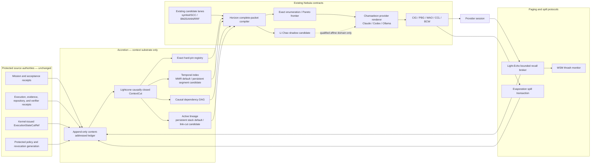

# GALAXY R3 — Accretion Context Virtualization Plane R1

**Status:** candidate architecture freeze; architecture-only; no runtime activation authorized  
**Date:** 2026-07-14 (revision pass; supersedes the 2026-07-13 freeze)  
**Scope:** durable context, compaction, paging, packet construction, lineage, provenance, and provider-session continuity  
**Cost boundary:** local filesystem, SQLite, Python standard library, installed Claude/Codex CLIs, and already-owned local compute only; no paid API, metered hosted inference, or recurring SaaS dependency  
**Parent freezes:** GALAXY R3 transactional kernel, qualified capability topology, Pulsar R1, and Quark Portfolio R2

---

## 1. Decision

Adopt **Accretion** as an internal context-virtualization plane beneath the existing
Nebula contracts. A model context window becomes a disposable, provider-specific
cache compiled from immutable external state. It is never the canonical memory,
never an authority source, and never evidence that an action is allowed or complete.

Accretion uses one immutable logical substrate with several independently
rebuildable indexes:

1. an append-only, content-addressed Context Ledger;
2. causally closed, revision-bound `ContextCut` snapshots;
3. an exact hard-obligation registry;
4. a temporal Merkle hierarchy over each ordered source stream;
5. a causal dependency DAG;
6. a single-parent active-lineage projection;
7. dependency-closed context-packet compilation;
8. provider-specific rendering and token accounting;
9. transactional spill, bounded recall, and clean-context handoff; and
10. exact replay and selection oracles that every optimized backend must match.

The default algorithms are deliberately strong and simple:

- an authenticated append-only Merkle accumulator/MMR for ordered history;
- parent pointers or a structurally shared persistent stack for active lineage;
- exact enumeration for small packet portfolios; and
- a sorted Pareto frontier for fixed `(token_cost, utility)` packet selection.

Persistent segment trees, link-cut trees, and Li Chao trees are retained as
**Quark-qualified shadow candidates**, not prestige dependencies and not new
authority nodes.

### 1.1 Prior art and the deliberate divergence

The operating-system framing here is not novel and should not be presented as
such. MemGPT ("Towards LLMs as Operating Systems", Packer et al., 2023; now the
Letta framework) established virtual context management for language models:
hierarchical memory with a bounded main context paged against unbounded external
storage. Accretion adopts that framing — two tiers, paging, page faults, an
external store of record — and the R3 brownfield ledger records it as a source.

One mechanism is rejected outright, and the reason is architectural rather than
aesthetic. MemGPT's defining feature is *self-editing memory*: the model itself
decides, through tool calls, what to page in and out, and overflow is handled by
recursive summarization — a summary generated from the previous summary plus the
evicted messages. Both properties are inadmissible here:

1. **The model is not the memory manager.** Under AC-R01 the context window is a
   compiled artifact and holds no authority. Letting the model choose retention
   would make the cache a memory authority, which is precisely the confusion this
   plane exists to eliminate. Compilation is mechanical, deterministic, and
   replayable from the ledger.
2. **Summary-of-summary is lossy and unauditable.** Recursive summarization
   destroys the original and compounds error with no path back to the source.
   Accretion evicts publish-before-evict against an immutable, content-addressed
   record: anything dropped from the window remains exactly recoverable through
   Light-Echo recall, and no compaction step is permitted to be the sole
   surviving copy of anything.

The distinction is the point: MemGPT gives the model an OS-like memory *and the
authority to run it*; Accretion gives the model an OS-like memory and keeps the
authority outside.

---

## 2. Architectural position



No edge in this graph bypasses the existing transactional-kernel mutation spine.
Provider output remains advisory until the existing authority, validation,
execution, evidence, and promotion gates accept it.

### 2.1 Names and ownership

| Name | Meaning | Existing owner |
|---|---|---|
| **Accretion** | Entire context-virtualization substrate | internal platform service; no effect authority |
| **Lightcone Cut** | Causally closed vector of immutable source cursors | CQC/CIG backend |
| **Horizon Portfolio** | Complete dependency-closed packet candidates and selector | WAO backend |
| **Chamaeleon Renderer** | Provider-specific packet materialization | CCL/BCW backend |
| **Evaporation Gate** | Publish-before-evict compaction protocol | SSP backend |
| **Light-Echo Broker** | Bounded page recall and clean-context handoff | SRB backend |

These names do not create alternate policy, scheduler, verifier, evidence, or
mutation authorities.

The "existing owner" column and the requirements reference Nebula node IDs
defined in the
[capability topology](2026-07-14-galaxy-r3-qualified-capability-topology.md#6-nebula-21-purpose-distinct-target-nodes),
not re-specified here: `CQC` query compiler, `CIG` context integrity gate, `PBG`
phase boundary gate, `WAO` workspace admission optimizer, `CCL` capacity ledger,
`BCW` bounded workspace, `SSP` structured spillway, `SRB` spillway recall broker,
`WSM` saturation monitor, `BIF` broadcast independence firewall, `SIN` Flare
intake. Accretion is a backend *beneath* these contracts; it adds no new node to
the `134`-node topology.

---

## 3. Non-negotiable requirements

Requirements are the contiguous set `AC-R01`–`AC-R34` (§3.1–§3.4). Each maps to
one or more implementation-plan tasks and a direct evidence class; that mapping
lives in the
[pre-implementation readiness ledger §4.1](2026-07-14-galaxy-r3-preimplementation-readiness-ledger.md#41-mnemosyne-requirement-by-requirement-implementation-mapping).
A linter must confirm all 34 IDs are present with no gap or duplicate before this
freeze is accepted.

### 3.1 Authority and correctness

| ID | Requirement |
|---|---|
| `AC-R01` | A packet contains no capability and cannot authorize, accept, discharge, revoke, verify, schedule, reserve, dispatch, mutate, or promote anything. |
| `AC-R02` | Execution/effect/verification/promotion paths revalidate live Singularity authority and canonical obligations independently of the packet. |
| `AC-R03` | CQC consumes only a kernel-issued, revision-bound `ExecutionStateCutRef`; raw mutable KSJ state is not imported as mission, evidence, or execution truth. |
| `AC-R04` | An append-only observation becomes accepted state only through a deterministic reducer over kernel-qualified receipts. Logging alone never establishes truth. |
| `AC-R05` | Every published `ContextCut` is causally closed across its source-cursor vector. Unknown parents, unknown edge kinds, cycles, reused sequence numbers, or fractured generations reject the cut. |
| `AC-R06` | Hard obligations, acceptance conditions, revocations, unresolved verifier failures, contamination findings, and protected stop conditions remain exact structured records. |
| `AC-R07` | If exact hard state cannot fit the provider envelope, compilation returns `ContextUnsatisfiable`; it never silently truncates or substitutes a model summary. |
| `AC-R08` | Summaries are derived advisory artifacts. No summary can discharge or replace exact hard state. |
| `AC-R09` | Taint, sensitivity, and origin ancestry are monotone: a transformation unions them and never cleans them. |
| `AC-R10` | Every page, summary, packet, and model output carries transitive origin closure so BIF can detect shared ancestry and false independence. |

### 3.2 Durability and publication

| ID | Requirement |
|---|---|
| `AC-R11` | Context events and immutable roots are addressed by canonical domain-separated SHA-256 digests that bind schema version, logical domain, source generation, and tree shape. |
| `AC-R12` | Hashing does not authenticate a writable store by itself. Published roots are anchored into protected kernel receipts. |
| `AC-R13` | Compaction writes bottom-up: raw page, typed leaves, summary artifact, validation/lineage receipt, candidate root, durable re-read, compare-and-swap current root, then eviction. |
| `AC-R14` | A failed or torn compaction transaction leaves the prior root current and the raw source reachable. |
| `AC-R15` | Garbage collection preserves every object reachable from live runs, audits, packets, published roots, verifier evidence, unresolved obligations, retention leases, or protected outcomes. |
| `AC-R16` | All immutable tables reject update and delete. The mutable current-root pointer is isolated and changed only by generation-bound CAS. |
| `AC-R17` | Recovery yields exactly a committed prefix or a committed successor root—never a partially published state. |

### 3.3 Provider sessions and paging

| ID | Requirement |
|---|---|
| `AC-R18` | In-session recall and true context replacement are distinct operations. Tool recall adds tokens; it does not reclaim opaque provider history. |
| `AC-R19` | True page replacement starts a fresh provider epoch/session compiled from a new packet unless the provider supplies independently verified replacement semantics. |
| `AC-R20` | Retry, rejected attempt, rollback, base revision change, policy change, context-cut change, contamination, or revocation advance requires a fresh provider session. |
| `AC-R21` | Same-session continuation is allowed only when transaction, clone, provider, capability set, specification, packet root, source snapshot, and revocation generation all still match. |
| `AC-R22` | Page faults route through existing `SRB -> SIN -> CIG/PBG -> WAO/BCW` admission and consume bounded epoch, byte, token, and recall credits. |
| `AC-R23` | Opaque page handles bind run, consumer, packet root, purpose, snapshot, sensitivity, TTL, byte/page limit, and immutable digest. A model never receives a raw filesystem path. |
| `AC-R24` | WSM records fault rate, refault distance, hot-page churn, working-set size, clean-handoff count, and unresolved hard-pin pressure. |

### 3.4 Algorithms and qualification

| ID | Requirement |
|---|---|
| `AC-R25` | Persistent interval structures operate per ordered source stream and never replace causal-DAG closure. |
| `AC-R26` | Segment aggregates use a proved associative constant-size monoid with identity. LLM-authored summaries are not monoid values. |
| `AC-R27` | Lazy tags require deterministic composition/action laws and may affect only derived view metadata under a bound policy generation. |
| `AC-R28` | Link-cut indexes only a deterministic single-parent ownership/inheritance forest; joins and shared prerequisites remain DAG edges. |
| `AC-R29` | Packet correctness is the union of exact hard pins, causal-DAG dependency closure, and active lineage. |
| `AC-R30` | Exact packet enumeration remains the permanent selector oracle. Pareto is the default optimized selector for fixed complete packets. |
| `AC-R31` | Li Chao is eligible only for one complete packet, one scalar domain, exact affine or piecewise-affine fixed-point utility, explicit validity intervals, deterministic ties, and no unsupported deletion semantics. |
| `AC-R32` | Every advanced backend has an independent kill switch, exact fallback, differential oracle, measured crossover, and rollback receipt. |
| `AC-R33` | R1 never persists plaintext credential/secret pages. It stores a digest plus protected source handle, or a deterministically redacted derived page; unknown secret classification fails toward non-persistence. |
| `AC-R34` | Live cut publication validates only a bounded causally closed delta against the prior committed reducer/root state. Recovery streams bounded batches; full flat replay remains an offline/shadow oracle. |

---

## 4. Canonical data model

### 4.1 Identity

All machine identities are opaque strings with closed constructors. Human labels
are metadata and never participate in authorization.

```text
EventRef       := (source_id, source_generation, sequence, event_digest)
ContextCutRef  := (cut_generation, vector_digest, logical_state_digest)
PageRef        := (content_digest, media_type, byte_length, sensitivity)
ArtifactRef    := (artifact_digest, kind, source_cut_digest, producer_digest)
PacketRef      := (packet_digest, provider, tokenizer_digest, template_digest)
```

Sequences are monotone only inside one `(source_id, source_generation)` stream.
Wall-clock timestamps are display metadata and never establish ordering.

### 4.2 `ContextEvent`

```json
{
  "schema_version": 1,
  "event_id": "opaque",
  "run_id": "opaque",
  "kind": "acceptance_added",
  "source": {
    "source_id": "singularity-kernel",
    "generation": 12,
    "sequence": 84
  },
  "parents": [
    {
      "source_id": "mission",
      "generation": 7,
      "sequence": 19,
      "event_digest": "sha256:..."
    }
  ],
  "payload_ref": "sha256:...",
  "authority_ref": "sha256:...",
  "origin_closure_ref": "sha256:...",
  "taint": "protected",
  "sensitivity": "run_private"
}
```

The event digest is computed over canonical JSON excluding any display timestamp.
The closed `kind` vocabulary is versioned. Unknown kinds fail closed rather than
being treated as generic context.

### 4.3 `ContextCut`

```json
{
  "schema_version": 1,
  "run_id": "opaque",
  "cut_generation": 31,
  "sources": [
    {
      "source_id": "mission",
      "generation": 7,
      "sequence": 19,
      "stream_root": "sha256:..."
    },
    {
      "source_id": "singularity-kernel",
      "generation": 12,
      "sequence": 84,
      "stream_root": "sha256:..."
    }
  ],
  "logical_state_digest": "sha256:...",
  "hard_pin_digest": "sha256:...",
  "origin_closure_ref": "sha256:...",
  "policy_generation": 9,
  "revocation_generation": 4
}
```

Publication requires:

1. every selected cursor exists;
2. every included event parent is selected at the same generation or earlier;
3. all selected stream roots verify;
4. deterministic reduction reproduces `logical_state_digest`;
5. exact pin reconstruction reproduces `hard_pin_digest`; and
6. a protected root-publication receipt binds the cut.

### 4.4 Exact hard pins

Hard pins use closed records rather than prompt prose:

```json
{
  "pin_id": "acceptance:tests-pass",
  "kind": "acceptance_condition",
  "introduced_by": "sha256:...",
  "current_generation": 3,
  "payload_ref": "sha256:...",
  "discharge_rule_ref": "sha256:...",
  "discharged_by": null,
  "origin_closure_ref": "sha256:...",
  "sensitivity": "run_private"
}
```

A pin disappears from the active set only through a valid typed discharge,
supersession, or revocation receipt accepted by the deterministic reducer.

### 4.5 Summary artifacts

```json
{
  "schema_version": 1,
  "kind": "episode_summary",
  "covers": ["sha256:first-event", "sha256:last-event"],
  "source_cut_digest": "sha256:...",
  "source_page_digests": ["sha256:..."],
  "dependency_refs": ["sha256:..."],
  "unresolved_pin_ids": ["acceptance:tests-pass"],
  "omission_declaration_ref": "sha256:...",
  "producer": {
    "provider": "ollama",
    "model_digest": "sha256:...",
    "prompt_digest": "sha256:...",
    "tokenizer_digest": "sha256:..."
  },
  "origin_closure_ref": "sha256:...",
  "taint": "derived_unverified"
}
```

Summary text is never folded into a canonical range aggregate. Its digest is a
derived cache key tied to the exact source root and producer configuration.

### 4.6 Complete context packets

A `ContextPacket` is admissible only when its completeness receipt proves:

```text
active_hard_pins(cut) subset_of exact_packet_records
active_lineage_path(cut, consumer) subset_of packet_closure
hard_dependency_closure(cut, query) subset_of packet_closure
all_packet_refs generation_valid and disclosure_allowed
rendered_token_upper_bound <= provider_budget
```

The packet binds:

- run, transaction, attempt, and consumer identities;
- `ContextCutRef` and `ExecutionStateCutRef`;
- mission, policy, repository, revocation, and source-snapshot generations;
- provider, model, tokenizer, template, and capability digests;
- exact hard-pin and dependency-closure digests;
- selected page/artifact digests and their transitive origin closure;
- rendered token count or conservative upper bound;
- expiry and launch-time CAS predicate; and
- a deterministic selector/tie-break receipt.

---

## 5. Storage model

### 5.1 Local-only layout

```text
state/context/
  context.db
  blobs/sha256/aa/<remaining-digest>
  replay/
  quarantine/
  benchmarks/
```

SQLite owns transactional metadata and root publication. The filesystem blob
store owns immutable bytes. Both live under the configured local state root.

### 5.2 SQLite tables

| Table | Mutability | Purpose |
|---|---|---|
| `context_events` | append-only | typed immutable event leaves |
| `context_event_parents` | append-only | typed causal edges |
| `context_pages` | append-only | content-addressed raw page metadata |
| `context_artifacts` | append-only | summaries, reductions, proofs, packet receipts |
| `context_stream_roots` | append-only | per-source Merkle roots by generation/sequence |
| `context_cuts` | append-only | validated causally closed vector cuts |
| `context_root_publications` | append-only | protected publication/rollback lineage |
| `context_current_root` | CAS mutable singleton per run | current committed cut pointer only |
| `context_retention_leases` | append-only plus terminal release receipt | GC reachability roots |
| `context_faults` | append-only | page-fault, refault, and clean-handoff telemetry |
| `context_backend_trials` | append-only | Quark benchmark/qualification receipts |

Immutable tables install SQLite triggers that abort `UPDATE` and `DELETE`.
`context_current_root` updates require expected generation, expected old digest,
and a valid candidate publication receipt inside one immediate transaction.

### 5.3 Blob publication

1. Compute the domain-separated content digest.
2. Write to a unique temporary path in the destination directory.
3. Flush file contents and best-effort directory metadata.
4. Atomically replace only when the final digest path is absent.
5. Re-read and verify byte length and digest.
6. Append the `context_pages` row.
7. Never overwrite a digest path with different content.

Before blob publication, deterministic sensitivity classification rejects
credential/secret plaintext. Accretion stores only its digest plus a protected
source handle, or a deterministically redacted derived page with monotone taint.
All other private pages remain local and disclosure-scoped. Disclosure policy
decides whether a consumer receives the page, a redacted derived artifact, or no
reference.

---

## 6. Algorithms

### 6.1 Temporal history

The default is a per-source append-only Merkle accumulator/MMR.

For an internal node with children `l` and `r`:

```text
A(v) = A(l) ⊕ A(r)
D(v) = H(domain, schema, interval, D(l), D(r), H(A(v)))
```

`⊕` must be associative and constant-size. Approved fields include:

- conservative provider-token upper-bound vectors;
- event-kind bitsets;
- exact event and active-pin counts;
- taint-lattice joins;
- maximum source/policy/revocation generation;
- minimum expiry; and
- proof-presence bitsets.

LLM summaries, free text, mutable scores, and authority decisions are forbidden
aggregate values.

#### Persistent segment candidate

A persistent segment hierarchy becomes eligible only when telemetry shows
repeated arbitrary historical/versioned range work that crosses the Quark P2
admission floor. It is not justified for pure append/tail workloads.

#### Lazy propagation

A lazy tag `t` is legal only if:

```text
apply(t1 ∘ t2, A) = apply(t1, apply(t2, A))
```

Approved candidate tags are monotone invalidation generation, visibility
intersection, minimum expiry, and minimum required policy generation. Lazy tags
never mutate truth, evidence, provenance, obligations, acceptance, authority, or
canonical event payloads.

### 6.2 Causal dependency graph

The DAG is authoritative only for typed dependency relationships present in
qualified receipts. Normal cut publication validates a bounded delta from the
prior committed cut, using the prior reducer state, parent index, and per-stream
root as its induction base. Recovery replays bounded batches with durable
checkpoints. Full flat replay is an offline/shadow oracle, not an unbounded live
request. Cut publication performs bounded-fanout validation and cycle rejection.
Packet compilation traverses exact hard dependencies before using any semantic
retriever.

Repository navigation retains the existing strategy:

1. exact symbol/path/direct hits;
2. SCC condensation of the dependency graph;
3. sparse BM25 scoring; and
4. bounded dependency/caller expansion.

Direct targets, hard boundaries, and verification commands are never dropped to
meet a soft context budget.

### 6.3 Active lineage

The production baseline is a structurally shared persistent stack or explicit
parent chain:

- fork/push/pop: `O(1)` plus aggregate merge;
- prefix aggregate: `O(1)` when cached; and
- materialization: `O(depth)`, which is output-optimal.

The lineage parent is a closed deterministic “inherits active execution state
from” relation. Multi-parent causal joins stay in the DAG.

Every explicit parent walk tracks visited IDs and enforces the cut’s node-count
ceiling. Corruption raises `ContextInvariantError`; it cannot spin indefinitely.

#### Link-cut candidate

Link-cut is eligible only for a real online one-parent forest with frequent legal
middle-of-tree cut/relink operations and predominantly fixed-size associative
path-aggregate queries. It is ineligible for shallow/static paths or when the
consumer must materialize the whole path.

Required safeguards:

- reject cycles before link;
- expose no caller-visible arbitrary `evert`;
- keep semantic parent identity outside splay representation;
- maintain forward and reverse aggregates for order-sensitive path digests;
- single-writer/versioned snapshots;
- atomic rebuild from the immutable ledger; and
- parent-chain fallback during recovery.

### 6.4 Packet selection

Hard feasibility is evaluated before utility:

```text
admissible(p) :=
  generation_valid(p)
  and dependency_closed(p)
  and hard_pins_covered(p)
  and disclosure_allowed(p)
  and rendered_token_upper_bound(p) <= budget
```

The exact lexicographic objective is:

1. admissible versus inadmissible;
2. higher calibrated verified-success lower bound;
3. greater exact evidence/requirement coverage;
4. lower page-fault-risk upper bound;
5. lower rendered token count;
6. lower render/page-in latency; and
7. canonical packet digest as the final deterministic tie-break.

Utilities use fixed-point integers. Floating-point NaN, infinities, and
platform-dependent ordering are forbidden.

#### Exact and Pareto selectors

- Exact enumeration is the permanent oracle.
- For fixed complete packets `(cost, value)`, sort by cost, remove dominated
  points, and keep prefix-best values. Query by binary search.
- Packet generation itself emits a completeness receipt; an optimal selector
  over an incomplete portfolio is not accepted.

#### Li Chao candidate

For provider/model/generation-bound complete packet `p`:

```text
f_p(x) = a_p * x + b_p, x in I_p
```

Li Chao is eligible only if this law is exact over the declared scalar domain.
It does not solve hard-budget knapsack, complementarity, overlap, attention
interference, multidimensional routing, or arbitrary packet deletion.

Counterexample: packets `(cost,value) = (1,1), (2,1.5), (3,3)`. At budget `2`
the middle packet is optimal, but its line `1.5 - 2λ` is never the upper envelope
against `1 - λ` and `3 - 3λ`. Therefore `V - λT` identifies supported hull
choices, not the exact discrete budget optimum.

(Verified: `1.5 - 2λ > 1 - λ` requires `λ < 0.5` while `1.5 - 2λ > 3 - 3λ`
requires `λ > 1.5`; these cannot both hold, so the middle packet never appears on
the envelope for any `λ >= 0`. This is the general reason a Lagrangian/Li Chao
envelope may skip an exact budget optimum, so Pareto/exact enumeration remains
the oracle and Li Chao is admissible only under `AC-R31`.)

### 6.5 Compaction and paging

#### Evaporation compaction transaction

```text
select completed typed range
  -> persist and verify raw pages
  -> append typed range leaves
  -> produce advisory summary candidate
  -> validate source coverage, ancestry, omissions, pins, and disclosure
  -> build candidate Merkle root and ContextCut
  -> durable re-read
  -> CAS-publish current root
  -> publish opaque page handle
  -> evict only the old provider epoch or local BCW copy
```

#### Light-Echo page fault

An in-session fault may add a bounded page when sufficient response reserve
remains. It cannot claim reclamation. If the working set cannot fit, Light-Echo
requests a fresh epoch compiled from the new packet. Repeated evict/refault cycles
trigger WSM containment: pin the hot set, widen within the existing budget,
decompose, delegate, or cleanly hand off.

### 6.6 Independence basis

BIF receives an explicit `IndependenceBasis` derived from each output’s transitive
origin closure, provider session, model/runtime digest, packet root, source cut,
and derivation ancestry. Two outputs are independent only when the protected BIF
policy says every required dimension is disjoint. Agreement without an
independence receipt remains correlated advice and cannot raise confidence as an
independent vote.

---

## 7. Brownfield integration map

| Existing seam | Current fact | Accretion treatment |
|---|---|---|
| `platform_core/orchestration/compaction.py` | oldest-half summary, best-effort raw offload, blind truncation fallback | preserve public facade; route to Evaporation only behind shadow/qualified flags |
| `platform_core/orchestration/brain_io.py` | four-char estimate and head/tail truncation | retain as emergency legacy lane until clean-context handoff is qualified; never call it from the qualified hard-pin path |
| `platform_core/orchestration/step_sink.py` | one executor callback fans out journal and trajectory events | add an isolated Accretion ingress adapter; sink failure cannot imply context publication success |
| `memory/ledger/journal.py` | mutable upsert-like operational journal; supersession deletes rows | remain an operational resume projection; never become canonical context history |
| `platform_core/runtime/trajectory.py` | append-only but fail-open unauthenticated telemetry | remain telemetry/candidate source; accepted context requires qualified event receipts |
| `platform_core/orchestration/llm_navigation.py` | exact hits plus BM25/SCC bounded graph expansion | retain as deterministic code-candidate lane |
| `memory/retrievals/core.py` | ANN/lexical RRF candidate generation | retain as advisory candidate lane with provenance and generation wrapping |
| `memory/retrievals/render.py` | greedy incoming-order pack; stops at first oversized item | replace qualified path with complete-packet portfolio and provider renderer |
| `platform_core/orchestration/step_resume.py` | plan signature can reuse a provider session | require full session-freshness predicate; fresh session on transaction/revision/cut change |
| `memory/stores/obsidian.py` | REST-first/disk-fallback human knowledge projection | keep as human-readable audit/contact/context projection only |
| `platform_core/ops/retention.py` | best-effort state cleanup | add reachability-driven context GC only after retention-leases and root proofs exist |

Root facades and compatibility imports remain stable. New implementation lives in
focused modules under `platform_core/context/`.

---

## 8. Provider specialization

Claude, Codex, and Ollama share evidence roots but receive independently rendered
packets. Each packet binds its provider/model/tokenizer/template digests because:

- context limits differ;
- tokenization differs;
- system/tool envelope overhead differs;
- provider sessions have distinct continuity/contamination state; and
- a useful page for a coding executor may be harmful noise for an independent
  verifier.

Provider roles are capability-specialized, not merely model names:

- **Codex:** repository navigation, implementation, deterministic tool execution,
  code review, and exact artifact production;
- **Claude:** long-form synthesis, alternative reasoning, specification review,
  adversarial interpretation, and cross-checking;
- **Ollama:** bounded local classification, deterministic-format summarization
  candidates, routing assistance, and cheap shadow evaluation.

No provider is allowed to declare its own context complete or authoritative.

---

## 9. Colored-team validation roles

| Team | Accretion responsibility |
|---|---|
| **Red Team** | omission, injection, poisoned summaries, false discharge, secret-handle exfiltration, and adversarial packet portfolios |
| **Orange Team** | crash boundaries, concurrent publication, stale CAS, retry/session reuse, rollback, cut fractures, and event-order anomalies |
| **Blue Team** | authority separation, provenance, origin closure, tamper detection, disclosure policy, retention reachability, and fail-closed behavior |
| **Green Team** | oracle equivalence, latency/RAM/disk/token measurements, crossover proofs, verified-success controls, and knockout ablations |

Team agreement is not treated as independent when packet, evidence, provider
session, model runtime, or derivation ancestry overlaps.

---

## 10. Research and brownfield posture

The design transfers mechanisms rather than importing competing platforms:

| Source | Transfer | Rejection |
|---|---|---|
| [Pi compaction](https://pi.dev/docs/latest/compaction) | typed turn/tool boundaries, structured summaries, branch handoff | summary without causal coverage proof |
| [CWL / pi-cwl](https://github.com/Kiz8-Team/pi-cwl) | typed episode DAG and dependency-aware eviction | agent-authored boundaries as unquestioned truth |
| [MAGE](https://arxiv.org/abs/2606.06090) | active root-to-current execution state and failed-branch quarantine | LLM maintenance judgment as verifier authority |
| [Pichay](https://arxiv.org/abs/2603.09023) | page handles, faults, pin/unpin, working-set telemetry | transparent proxy/FIFO as final policy; no code copied without license |
| [ReMe](https://github.com/agentscope-ai/ReMe) | local procedural-memory distillation and utility pruning | wholesale framework/duplicate store import |
| [MemOS](https://github.com/MemTensor/MemOS) | namespaced role/consumer memory views | Neo4j/Qdrant/full-stack operational burden |
| [MemGPT/Letta](https://github.com/letta-ai/letta) | explicit core versus archival memory operations | overlapping orchestration authority |
| [Anthropic context engineering](https://www.anthropic.com/engineering/effective-context-engineering-for-ai-agents) | structured external state, compaction, note-taking, and subagent isolation | provider transcript as canonical memory |

The complete counted source set is owned by the
[Brownfield and Frontier Evidence Registry](2026-07-14-galaxy-r3-brownfield-frontier-registry.md).
Accretion projects these canonical records:

| Accretion concern | Repository IDs | Paper IDs | Admission question |
|---|---|---|---|
| typed episodes and explicit paging | BR07-BR09 | FR09 | can branch/fold or paging preserve exact hard-pin and causal coverage? |
| procedural/workflow memory | BR01, BR36 | FR14 | do induced procedures survive temporal holdout without stale-workflow harm? |
| temporal/causal/entity retrieval | BR37 | FR11-FR13 | does typed multi-view retrieval beat one simple graph at equal quality and cost? |
| evolving-state memory evaluation | BR38 | FR10, FR15-FR16 | do competency-separated, on-policy tests reveal reproducible local failures? |
| memory privacy | BR40-BR43 | FR30 | can any role, scope, or tool recover a seeded cross-boundary canary? |

FR09-FR16 and FR30 are hypotheses, not memory authority. Model-written
summaries, graph edges, intent tags, workflows, and safety judgments remain
proposals until mechanical provenance, coverage, disclosure, and verifier gates
accept them.

Any source-code port requires a recorded license/commit provenance receipt.
Research-paper mechanisms without reusable code are clean-room implementations.

---

## 11. Qualification program

### 11.1 Permanent baselines and oracles

1. `Cepheid-F`: flat immutable receipt scan, causal-parent validation,
   deterministic reduction, parent-path materialization, and exhaustive packet
   enumeration.
2. Authenticated append-only MMR/hierarchy.
3. Parent-chain active lineage.
4. Exact enumeration and sorted Pareto selection.
5. Current head/tail truncation and current compaction as negative controls.
6. Existing symbol/SCC/BM25 plus ANN/lexical RRF retrieval as candidate controls.

### 11.2 Workload families

- `10^2` through `10^6` events;
- latest and historical cuts;
- append-only through query-heavy range mixtures;
- deep, wide, star, broom, hotspot, alternating-leaf, and dynamically reparented
  forests;
- one through `10^5` complete packet candidates;
- Claude, Codex, and Ollama provider envelopes;
- early requirements buried by later work;
- later corrections and revocations;
- stale failed attempts and branch rollbacks;
- contradictory or injected memory;
- page thrashing and clean-context handoffs; and
- crash injection at every publication boundary.

### 11.3 Hard gates

All are mandatory:

```text
hard_obligation_recall = 100%
stale_or_wrong_generation_admission = 0
dependency_or_provenance_divergence = 0
authority_drift = 0
tamper_acceptance = 0
selector_regret_against_encoded_exact_objective = 0
partial_publication_after_crash = 0
paid_or_network_fallback_during_algorithm_qualification = 0
```

Verified-task success must be non-inferior under identical model, token, local
compute, latency, and disclosure budgets before efficiency savings count.

### 11.4 Quark P2 crossover

```text
need := incumbent_p95 > 250 microseconds
        or incumbent_cpu_share >= 1 percent

gain := incumbent_end_to_end_p95 - candidate_end_to_end_p95

promote only if:
  need
  and lower_95_percent_CI(gain) >= 100 microseconds
  and lower_95_percent_CI(gain / incumbent_p95) >= 30 percent
```

End-to-end cost includes index construction/amortization, update, serialization,
persistence, proof verification, packet rendering, fallback bookkeeping, and
recovery. A 2x isolated-kernel result is an engineering-priority signal, not a
substitute for this frozen activation contract.

### 11.5 Backend-specific gates

| Candidate | Eligibility |
|---|---|
| Persistent segment hierarchy | repeated arbitrary historical/versioned range work; proved monoid; beats MMR/chunk coverage end-to-end |
| Lazy propagation | proved composable metadata action; never canonical truth; separately crosses P2 |
| Link-cut | true online one-parent forest with legal cuts/relinks and fixed-size path aggregates; parent-chain crosses P2 first |
| Li Chao | exact affine/piecewise-affine one-scalar domain; fixed-point arithmetic; exact/Pareto crosses P2 first; zero regret versus enumeration |

Any knockout ablation with no measurable quality or performance loss retires the
extra mechanism.

---

## 12. Dashboard contract

The future live flow graph consumes immutable observation receipts only:

- `ContextEventAccepted`
- `ContextCutPublished`
- `HardPinBlocked`
- `PacketPortfolioCompiled`
- `ContextPacketSelected`
- `ProviderEpochOpened`
- `PageFaultRaised`
- `PageRecallAdmitted`
- `CleanHandoffRequested`
- `CompactionCandidateBuilt`
- `CompactionCommitted`
- `BackendTrialRecorded`
- `BackendQualified`
- `BackendRolledBack`

Every displayed value includes run/cut cursor, freshness, and authority class.
The dashboard is a projection and cannot mutate a context root or scheduler state.

---

## 13. Voyager boundary

Voyager remains disabled and read-only. Future Voyager-Lab artifacts may enter only
as tainted hypothesis events with explicit external provenance. They cannot:

- become acceptance conditions or policies;
- discharge hard pins;
- modify provider routing or context budgets;
- trigger self-modification;
- count as independent corroboration without BIF ancestry analysis; or
- bypass Quark qualification.

This reserves the integration space without coupling Accretion correctness to an
unfinished consciousness/RSI research process.

---

## 14. Rejected complexity theatre

The following are explicitly not part of R1:

- one giant graph database replacing the local stores;
- a segment tree for a pure append-only workload;
- lazy propagation over evidence, truth, provenance, obligations, or authority;
- link-cut for shallow/static parent paths or full-path materialization;
- Li Chao for ordinary `cost <= budget` Pareto selection;
- a learned summary or learned selector in the hard-obligation path;
- a global total order synthesized from unrelated wall clocks;
- using Obsidian, the mutable step journal, or provider transcripts as canonical
  context state;
- importing a memory framework that duplicates orchestration or persistence;
- benchmarks that omit construction, persistence, verification, recovery, or
  fallback overhead; and
- node/edge inflation without a distinct contract, owner, failure mode, and
  falsifiable benefit.

---

## 15. Implementation waves

1. Instrument current behavior and capture replayable workload shapes.
2. Build canonical contracts, content-addressed blobs, append-only ledger, and
   flat replay oracle.
3. Add causal-cut validation, deterministic reduction, and exact hard pins.
4. Add authenticated append-only history, dependency DAG, and parent-chain
   lineage.
5. Add complete-packet compilation, provider rendering, exact selection, and
   Pareto optimization.
6. Add transactional compaction, opaque page handles, bounded recall, clean
   provider epochs, and WSM telemetry.
7. Integrate brownfield producers and consumers behind dark/shadow flags.
8. Admit persistent segment, link-cut, or Li Chao candidates only when real
   telemetry proves their shape and Quark P2 qualifies them.
9. Run A/A, hidden replay, temporal holdout, shadow activation, canary, rollback,
   and narrowly scoped cutover.

The accompanying implementation plan expands these waves into test-first,
file-exact tasks. There is no ninth speculative architecture phase after this
candidate freeze.

---

## 16. Approval gate

Implementation may begin only after this candidate freeze is accepted. Approval
authorizes implementation behind disabled/dark flags; it does not authorize live
activation. Live activation still requires the exact qualification, shadow,
canary, and rollback receipts defined above and in Quark Portfolio R2.

Acceptance of this freeze is the sole remaining pre-implementation decision
recorded in the
[readiness ledger §9](2026-07-14-galaxy-r3-preimplementation-readiness-ledger.md#9-remaining-approval-boundary).
Any edit to this specification after acceptance invalidates the spec SHA-256
recorded in that ledger and requires a re-freeze and hash recomputation before
Task 1 begins.
