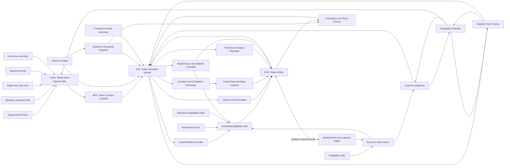

# GALAXY R3: Pulsar R1 Qualified Scheduling Topology

> **Date:** 2026-07-14 (revision pass; supersedes the 2026-07-13 freeze)
>
> **Status:** frozen target architecture; runtime implementation remains deferred
>
> **Parents:** [GALAXY Revision 3](2026-07-14-galaxy-r3-design.md) and [Target Capability Topology](2026-07-14-galaxy-r3-qualified-capability-topology.md)
>
> **Companion:** [Quark Portfolio R2](2026-07-14-galaxy-r3-quark-portfolio-r2-qualified-topology.md)
>
> **Hard constraint:** essentially zero incremental external operating cost. No paid API, metered hosted inference, recurring SaaS, credit purchase, or automatic billing fallback is eligible.

## 1. Freeze decision

Pulsar R1 is the host-wide scheduling control plane for all work managed by 9to5. It replaces fragmented authored-order queues, detached launchers, worker-local sleeps, and bypassable resource admission with one deterministic, transactional, replayable path.

Pulsar adds exactly **19 purpose-distinct nodes and 68 unique typed edges**:

| Layer | Added nodes | Added edges | Cumulative nodes | Cumulative edges |
|---|---:|---:|---:|---:|
| Existing GALAXY R3 core | - | - | 108 | 170 |
| Pulsar R1 | 19 | 68 | **127** | **238** |
| Quark Portfolio R2 | 4 | 12 | **131** | **250** |
| Disabled Voyager boundary | 3 | 6 | **134** | **256** |

The 19 Pulsar nodes are exactly: `TWIG, WCC, KSJ, TWS, CRI, SRR, SLC, CPS,
DCF, FAR, RO, SEG, RCG, KHA, BSC, DIO, SCR, PDP, LVS` (§4). The 68 edges are
exactly `PU01`–`PU68` (§6); a linter must confirm 19 rows and 68 rows with no
duplicate ID or ordered pair, and that every edge has at least one Pulsar
endpoint (so none collides with the inherited `170`-edge core).

These are exact structural target counts. In this frozen architecture snapshot,
all 23 Pulsar/Quark nodes are `specified`; none is runtime-qualified or
active. Source implementation maturity is immutable within one committed
manifest generation and changes only with reviewed source evidence plus a new
generated manifest—not with runtime authority.
Eligibility and activation exist only in an OA-owned runtime overlay resolved
from an externally persisted, digest-bound receipt. No target JSON edit,
generated mirror, environment flag, or dashboard projection can activate a node
or edge.

Pulsar uses immutable overlay-set scope `khronos.scheduler.r1`. Its switch
receipt binds the initial scoped entry, its immutable `activation_root_id` and
`authority_digest`, and the CAS transaction that installed it. The non-expiring
phase ledger anchors that activation root, not one expiring lifetime leaf or the
whole overlay-set journal generation. Runtime gates resolve the unique current
OA-attested descendant of the root. A renewal-only successor follows the parent
overlay contract: it is atomic with the successor warrant, preserves every
authority-bearing field, and may change only permitted lifetime/renewal/
revocation bindings and the monotone leaf generation. A later Quark or GALAXY
activation references the Pulsar root as a mandatory parent and resolves its
current valid leaf; unrelated scope updates or valid renewal do not stale the
child. Root replacement, lineage break, expiry, revocation, or authority drift
makes the parent and every dependent child inert.

Expiry or revocation closes new Pulsar admission/commit/DIO/K_ACT while
preserving scheduler-field ownership and permitting only bounded
drain/containment/recovery. Reactivation is a fresh externally admitted
activation root, never a renewal of dead bytes. It may reuse the durable switch
anchor only when the exact phase ancestry, controller, stores, schemas, field
matrix, and reconciled state remain current; otherwise recovery or a new
field-authority cutover is required. An old Quark/GALAXY child never follows a
new Pulsar root automatically.

The name is permanently **Pulsar**. `Khronos` and `Chronos` are retired prose aliases and must not appear in new work. `Gaia` remains the read-only temporal projection and never becomes a scheduler, journal authority, or alternate spelling. The canonical node IDs remain `KSJ` for Pulsar Schedule Journal and `KHA` for Pulsar Arbiter: three-letter node codes are opaque structural identifiers deliberately preserved across the rename (see the design appendix), so their letters no longer spell the subsystem name and no meaning may be inferred from them.

## 2. Sovereignty boundary

Pulsar is powerful over order and deliberately weak over authority.

It may:

- accept already-authorized work proposals through a closed ingress union;
- compile immutable scheduling contracts;
- determine readiness, service class, slack, fairness debt, and resource eligibility;
- queue, rank, reserve, backfill, drain, checkpoint, and requeue work;
- request zero-cost capacity from existing node `B`;
- append a fenced dispatch intent for existing controller `K`;
- detect liveness failures and request containment;
- emit replay, calibration, and Supernova evidence.

It may not:

- create a goal or widen a work objective;
- grant trust, provider, mutation, effect, credential, or acceptance authority;
- mint capacity or redeem a reservation;
- invoke Claude, Codex, Ollama, a subprocess, browser, native UI, Git, worktree, network, or external effect;
- declare repository verification, semantic acceptance, terminal success, or policy promotion;
- repair an unknown external effect by blind retry;
- schedule or grade its own policy experiment;
- block the external Singularity recovery and emergency-stop path.

The sovereign **Singularity emergency stop is not scheduled work**. It is an
out-of-band anchor capability that bypasses TWIG, queues, KHA, reservations,
and DIO; atomically advances the scheduler invalidation generation, fences all
attempt generations it can identify, closes new admission, and starts
containment/reconciliation. Ordinary cancellation, cleanup, and repair may be
P0 queue work, but they can neither delay nor impersonate this emergency path.

Existing controller `K` remains the sole attempt issuer and capacity redeemer. The protected R3 mutation spine remains unchanged:

```text
RS -> RI? -> TP -> GS -> BI -> OF -> (MG | RC) -> TJ -> TO -> TA -> PA
```

No Pulsar edge targets any node in that spine. `DIO -> K` is an activation
request, not execution authority. Immediately before durable issuance and again
immediately before process launch, K evaluates the closed K-side activation
guard in Section 8.3. A stale pending row cannot survive cancellation,
revocation, clock/deadline drift, boot change, cost-route drift, or an Singularity
emergency generation.

## 3. Combined control flow

Inherited node IDs below are defined in the parent design and capability
topology, not re-specified here: `G` mission DAG, `DL` operator command work,
`FC` repair/retry work, `CR` Supernova, `K` Singularity controller, `RA` normal-run
authority, `R` capability router, `B` machine/zero-cost capacity ledger, `AR`
attempt receipts, `PA` protected terminal outcomes, `TR` resolved trust tier,
`E` evidence graph. The 19 `KHXX`-named nodes are Pulsar-owned and defined in
§4.



The only live dispatch route is:

```text
TWIG -> WCC -> KSJ -> ... -> KHA -> B -> KHA -> KSJ -> DIO -> K
```

There is no `KHA -> DIO`, `AR -> DIO`, or `PDP -> K` edge. Candidate selection, attempt feedback, checkpoint feedback, and preemption planning must first become a committed journal fact.

## 4. Structural target node ledger

All contracts below are version `khronos.r1.v1` and begin with source
implementation maturity `specified`.

| ID | Node | Contract and lifecycle | Authority ceiling and failure terminal |
|---|---|---|---|
| `TWIG` | Tendril Work Ingress Gate | Protected reference monitor over the exact producer union in PU01-PU06. Validates provenance, normal-run authority, deduplication, revision, bounds, and forbidden fields. Stateless per activation. | May admit or reject a proposal. Cannot compile, rank, persist work, reserve, or launch. Unknown producer/schema -> `rejected` with a bounded receipt. |
| `WCC` | Work Contract Compiler | Pure transform from an admitted proposal to one immutable `WorkContract`. Resolves scheduling fields without changing goal, trust, effect, or acceptance semantics. | Cannot infer permission or turn unknown cost/scope into a permissive value. Invalid or incomplete input -> `blocked_contract`. |
| `KSJ` | Pulsar Schedule Journal | Canonical host scheduling-state owner: immutable contracts, append-only scheduler generations, readiness facts, scheduler attempt allocations/issuance links, reservation refs, decisions, timers, DIO rows, checkpoint metadata links, tombstones, and projection cursors. | Authoritative only for scheduling coordination. Execution observations, mission/acceptance, repository content, mutation journals, evidence truth, and terminal success remain externally owned. Corruption/unavailability -> `recovery_only`; no new admission or attempt issuance. |
| `TWS` | Temporal Wakeup Service | Durable wake registration and at-least-once due-event delivery by timer/work generation, boot identity, and timer policy. KSJ deduplicates durable wake receipts, and a bounded exact due-time rescan repairs missed delivery. | A wake only requests recomputation. It cannot make work eligible, rank, or dispatch. Unknown clock continuity -> conservative delayed/recovery wake. |
| `CRI` | Causal Readiness Index | Rebuildable projection over one immutable KSJ cut. Computes dependency blockers, failed ancestors, SCC diagnostics, and direct readiness explanations. | Cannot update work or treat reachability as completion. Missing/corrupt index -> rebuild or fail closed. |
| `SRR` | Schedule Revision Reconciler | Joins mission revisions, KSJ state, and protected outcomes into an append-only supersession/reconciliation delta. | Cannot rewrite history or revive terminal work. Ambiguous revision lineage -> `blocked_revision`. |
| `SLC` | Service-Level Classifier | Deterministically assigns P0-P5 and hard-deadline metadata from protected policy plus a KSJ cut. | Cannot create priority authority from free text. Unknown or conflicting class -> `blocked` unless a protected operation type has exactly one class mapping; never infer P0. |
| `CPS` | Critical-Path and Slack Analyzer | Computes DAG critical paths, deterministic laxity bounds, immediate-unlock facts, and schedulability certificates. | Forecasts may advise order but cannot create eligibility. Cyclic/unknown graph -> diagnostic and no hard-deadline certificate. |
| `DCF` | Duration and Completion Forecaster | Produces calibrated p50/p90/tail distributions from prior protected outcomes and current task features. Updates only across outcome epochs. | No model call in the hot path. Missing calibration -> explicit unknown distribution; a percentile is never promoted into a deterministic duration ceiling. |
| `FAR` | Fairness and Aging Regulator | Computes protected class deficits, weighted dominant-resource fairness debt, capped age, and starvation alarms from journaled service. | Cannot reserve capacity or lower a service class. Missing history -> bounded neutral debt with no preferential boost, never fabricated service. |
| `RO` | Resource Observatory | Rebuildable view of provider circuits, B capacity facts, controller process inventory, CPU/RAM/GPU/browser/native/worktree occupancy, and reservation health. | Observation is not reservation. Stale/unknown capacity is ineligible. |
| `SEG` | Scheduling Eligibility Gate | Sole deterministic conjunction of all pre-transaction predicates. Emits a reason-complete provisionally eligible set for one immutable KSJ cut, including `CAP_OBSERVED` and `RESOURCE_OBSERVED`. | Cannot rank, reserve, or assert final capacity/resource truth. Any unknown mandatory term -> ineligible; only the atomic coordinator may emit `CAP_RESERVED` and `RESOURCE_RESERVED`. |
| `RCG` | Resume Compatibility Gate | Checks provider, driver, session, model, repository, base, policy, checkpoint, sandbox, and attempt-generation compatibility. | No cross-provider resume and no compatibility guessing. Failure creates a fresh-attempt or blocked recommendation only. |
| `KHA` | Pulsar Arbiter | Selects among the provisionally feasible cohort using the frozen hierarchy, requests a non-authoritative expiring B capacity quote, and emits a decision proposal. Stateless over one snapshot. | Cannot reserve or mutate B, KSJ, DIO, or execution state directly. Snapshot/quote drift or final reservation failure -> recompute; no dispatch. |
| `BSC` | Backpressure and Stability Controller | Computes admission pressure, queue stability, contention, saturation, safe backfill envelope, and drain advisories. | Cannot cancel, preempt, or reserve. Unknown stability -> reduce admission. |
| `DIO` | Dispatch Intent Outbox | Durable append-only outbox for a closed `start_attempt \| checkpoint_request \| drain_request \| cancel_request \| release_request` union. A start is joined atomically to final reservation, attempt generation, and schedule decision; a control intent is joined to the current attempt/fence and protected warrant. Delivery advances `pending -> claimed -> issuance_recorded -> converged`, with closed exceptional states `rejected \| cancelled \| expired \| launch_unknown \| recovery_required`. | Cannot execute, signal a process, release capacity, or invoke a provider. `issuance_recorded` requires K's durable create-or-return attempt-intent receipt, not a process observation. An unknown launch is never redelivered; containment terminalizes the old row and any retry receives fresh identities. Never delete-before-convergence. |
| `SCR` | Semantic Checkpoint Registrar | Validates checkpoint schema, repository/base/generation binding, resumability class, and immutable artifact digest. | Cannot pause a process or declare resume safe. Invalid checkpoint -> rejected receipt. |
| `PDP` | Preemption and Drain Planner | Proposes checkpoint-only preemption, lease release, draining order, or non-preemptible completion based on current attempts and stability needs. | Cannot signal a process, release capacity, or act on opaque work. Unsafe preemption -> drain-only. |
| `LVS` | Liveness Goldstone | Detects missing bootstrap/start/heartbeat/terminal acknowledgements, zombies, expired generations, and reservation leaks. | May journal an anomaly and signal K. It cannot cancel, recover, or terminalize. Uncertain liveness -> `unknown`, never success. |

### 4.1 Distinctness from existing GALAXY identities

- `WCC` schedules a resolved mission; existing `I` resolves user intent.
- `KSJ` journals scheduling; `TJ` and `JA` journal promotion/finalization.
- `DIO` precedes the controller; existing `EI` is the later K-issued attempt intent and lease.
- `KHA` selects work; `R` maps providers, `V` decides deliberation, and `K` executes.
- `DCF` forecasts runtime; Nebula `CLE` estimates evidence/context loss.
- `BSC` governs host scheduler pressure; Nebula `WSM` governs a bounded workspace.
- `RO` observes capacity; existing `B` alone owns and reserves it.

## 5. Inherited edge contract

Every KH edge inherits this closed contract unless a row narrows it:

```text
edge_id
source_contract = khronos.r1.v1 or pinned existing contract
target_contract = khronos.r1.v1 or pinned existing contract
run_id
repository_id
work_id
work_generation
attempt_generation?
snapshot_digest
policy_generation
runtime_activation_generation
graph_warrant_digest?
graph_warrant_revocation_generation?
causal_parent_digests[]
payload_schema_id
payload_digest
idempotency_key
created_at_utc
boot_id
expires_at
```

Rules:

- canonical encoding, schema version, integer bounds, and all parent digests are mandatory;
- unknown fields, variants, producers, revisions, generations, or billing classes fail closed;
- one ordered source/target pair has one closed tagged payload union and counts once;
- default activation is once per `(edge_id, run, work_generation, snapshot_digest)`;
- PU24 and DIO delivery edges may retry bounded transport/claim delivery, but
  their semantic receipt is create-or-return under the original idempotency key;
- default queue ceiling is one pending activation per key and 64 KiB per payload;
- batched snapshots are capped only after a `CohortCompletenessCertificate`
  proves every excluded host-global item is ineligible, belongs to a strictly
  lower protected stratum that cannot outrank or conflict with the cohort, or
  is already represented by a sufficient aggregate bound;
- local transforms time out in five seconds unless their node contract is stricter;
- expired advisory artifacts are recomputed, never refreshed in place;
- every edge has ablation key equal to its ID;
- no edge artifact grants more authority than the intersection of its source and target contracts.

### 5.1 Host-global cohort completeness

Bounded selection is valid only with a `CohortCompletenessCertificate` binding
the host-global namespace cursor, every live repository/run cursor, immutable
policy/order generation, included work-ID digest, excluded count/reason
partition, maximum possible order key per excluded stratum, and conflict/resource
closure. Each excluded item must have a machine-checkable proof that it is
currently ineligible, cannot outrank any included candidate under the protected
lexicographic hierarchy, and cannot change included feasibility through a
dependency, mutation/effect conflict, reservation, fairness deficit, or deadline.
An aggregate exclusion is allowed only when its sufficient statistic and bound
are exact. Unknown namespace, missing cursor, or unproved exclusion makes the
cohort incomplete and forbids selection. The atomic claim transaction
revalidates the certificate's global cursor and exclusion bounds; cursor drift
aborts.

## 6. Exact Pulsar edge ledger: 68

Every PU01-PU68 row has source implementation maturity `specified`. No source
edge field, manifest row, or generated mirror supplies runtime qualification,
eligibility, or activation; those exist only in the external OA-owned overlay.

| ID | Source -> target | Closed payload | Guard and authority ceiling |
|---|---|---|---|
| `PU01` | `G -> TWIG` | `MissionWorkProposal` | Exact mission revision and normal-run authority; proposal only. |
| `PU02` | `DL -> TWIG` | `OperatorCommandWorkProposal` | Unavailable until the command/effect activation wave. After activation, the command must already be durably accepted and carries no apply authority. |
| `PU03` | `FC -> TWIG` | `RepairRetryWorkProposal` | Bound failure receipt and remaining retry budget required. |
| `PU04` | `CR -> TWIG` | `CrucibleTrialWorkProposal` | Separate experiment ID, LabBaseline warrant, and P5/default shadow class. |
| `PU05` | `K -> TWIG` | `ControllerMaintenanceWorkProposal` | Existing controller generation plus an external OA/LVS/B/operator incident or maintenance-warrant digest and remaining finite maintenance credit. K cannot mint the cause, replenish credit, or self-authorize promotion. |
| `PU06` | `RA -> TWIG` | `NormalRunAdmissionEnvelope` | First-statement run authority and immutable run revision. |
| `PU07` | `TWIG -> WCC` | `AdmittedWorkProposal` | Exact accepted proposal digest; no inferred fields. |
| `PU08` | `WCC -> KSJ` | `CompiledWorkContract` | Append-only create-or-return by contract digest. |
| `PU09` | `OA -> KSJ` | `ProtectedSchedulerGenerationReceipt` | Attestation/generation only; no task score or mutable objective. |
| `PU10` | `KSJ -> SLC` | `ClassificationJournalCut` | One immutable cut; advisory output cannot alter the cut. |
| `PU11` | `OA -> SLC` | `ProtectedServicePolicyReceipt` | Pinned class policy and generation only. |
| `PU12` | `KSJ -> DCF` | `ForecastJournalCut` | Excludes unresolved current-attempt outcomes from training evidence. |
| `PU13` | `E -> DCF` | `ResolvedDurationOutcomeBatch` | Protected, terminal, later-epoch outcomes only. |
| `PU14` | `DCF -> E` | `CalibratedDurationForecastReceipt` | Forecast claim with interval and calibration provenance; not truth. |
| `PU15` | `KSJ -> CPS` | `DependencyDeadlineJournalCut` | Exact DAG/work/deadline revision. |
| `PU16` | `DCF -> CPS` | `DurationDistributionBundle` | Advisory calibrated quantiles/tails only. Deterministic ceilings come from the protected WorkContract in PU15 and can never be inferred here. |
| `PU17` | `KSJ -> CRI` | `ReadinessJournalCut` | Exact dependency and terminal-receipt cursor. |
| `PU18` | `G -> SRR` | `MissionDagRevisionReceipt` | New immutable DAG revision, never an in-place edit. |
| `PU19` | `KSJ -> SRR` | `SchedulerRevisionSnapshot` | Exact prior revision and live generations. |
| `PU20` | `PA -> SRR` | `ProtectedTerminalOutcomeReceipt` | Existing PA truth only; scheduler cannot synthesize it. |
| `PU21` | `SRR -> KSJ` | `ScheduleRevisionDelta` | CAS append; ambiguous lineage blocks. |
| `PU22` | `OA -> TWS` | `ProtectedClockAndTimerPolicyReceipt` | UTC/boot policy, generation, and timer bounds only. |
| `PU23` | `KSJ -> TWS` | `WakeRegistrationSet` | Create-or-return timer IDs; no eligibility claim. |
| `PU24` | `TWS -> KSJ` | `DueWakeReceipt` | At-least-once delivery; KSJ create-or-returns one semantic wake receipt per timer/work generation. Stale or duplicate delivery is inert. |
| `PU25` | `R -> RO` | `ProviderCapabilityAndCircuitSnapshot` | Observation of qualified provider/mode health, not a route decision. |
| `PU26` | `B -> RO` | `CapacityFactSnapshot` | B-owned facts; stale snapshots never reserve. |
| `PU27` | `K -> RO` | `ProtectedExecutionInventorySnapshot` | Fenced process/attempt inventory; observation only. |
| `PU28` | `OA -> RO` | `AttestedHostResourcePolicyReceipt` | Resource ceilings and generation; no allocation. |
| `PU29` | `CRI -> SEG` | `CausalReadinessCertificate` | Dependency result for the exact snapshot. |
| `PU30` | `RO -> SEG` | `ProvisionalResourceObservation` | Supplies `CAP_OBSERVED`/`RESOURCE_OBSERVED` only. Unknown or expired capacity is false; this is never a reservation. |
| `PU31` | `TR -> SEG` | `TrustTierEligibilityReceipt` | Existing resolved trust tier; cannot be widened. |
| `PU32` | `BSC -> SEG` | `StabilityAdmissionEnvelope` | May only narrow admission. |
| `PU33` | `RCG -> SEG` | `ResumeCompatibilityReceipt` | Closed `compatible \| fresh_attempt \| blocked` union. |
| `PU34` | `SEG -> KHA` | `ProvisionallyEligibleCandidateSet` | Reason-complete, digest-bound, stale-able advisory set with a host-global `CohortCompletenessCertificate`; final capacity/resource truth is absent. Unknown exclusion or cursor drift blocks selection. |
| `PU35` | `KSJ -> FAR` | `FairnessJournalCut` | Service and queue history at one cut. |
| `PU36` | `RO -> FAR` | `DominantResourceUsageSnapshot` | Actual bounded resource occupancy by mission/class. |
| `PU37` | `FAR -> KHA` | `FairnessDebtVector` | Ordering input only; cannot make work feasible. |
| `PU38` | `KSJ -> BSC` | `BackpressureJournalCut` | Queue/attempt/reservation state at one cut. |
| `PU39` | `RO -> BSC` | `ResourcePressureSnapshot` | Conservative occupancy and circuit health. |
| `PU40` | `DCF -> BSC` | `DurationTailRiskEnvelope` | Advisory intervals; missing data increases conservatism. |
| `PU41` | `BSC -> PDP` | `StabilityDrainRequest` | Planning request only. |
| `PU42` | `CPS -> KHA` | `CriticalPathSlackVector` | Order input with explicit proof/unknown fields. |
| `PU43` | `SLC -> KHA` | `ServiceClassVector` | Protected class assignment for exact candidates. |
| `PU44` | `OA -> KHA` | `ActivatedSchedulerPolicyReceipt` | Attested immutable policy generation only; no per-task decision. |
| `PU45` | `KHA -> B` | `CapacityReservationPrepareRequest` | Pure quote/prepare request outside the writer transaction; KHA cannot mutate B or hold capacity. |
| `PU46` | `B -> KHA` | `ExpiringCapacityReservationQuote` | Non-authoritative quote bound to resource/policy/capacity generations. It reserves nothing and cannot be redeemed. |
| `PU47` | `KHA -> KSJ` | `ScheduleDecisionProposal` | Must be revalidated and committed by the Singularity transaction coordinator. |
| `PU48` | `KSJ -> DIO` | `CommittedDispatchIntent` | Closed start/control union. A start binds committed decision, reservation, attempt generation, complete `K_ACT` authority refs, boot identity, and emergency generation; control requires a current attempt/fence and protected warrant. |
| `PU49` | `DIO -> K` | `FencedDispatchActivationRequest` | Closed start/control request only. K evaluates every `K_ACT` term immediately before durable issuance and process launch; failure rejects and starts B release convergence. |
| `PU50` | `K -> DIO` | `AttemptIntentOrControlReceipt` | Create-or-return durable `ExecutionIntent`/`AttemptIntentReceipt`, or a closed reject/control result. A release-bearing result carries only a stable B-owned `CapacityDispositionReceipt` reference. Acknowledges durable issuance, never mere request acceptance or inferred process launch. |
| `PU51` | `DIO -> KSJ` | `OutboxConvergenceReceipt` | Stable event ID plus reservation ID, attempt ID/generation, fence, and coordinator-validated B disposition ref. Process observation is separate; release/reject/cancel converges only against the same bound tuple. |
| `PU52` | `AR -> KSJ` | `AttemptLifecycleReceipt` | Existing immutable execution receipt; never inferred success. |
| `PU53` | `PA -> KSJ` | `ProtectedOutcomeLink` | Scheduler links external terminal truth but does not own it. |
| `PU54` | `K -> LVS` | `ExecutionLivenessObservation` | Exact process/attempt/generation and expected heartbeat contract. |
| `PU55` | `RO -> LVS` | `ResourceLivenessSnapshot` | Reservation/process/circuit observation only. |
| `PU56` | `LVS -> K` | `LivenessIncidentSignal` | Incident signal, never cancel/recovery authority. |
| `PU57` | `LVS -> KSJ` | `LivenessAnomalyReceipt` | Append-only `suspected \| confirmed \| cleared \| unknown`. |
| `PU58` | `AR -> SCR` | `SemanticCheckpointEvidence` | Immutable checkpoint candidate bound to attempt generation. |
| `PU59` | `SCR -> KSJ` | `CheckpointRegistrationReceipt` | Validated checkpoint metadata only. |
| `PU60` | `KSJ -> RCG` | `ResumeCandidateSnapshot` | Exact checkpoint/session/work/policy generations. |
| `PU61` | `G -> RCG` | `MissionRevisionCompatibilityRef` | Current mission/base requirements. |
| `PU62` | `OA -> RCG` | `ProtectedResumePolicyReceipt` | Pinned compatibility and expiry policy. |
| `PU63` | `R -> RCG` | `ProviderSessionCompatibilitySnapshot` | Provider/driver/mode/model/session qualification facts. |
| `PU64` | `KHA -> PDP` | `SelectedPreemptionCandidate` | Advisory candidate; no signal or release authority. |
| `PU65` | `SCR -> PDP` | `CheckpointAvailabilityReceipt` | Exact resumability class and artifact digest. |
| `PU66` | `K -> PDP` | `ProtectedAttemptControlSnapshot` | Current opaque/cooperative attempt capabilities. |
| `PU67` | `PDP -> KSJ` | `PreemptionDrainPlan` | Journal-first plan; K acts only through a later authorized path. |
| `PU68` | `KSJ -> CR` | `SchedulerTrialEvidence` | Separate experiment/outcome epoch; cannot alter the current run. |

The 68 ordered pairs are unique. Every pair has at least one Pulsar endpoint, so none duplicates the prior 170-edge core.

Before the dedicated command/effect activation generation, PU02 is closed and
TWIG admits only a WorkContract with an independently checkable
`effect_class = none` receipt. Effectful WorkContract variants are unavailable,
not queued optimistically. Opening PU02 or any effectful variant requires the
real command/effect machines, a new GraphWarrant, and an activated contract
generation; the presence of placeholder tables is not activation.

## 7. Cycle permits

The graph permits feedback only through explicit finite state machines:

| Cycle | Permit and hard bound |
|---|---|
| `KSJ -> SRR -> KSJ` | One CAS delta per unseen `(mission_revision, journal_cut, outcome_set)` digest. Same digest terminates. |
| `KSJ -> TWS -> KSJ` | At-least-once wake delivery with KSJ create-or-return deduplication. A protected rescan interval no larger than `max_late_wakeup_ms` performs an exact due-time scan over the same timer generation. Transport retries have bounded exponential backoff and expiry to `recovery_required`. A wake can only request recomputation. |
| `DCF -> E -> DCF` | Cross-outcome-epoch calibration only. The forecast that influenced an attempt cannot consume that attempt's unresolved outcome. |
| `KHA -> B -> KHA` | One expiring prepare quote per snapshot and candidate bundle. It holds no capacity. Quote failure/rejection requires a new capacity generation or scheduled backoff; final reservation occurs only in the coordinator transaction. |
| `KSJ -> DIO -> K -> DIO -> KSJ` | One idempotency key and one monotone DIO lifecycle. Bounded claim redelivery is allowed only before durable issuance. Unknown launch permanently consumes the old one-use capability; containment terminalizes it and any retry gets fresh identities. |
| `K -> TWIG -> WCC -> KSJ -> DIO -> K` | Controller-maintenance proposals require an external OA/LVS/B/operator incident or maintenance-warrant digest, a newer controller/incident generation, and a finite non-replenishing maintenance budget. K cannot mint its own cause or replenish credits; same incident/work digest stops. |
| `K -> LVS -> K` | Monotone incident generation, cooldown, and explicit clear receipt. LVS cannot perform the requested action. |
| `KSJ -> CR -> TWIG -> WCC -> KSJ` | New Supernova experiment ID, separate LabBaseline schedule, finite trial budget, and no current-run influence. |
| `KSJ -> projections -> (SEG \| KHA \| PDP) -> ... -> KSJ` | Covers CRI/SEG, SLC/CPS/FAR/KHA, BSC/SEG-or-PDP, and RCG/SEG decision-recomputation cycles. Each work generation receives a bounded recomputation-credit counter. A consumed credit must end in one named monotone advance: journal cut, policy generation, capacity generation, readiness generation, timer generation, decision generation, drain generation, or terminal blocked reason. Same semantic digest stops. |
| `KHA -> PDP -> KSJ -> KHA` | At most one preemption proposal per `(attempt fence, decision generation, checkpoint digest)`. Re-entry requires a newer attempt/fence or a monotone drain/checkpoint state advance. |
| `KSJ -> DSC -> DSE -> DPV -> KHA -> KSJ` | Quark uses the same per-work decision-recomputation credit plus QK10's three-attempt verifier budget. A certified candidate is stale-able advice; commit or rejection consumes the decision generation. |

The semantic digest excludes timestamps, delivery counters, repeated equivalent
observations, and append position; it includes only canonical decision-relevant
facts. `suspected -> cleared -> suspected` liveness oscillation is capped at one
clear/reopen per observation generation, after which the item becomes
`recovery_required` until a newer protected K process observation arrives. The
policy pins a finite recomputation-credit limit in the immutable WorkContract;
credits never replenish within that work generation, and exhaustion produces a
reason-complete blocked/recovery receipt. No generic retry arrow or unbounded
queue-to-model loop exists.

## 8. Host-global transaction domain

### 8.1 Physical boundary

Pulsar uses one Singularity-attested host-global SQLite database in WAL mode under an external scheduler root, provisionally named `omega_scheduler.db`. The root is outside every target repository and is owned by the external Singularity service identity.

The database contains:

- KSJ scheduling tables, namespaced by cryptographic repository ID and run ID;
- B-owned machine-capacity and reservation tables under contract
  `capacity-ledger.v2`;
- monotone attempt/fencing generations;
- DIO rows, claims, durable-issuance links, and convergence receipts;
- command/effect state-machine placeholders, disabled until their dedicated waves;
- migration, schema, integrity, backup, and recovery receipts.

`capacity-ledger.v2` has a closed resource universe: CPU, RAM, GPU, local
process slots, browser seats, native-UI seats, worktrees, verifier slots,
pre-owned provider/CLI seats, and bounded local solver compute. A new machine
resource type requires a versioned authority-manifest change. Human attention
is not fungible capacity and is never reserved by B; any required operator
presence is an explicit RA/operator gate that blocks admission until a current
receipt exists.

Physical co-location does not merge logical ownership:

- `B` is an in-process logical ledger authority whose pure, versioned
  transition function validates and changes only its own tables through the
  coordinator's already-open SQLite connection; it is not an external service;
- `KSJ` alone owns scheduler facts;
- the Singularity transaction coordinator is the only writer and invokes both
  logical transitions in one local transaction;
- `DIO` is an append-only table, not an actor;
- `KHA`, DIO, models, and repository processes receive no database write handle.

The external coordinator service alone receives a non-serializable,
process-local `SchedulerStoreAuthority`. Serialized state-root, activation,
warrant, or migration receipts are evidence and can never be upgraded into a
connection or writer capability. Target code and the run loop receive only a
closed request-only `KhronosClient`; importing the store/connection layer from a
target, model, dashboard, projection, K backend, or KHA process is a contract
violation. The service persists before responding and every mutating request is
create-or-return under a closed idempotency key.

PU45/PU46 are an optional pure prepare/quote exchange before lock acquisition.
The quote is expiring advice and holds no capacity. No filesystem, process,
model, provider, network, IPC, or external-service call is allowed while the
SQLite writer transaction is open. CRI/CPS/DCF/Quark/index construction also
remain outside the lock. The coordinator only revalidates their immutable
digests and runs bounded pure predicates; a protected `writer_lock_budget_ms`
aborts and backs off rather than monopolizing the host writer.

`writer_lock_budget_ms`, the per-repository journal quotas, and the
`max_late_wakeup_ms` rescan bound (§7) are protected pinned constants with no
default in this freeze; each must be assigned a concrete value in the protected
policy generation before activation, and a missing value fails closed rather
than defaulting to unbounded.

The wakeup path itself remains a bounded rescan in R3. The hierarchical timing
wheel (`Orbit`, Quark catalog §14.1) is a dormant P0 candidate to replace the
scan with an `O(1)` per-tick facility; it may not be activated before its
differential oracle proves identical fire order and identical virtual-time
firing tick against this rescan. Choosing `max_late_wakeup_ms` is a prerequisite
for that comparison, not a task deferred by it.

Repository identity binds canonical no-follow root identity, repository UUID, initial trusted base, and Singularity generation. A path string alone is not identity. Per-repository quotas prevent one namespace from exhausting the host journal.

The global database is canonical only for scheduling coordination. Its exact
authority is admission, ordering, readiness projections, scheduler generations,
attempt allocation/issuance references, fences, machine-resource reservations,
timers, and DIO delivery. Mission text and acceptance contracts, command/effect
intent, repository content, Git transitions, verification evidence,
finalization journals, and terminal outcomes stay in their existing protected
repository- or anchor-scoped authorities. Cross-boundary convergence uses stable
IDs and outbox/inbox receipts; it does not claim cross-database atomicity.

| Field family | Pre-scheduler cutover authority | Post-scheduler cutover authority |
|---|---|---|
| admission, queue order, readiness, retry/not-before, scheduler attempt generation, reservation refs, DIO | legacy TaskState/run writer | KSJ/B/DIO under the Singularity coordinator |
| mission content, objective, acceptance contract | existing mission/intent authority | unchanged existing authority |
| execution observation and terminal outcome | K/AR and PA receipts | unchanged; KSJ stores verified links only |
| repository bytes, Git, verification, promotion, finalization | existing repository transaction spine | unchanged existing authority |
| operator command intent | `control.db` | `control.db` until a separately activated command wave |
| command application/effect state | legacy TaskState where already supported, otherwise disabled | remains legacy/disabled until its own field-level cutover; never inferred from KSJ |

### 8.2 Atomic claim transaction

One `BEGIN IMMEDIATE` transaction must perform all of the following or none:

1. Load the exact immutable `WorkContract`, KSJ cut, host-global
   `CohortCompletenessCertificate`, scheduler policy, run revision, repository
   revision, boot identity, emergency generation, current externally resolved
   GraphWarrant, and current generations.
2. Re-evaluate every non-capacity hard predicate under the lock from one
   immutable cut, including an exact zero-cost preflight receipt and explicit
   `effect_class = none` proof while effect authority is inactive.
3. Recompute the candidate's bounded deterministic order key from sealed
   artifacts and confirm it still wins its protected cohort; do not rerun a
   forecast, graph build, model, Quark solver, or unbounded scan.
4. Invoke B's pure `capacity-ledger.v2` transition on the same SQLite
   connection to validate and reserve the complete machine-resource bundle
   all-or-none; emit final `CAP_RESERVED` and `RESOURCE_RESERVED` facts.
5. Allocate a monotone attempt generation and owner fence.
6. Append the final issuance-feasibility certificate and KHA decision receipt.
7. Append the idempotent DIO request bound to reservation ID, attempt ID,
   attempt generation, owner fence, complete `K_ACT` authority refs, boot
   identity, emergency generation, exact policy/repository generations, and the
   current GraphWarrant digest, activation generation, expiry, and revocation
   generation.
8. Commit.

Any drift, timeout, unavailable table, partial transition, or failed predicate
aborts the entire transaction. No partial capacity may remain held. A derived
index fallback is valid only if it runs before writer-lock acquisition, scans
the same immutable KSJ cut, and emits the identical reason-complete certificate
schema and predicate vector. If the needed sealed artifact is unavailable under
the lock, the transaction aborts and recomputes outside it.

Checkpoint, drain, cancel, and release intents use the same journal/outbox discipline but never allocate a fresh attempt or reservation implicitly. Their transaction revalidates the existing attempt generation, owner fence, protected control warrant, and permitted state transition before appending the DIO variant.

### 8.3 Durable issuance and DIO convergence

K evaluates this closed guard from current protected authorities immediately
before create-or-return issuance and repeats it immediately before consuming the
one-use launch capability:

```text
K_ACT = F_issue_current
        and BOOT_CURRENT
        and EMERGENCY_GENERATION_CURRENT
        and DIO_GENERATION_CURRENT
        and GRAPH_WARRANT_CURRENT
        and ONE_USE_LAUNCH_CAPABILITY_LIVE
```

`F_issue_current` means every Section 11 term, not the stale certificate bit:
LIV, REV, DEP, TIME, RETRY, AUTH (including revocation), exact FREE, reserved
CAP/RESOURCE, RESUME, EFFECT, SCOPE, DEADLINE, and every FENCE. Any false or
unknown term rejects or cancels the launch and begins fenced B release
convergence. Guard evaluation is bounded, local, and model-free. The deepest K
process-spawn boundary revalidates and consumes the one-use capability under a
K-owned launch-gate lock bound to the emergency and owner-fence generations;
emergency invalidation closes the same gate before containment. If spawn wins
the serialization point first, the already-registered process tree is part of
that emergency's mandatory containment set.

The GraphWarrant digest and generation are bound into the policy receipt, KSJ
cut, KHA decision, DIO row, K-owned issuance receipt, and one-use launch
capability. The coordinator and both K_ACT gates resolve it afresh from the
external authority. Expiry or revocation closes new admission and issuance and
enters bounded drain/recovery for existing attempts; it never falls back to a
committed topology mirror or the legacy scheduler.

K claims a pending DIO row with a lease and fence, then create-or-returns a
durable `ExecutionIntent`/`AttemptIntentReceipt` in a physically separate,
anchor-attested K-owned issuance/process registry before acknowledging the row.
That registry does not share `omega_scheduler.db`'s corruption domain. DIO moves to
`issuance_recorded` only with that receipt. Bootstrap, PID/process-tree, and
heartbeat observations are later AR/K facts; they are never collapsed into the
issuance acknowledgement.

If K crashes after a possible launch but before a decisive protected process
observation, the row becomes `launch_unknown`. That row and attempt never return
to `pending` and their one-use capability is permanently consumed. Containment
reconciles the independent K process registry, durable issuance receipt, boot
identity, PID/process-tree identity, and reservation tuple. Even after proving
no live process remains, it terminalizes the old row with a bounded unknown/
contained disposition. Any safe retry consumes retry credit and allocates a new
attempt generation, reservation, fence, idempotency key, and DIO ID.

Capacity disposition remains B-owned. The existing base `K -> B` capacity edge
is normatively versioned as a closed `redeem | release | revoke | reconcile`
request union bound to reservation ID, attempt ID/generation, owner fence, and
boot/emergency generation. B create-or-returns a durable
`CapacityDispositionReceipt` in its own co-located tables. PU50 carries only its
stable reference; the Singularity coordinator re-reads and joins that B receipt before
PU51 can append convergence. Rejection, cancellation, expiry, and release
converge only when the full tuple matches. `converged` means the issuance/control
outcome and required B-owned capacity disposition are both durable; it does not
mean the work succeeded.

### 8.4 Corruption, migration, and backup

- Every schema migration is offline, versioned, checksummed, and reversible only before activation.
- Startup runs SQLite integrity checks, manifest checks, namespace checks, and receipt-chain reconciliation before admission.
- Corruption or missing global state disables new admission and attempt
  issuance. Recovery starts in containment mode and reconciles an independently
  protected K process registry plus durable issuance receipts before any
  reservation or attempt may be reissued. A TaskState projection or dashboard
  cannot reconstruct authority.
- Backups are encrypted/ACL-protected local artifacts with generation and journal-cursor receipts; restoring creates a new Singularity generation and forces reconciliation.
- WAL, database, backup, and logs never store provider credentials or raw model transcripts unless a separate contract explicitly permits a bounded artifact.

## 9. Seven orthogonal state machines

One giant status enum is forbidden. Canonical state is a product of seven machines:

| Machine | States | External truth boundary |
|---|---|---|
| Run/outcome | `proposed -> admitted -> active -> draining -> terminal_pending -> terminal_linked -> acknowledged`, plus `cancelled`, `quarantined`, `recovery_only` | `PA` remains terminal truth; KSJ stores only a verified link. |
| Work/readiness | `proposed -> accepted -> blocked/eligible -> claimed -> active -> checkpointed/retry_wait -> terminal_linked`, plus `superseded`, `tombstoned`, `quarantined` | Dependencies and revisions are receipt-derived; no in-place deletion. |
| Attempt | `allocated -> reserved -> outboxed -> dispatched -> bootstrapped -> running -> checkpointed -> execution_terminal -> receipt_linked`, plus `cancel_requested`, `cancelled`, `unknown_launch`, `reconcile_required` | K/AR own execution observations. |
| Resource/lease | `requested -> reserved -> bound -> releasing -> released`, plus `expired`, `revoked`, `unknown` | B owns capacity truth and fences. |
| DIO delivery | `pending -> claimed -> issuance_recorded -> converged`, plus `rejected`, `cancelled`, `expired`, `launch_unknown`, `recovery_required` | K's durable issuance registry proves issuance; AR/K process observations are separate. |
| Command | `proposed -> claimed -> applied/rejected/deferred -> acknowledged` | Architecturally specified but inactive until the command wave; no delete-before-apply. |
| Effect | `proposed -> authorized -> persisted -> applied -> observed -> acknowledged`, plus `reconcile_required` | Architecturally specified but inactive until the effect wave; unknown effects never auto-retry. |

Cross-machine invariants:

- `attempt.dispatched` requires `resource.reserved`, a current fence, a committed DIO row, and a durable K-owned attempt-intent receipt;
- `attempt.running` requires a protected bootstrap observation;
- `work.retry_wait` requires a terminal or reconcile receipt and consumed retry credit;
- `work.terminal_linked` requires an external protected terminal receipt;
- run acknowledgement requires all required work terminal-linked plus the existing promotion/finalization chain;
- attempt cancellation may leave work retryable; work cancellation may coexist with an attempt awaiting containment;
- release is idempotent and fenced; a lost release acknowledgement cannot mint capacity;
- a `launch_unknown` DIO/attempt never returns to pending; containment terminalizes the old identities, and a safe retry consumes credit and creates a fresh attempt/reservation/fence/DIO tuple;
- command/effect machines cannot become active merely because their tables exist.

## 10. Immutable WorkContract

Every admitted item compiles to one bounded contract:

```text
work_id
work_generation
repository_id
run_id
mission_revision
goal_and_acceptance_refs
dependency_ids[]
not_before
soft_deadline?
hard_deadline?
deterministic_duration_ceiling?
retry_budget
recompute_credit_limit
maintenance_cause_ref?
maintenance_credit_limit?
service_class_hint
mission_weight
resource_vector
provider_and_mode_constraints
trust_tier
mutation_scope
effect_class
idempotency_and_reconciliation_class
checkpoint_protocol
resume_policy
verification_obligations
authority_refs[]
zero_cost_proof_ref
stable_enqueue_sequence
contract_digest
```

Unknown cost is not zero cost. Unknown or empty mutation scope conflicts repository-wide. Windows paths are normalized using protected no-follow identity, Unicode normalization, separator normalization, and case-insensitive alias checks before scope comparison. A path string supplied by a model never proves disjointness.

`resource_vector` is restricted to the closed `capacity-ledger.v2` machine
resource universe. Required human/operator presence is represented by a current
RA/operator-gate receipt in `authority_refs`, never by a synthetic B capacity
unit.

`service_class_hint` is untrusted input to SLC. It may request attention but cannot raise the protected class, create P0, or bypass the deterministic service policy.

Contracts are immutable. Changes append a new work generation and tombstone or supersede the old generation. Retries append a new attempt generation. Nothing rewrites history in place.

## 11. Hard feasibility

For snapshot `Sigma`, SEG may emit a **provisionally eligible** candidate only
when the following pre-transaction conjunction holds:

```text
F_pre(Sigma) = LIV and REV and DEP and TIME and RETRY and AUTH and FREE
               and CAP_OBSERVED and RESUME and EFFECT and SCOPE
               and RESOURCE_OBSERVED and DEADLINE and FENCE
```

The Singularity transaction coordinator may issue it only when the same immutable cut
is revalidated and the stronger conjunction holds:

```text
F_issue(Sigma) = LIV and REV and DEP and TIME and RETRY and AUTH and FREE
                 and CAP_RESERVED and RESUME and EFFECT and SCOPE
                 and RESOURCE_RESERVED and DEADLINE and FENCE
```

In the table below, `CAP` and `RESOURCE` name the predicate families; the
observed and reserved suffixes identify their provisional and final forms.

| Term | Meaning | Protected attester |
|---|---|---|
| `LIV` | Run/work is live, not terminal, cancelled, quarantined, or drained beyond admission. | KSJ plus protected run receipt |
| `REV` | Mission, repository, work, policy, and scheduler revisions are current. | SRR/KSJ/OA |
| `DEP` | Every required dependency has the permitted protected terminal outcome. | CRI over KSJ/PA links |
| `TIME` | `not_before`, timer, cooldown, and boot-continuity rules permit consideration. | TWS/KSJ |
| `RETRY` | Durable retry budget remains and same-digest stop does not apply. | KSJ |
| `AUTH` | Existing normal-run, trust, provider, mutation, and effect references cover the exact work. | RA/TR/OA and existing GALAXY gates |
| `FREE` | An exact, generation-bound zero-cost preflight receipt proves route `preowned_local_cli` or `local_compute` and proves no API key, metered fallback, purchase, or billing path exists. | B/R/OA |
| `CAP` | Final `CAP_RESERVED` is created only when B reserves the exact machine/provider bundle in the atomic claim transaction; SEG carries only `CAP_OBSERVED`. | B under transaction |
| `RESUME` | Resume/fresh-attempt semantics are explicitly compatible. | RCG |
| `EFFECT` | Until the effect wave, an explicit `effect_class = none` proof exists. After activation, prior/proposed effects are authorized, idempotent, reconciled, or safely blocked under the real effect machine. | Existing effect authority plus KSJ refs |
| `SCOPE` | Mutation/effect scopes are proven non-conflicting; unknown means repository-wide conflict. | WCC/SEG plus protected path identity |
| `RESOURCE` | Final `RESOURCE_RESERVED` proves the closed machine-resource vector is reserved all-or-none; SEG carries only `RESOURCE_OBSERVED`. Operator presence, when required, is a separate RA gate. | B under transaction; RO/SEG are provisional |
| `DEADLINE` | A declared hard deadline has a WorkContract timeout/checkpoint/resource-policy-derived deterministic ceiling and schedulability proof. DCF percentiles are advisory. Missing proof makes that hard-deadline contract ineligible; it is never silently downgraded to soft. | WCC/CPS/SLC |
| `FENCE` | Run, work, attempt, reservation, policy, repository, and owner generations are current. | OA/KSJ/B/K |

Forecasts may rank feasible work. They may never turn a false or unknown hard term true.

## 12. Scheduling hierarchy

The live dispatcher is deterministic and model-free.

1. `P0`: ordinary cancellation, fencing, recovery, release, and consistency repair. This queue class is subordinate to the sovereign out-of-band Singularity emergency stop defined in Section 2.
2. Feasible hard-deadline work ordered by least non-negative deterministic laxity; negative laxity emits a deadline-miss incident rather than inventing feasibility.
3. `P1-P4`: protected service-class deficit scheduling with bounded replenishment and no starvation.
4. Within the selected class, choose the mission with greatest weighted dominant-resource fairness debt.
5. Within the mission, compare an exact lexicographic tuple containing deterministic laxity, critical-path rank, immediate unlocks, capped age, least attained service, conservative tail risk, verified-value lower bound per dominant resource, locality/switching cost, and immutable enqueue sequence.
6. `P5`: experiments, speculative context staging, and policy trials use residual capacity only.

No unconstrained weighted mega-score may trade safety, authority, or hard deadlines against utility. If a lexicographic tuple is encoded into integers, each radix must be proven larger than the maximum possible lower-order contribution; otherwise Pulsar performs sequential constrained comparisons.

### 12.1 Fairness

- Class deficits and mission DRF debt are journaled facts, not worker-local counters.
- Aging is capped and cannot cross P0 or hard-authority boundaries.
- Priority donation applies only to the holder operation needed to checkpoint, release, or complete a blocking resource.
- Donation cannot widen trust, provider quota, mutation scope, effect scope, deadline class, or capability.
- Donation chains are bounded, cycle-checked, generation-bound, and revoked deterministically when the blocking relation ends.

### 12.3 Progress obligation

Every failure path in this specification resolves conservatively to `recompute`
with no dispatch. That is correct for safety and insufficient on its own: a
scheduler that never dispatches satisfies every safety property in §13 while
delivering nothing. R3 therefore states the liveness side explicitly.

1. **Bounded recompute.** Snapshot drift, quote expiry, and final reservation
   failure are retried under a protected bounded-attempt budget with
   deterministic backoff. Exhausting the budget is a journaled
   `blocked_contention` fact with a reason, never a silent spin. The budget is a
   protected constant with no default and must be assigned before activation.
2. **No livelock by construction.** Repeated loss of the same order key under
   contention must not be able to starve a candidate indefinitely: capped aging
   (§12.1) is journaled across recompute cycles, so a repeatedly-losing candidate
   strictly improves its position and eventually wins or blocks with a reason.
   Aging that resets on recompute would reintroduce the livelock and is
   forbidden.
3. **Progress is evidence, not assertion.** The liveness claim is discharged by
   the design's DST liveness-mode campaign (§15.1, requirement 7), not by
   inspection: after fault injection stops, every admitted contract must reach a
   terminal or an explicit reasoned blocked state within a preregistered virtual
   time bound.

### 12.4 Accepted ordering trade-off: mission-major ranking

The hierarchy selects a mission by weighted DRF debt (step 4) **before** it
compares critical-path rank (step 5). Critical path is therefore only ever
compared *within* one mission. The consequence is intended and is recorded here
so it is not mistaken for an oversight: a globally critical task in a low-debt
mission can queue behind a locally-critical but globally-slack task in a
high-debt mission. R3 accepts this because cross-mission fairness and
starvation-freedom are hard properties while makespan is an optimization target,
and because a global critical-path order across missions is trivially starvable
by a single deep mission.

Any future proposal to compare critical paths across missions must be treated as
a change to the frozen hierarchy — that is, a new protected policy generation
with its own evidence — and must preserve capped aging and class-deficit
guarantees. It is not a tuning parameter.

### 12.2 Resources, preemption, and backfill

- Resources are acquired all-or-none in one deterministic order. Waiting while holding a partial bundle is forbidden.
- Cooperative preemption requires a declared semantic checkpoint protocol and a validated SCR receipt.
- Opaque Claude/Codex processes are non-preemptible except cancellation/containment; Pulsar drains them.
- A rate-limit/quota response releases the worker and reservation, writes `not_before`, and returns to TWS. No worker sleeps while holding provider capacity.
- Backfill is admitted only when a deterministic conservative duration bound proves it cannot delay a higher-class or hard-deadline start. A forecast alone is insufficient.

### 12.5 Brownfield and frontier scheduler laboratory

Pulsar projects the scheduler subset of the canonical
[Brownfield and Frontier Evidence Registry](2026-07-14-galaxy-r3-brownfield-frontier-registry.md),
principally BR12, BR24-BR35, BR44, BR46 and FR01-FR08, FR17-FR18.
Projection does not change the frozen live hierarchy in Section 12. Every candidate
starts in deterministic replay, then shadow, and requires a new protected policy
generation plus Quark/Supernova evidence before activation.

| Candidate | Source IDs | Shadow comparison | Immediate falsifier |
|---|---|---|---|
| program-aware attained-service ordering | FR01, BR27-BR28 | FIFO and the mission-major lexicographic incumbent on identical DAG traces | fairness loss, cancellation delay, or no end-to-end tail gain |
| safe out-of-order execution | FR03, BR28 | global barriers versus exact dependency cuts | causal violation or negligible full-system speedup |
| bounded work stealing | BR27-BR28 | no stealing versus capability/locality/fence-compatible stealing | oscillation, reservation violation, or worse p95 |
| state-aware backpressure | FR02, FR05, BR30, BR32, BR35 | saturation, provider-quota, slow-consumer, and recovery-burst campaigns | dropped authority event, unbounded queue, or retry storm |
| heterogeneous placement | FR04, BR27, BR29, BR33-BR34 | exact small-cohort oracle versus certified heuristic | infeasible placement, missing witness, unstable replans, or no crossover |
| durable timers and replay | BR24-BR26, BR30 | scan/heap/ORBIT plus seeded crashes around wake and issuance | early/lost wake, duplicate effect, boot ambiguity, or unreplayable history |
| deterministic scheduler simulation | BR12, BR31, BR44, BR46, FR17-FR18 | virtual clock/disk/RNG/provider/CLI fault matrix | seed+commit cannot reproduce or liveness fails after faults stop |

DRF, critical-path order, work stealing, solver placement, or learned policy
cannot trade away hard feasibility, mission fairness, capped aging, DIO uniqueness,
or the progress obligation. Reported paper speedups are not GALAXY priors.

## 13. Failure closure

| Failure | Required terminal or next state |
|---|---|
| Scheduler DB unavailable, corrupt, or schema-invalid | `recovery_only`; no new admission, DIO, reservation, or attempt. Contain and reconcile the independent K process registry plus durable issuance receipts before any reissue; no projection may declare success. |
| Crash after atomic reservation/DIO commit and before K issuance | DIO remains pending/claimed; K create-or-returns the same durable attempt intent under the bound idempotency key. |
| Durable issuance exists but process launch is unobserved | `launch_unknown`; never redeliver or reuse the tuple. Contain/reconcile K registry, process tree, boot identity, attempt/fence, and reservation, terminalize the old row, then consume retry credit and allocate entirely fresh identities if retry is safe. |
| Cancellation before launch | DIO `cancelled`, reservation released idempotently, no process. |
| Cancellation during bootstrap/running opaque process | Revoke attempt/effect capability, request K containment, wait for protected observation; partial effects -> `reconcile_required`. |
| Stale wake, candidate, policy, revision, reservation, or fence | Inert rejection receipt and recomputation; never dispatch. |
| Partial resource reservation observed | Integrity incident and transaction recovery; no work launch. |
| Capacity release response lost | K repeats the fenced existing-base `K -> B` lifecycle request; B create-or-returns the same `CapacityDispositionReceipt`, and the coordinator joins it through PU50/PU51. Capacity remains unavailable until proven released. |
| Derived index missing/corrupt | Rebuild from the immutable KSJ cut or run a simpler exact scan that emits the identical reason-complete certificate/predicate vector from that same cut; never reconstruct authority from the index. |
| Provider quota reset unknown | Release resources, bounded backoff, one protected half-open probe; no retry storm or purchase. |
| Clock/boot identity changed | Persisted monotonic values are not compared across boots; timers are conservatively recalculated from UTC policy. |
| DPV unavailable or disagrees with a solver | Quark candidate unavailable; KHA's simpler deterministic base policy remains. |
| Forecast unavailable or miscalibrated | Explicit unknown/conservative bounds; feasibility unaffected, ordering falls back deterministically. |
| Unknown mutation scope or path aliasing | Repository-wide serialization. |
| Unknown external effect outcome | `reconcile_required`; never blind retry. |

No failure path infers success.

## 14. Field-level TaskState cutover

R3 originally treats Task JSON as run-state authority. Pulsar supersedes only
the scheduling field family, and only after an explicit cutover. It does not
silently seize mission, command/effect, repository, evidence, or terminal
authority.

Closed phase order (detailed in steps 1–8 below; phases never decrement and
never skip):

```text
prepared -> quiesced -> reconciled -> scheduler_authority_switched -> projection_enabled
pre-switch terminal: aborted_pre_switch      mismatch: recovery_required
```

Only a `live_cutover`-mode chain may append `scheduler_authority_switched`; a
`rehearsal`-mode chain terminates at `reconciled`, `aborted_pre_switch`, or
`recovery_required`. Rehearsal and live generations occupy separate,
non-substitutable namespaces.

Only the external Polaris Anchor/admin phase-ledger writer may append any
rehearsal or cutover phase, including `prepared`, `quiesced`, `reconciled`,
`scheduler_authority_switched`, `projection_enabled`, `aborted_pre_switch`, or
`recovery_required`. Target/controller code may submit sealed evidence for
validation but cannot mint, advance, recover, or persist a phase receipt.

Every phase receipt binds a closed `phase_mode = rehearsal | live_cutover`, its
own monotone generation, and either copied-fixture identity or live store/run
identity. Rehearsal and live generations occupy separate namespaces and are
never substitutable. A rehearsal may end only at `reconciled`,
`aborted_pre_switch`, or `recovery_required`; it can never append
`scheduler_authority_switched` or `projection_enabled`. Only a `live_cutover`
chain may switch scheduling authority.

Phase receipts are non-expiring immutable ledger facts. A current phase proof
resolves the exact current generation/head plus the requested receipt's ancestry
and rechecks the active controller and sealed store/schema/matrix bindings; it
is not a lease or renewable attestation. A switch receipt remains the current
field-authority selector while it is an ancestor of a head equal to
`scheduler_authority_switched` or `projection_enabled`. A
`recovery_required` head closes new scheduling work but does not erase the
switch or restore legacy ownership. Warrant, overlay, or controller
expiry/revocation likewise closes new work/requires recovery without making the
legacy writer current again.

1. **Pre-cutover:** TaskState/run writer remains scheduling authority; Pulsar
   may run trace-only and shadow projections.
2. **Prepare:** only the external Polaris Anchor/admin service appends a monotone
   `SchedulerCutoverPhaseReceipt(prepared)` outside both the repository state
   root and `omega_scheduler.db`, binding repository/run, legacy cursor, target
   schema/generation, exact controller generation, concrete per-writer
   field-path-matrix schema and digest, both store identities, phase mode, and
   copied-fixture or live-state identity.
3. **Quiesce and snapshot:** close admission and legacy scheduling writes,
   prove writer/process quiescence, then append `quiesced` and ingest TaskState
   plus protected receipts into a candidate KSJ generation. The `quiesced`
   receipt extends the prepared seal with the exact frozen legacy TaskState
   generation, cursor, snapshot/state digest, and writer-quiescence proof.
4. **Reconcile:** prove every live scheduling-field item, dependency, retry,
   timer, attempt, reservation reference, and outcome link maps exactly once.
   Commands/effects remain under their existing authority and are not claimed
   by this migration. Unknowns block; success appends `reconciled`, extending
   the cumulative seal with the exact KSJ generation/state digest and the
   one-to-one mapping/reconciliation digest.
5. **Switch:** only in `live_cutover` mode, after re-reading the `quiesced` and
   `reconciled` parent receipts under the fence and proving the current legacy
   and KSJ state digests still exact-match their phase-specific cumulative
   seals,
   the external Singularity admin transaction atomically installs the exact
   dependency-closed `RuntimeActivationOverlay(scope_id=khronos.scheduler.r1)`
   activation root referenced by the current governing GraphWarrant and appends
   `scheduler_authority_switched`. That
   externally anchored phase
   receipt is the sole field-authority selector; neither database may assert the
   switch by itself. It repeats and exact-matches the prepared controller,
   schema, field-path-matrix, and store-identity digests plus the quiesced legacy
   state and reconciled KSJ/mapping digests; any drift blocks the
   switch. OA first canonicalizes the non-circular `ActivationProposal` and its
   `activation_binding_digest`; the warrant references that binding and the
   overlay content digest, the installed overlay attestation references the same
   binding and issued warrant, and the atomic switch/join receipt records the
   exact resulting artifact digests. All commit or none do. Later runtime
   admission resolves the unique current valid leaf descended from that root.
   Warrant bytes or a phase receipt alone can never imply qualified, eligible,
   or active nodes/edges.
6. **Post-cutover:** TaskState is read-only only for migrated scheduling fields;
   direct legacy scheduling transitions are rejected. Command/effect fields may
   retain their prior writer until a separately reviewed field-level cutover,
   but every remaining writer has a closed field-family matrix and must live in
   a separate authority sidecar or pass a protected field-mask CAS binding the
   expected TaskState generation, that writer's exact allowed fields, and an
   unchanged KSJ-projection digest. Unknown, nested, aliased, or another owner's
   field is rejected; a complement such as "all non-KSJ bytes" and every
   whole-document legacy save are forbidden.
7. **Projection:** after a verified KSJ-to-TaskState rebuild, Singularity appends
   `projection_enabled`. Projection lag cannot block or authorize scheduling.
8. **Failure:** phases never decrement. Before `scheduler_authority_switched`,
   Singularity may append terminal `aborted_pre_switch` and reopen only the exact
   quiesced legacy generation; another attempt uses a new cutover generation.
   After the switch, the same run never dual-writes or silently reverts. Neither
   a new run generation nor a protected warrant restores legacy scheduling-field
   ownership. Any future reverse migration requires its own separately reviewed,
   externally anchored field-authority cutover; it is not a Pulsar R1 fallback.

The closed phase order is `prepared -> quiesced -> reconciled ->
scheduler_authority_switched -> projection_enabled`, with pre-switch terminal
`aborted_pre_switch`. A mismatch enters `recovery_required`; it cannot skip a
phase. Projection rebuilds consume KSJ and protected outcome receipts and never
reconstruct missing authority.

`SchedulerCutoverRehearsalBundle` is a read-only resolved view, not a separately
issued authority token. It is valid only when it contains the externally
issued, persisted, and re-read `SchedulerCutoverPhaseReceipt` values for
`prepared`, `quiesced`, and `reconciled` from one `rehearsal` generation over
copied fixtures; every
receipt exact-matches controller, schema, per-writer field-matrix, legacy/KSJ
store, fixture/input, quiesced legacy snapshot/state, reconciled KSJ state, and
one-to-one mapping digests; and the phase ledger supplies a cursor-bound
proof that its current head is exactly `reconciled`, with no
`aborted_pre_switch`, `recovery_required`, unknown terminal,
`scheduler_authority_switched`, or later phase. A target may resolve this bundle
but cannot mint or persist it.

The cutover receipt seals a concrete field-path matrix generated from the exact
TaskState schema and controller generation. At minimum it separates these
writer classes:

| Writer class | Permitted family | Never permitted |
|---|---|---|
| KSJ projection writer | migrated scheduling projection, cursor, freshness, and digest fields only | mission, command/effect intent, repository/evidence truth, terminal truth |
| mission/intent authority | mission content and acceptance-contract fields it already owns | any scheduling, reservation, DIO, attempt, or projection field |
| command/effect authority | exact legacy command/effect TaskState paths sealed for that writer through the protected CAS and/or its separately activated sidecar paths | scheduling and terminal fields; no whole-TaskState save |
| protected outcome linker | immutable external terminal-receipt references only | inferred success, scheduling transitions, or command/effect application |
| presentation writer | separate non-authoritative UI sidecar only | every TaskState authority field |

An unlisted writer has no post-cutover TaskState write surface. Each concrete
field path belongs to exactly one row; aliases and overlapping/nested prefixes
make the matrix invalid.

Cutover admission requires a repository-wide static inventory of every
TaskState read, assignment, mutator, save/patch wrapper, alias, and dynamic path
constructor. Every path is classified as frozen historical data, one exact
named field-mask-CAS owner, or one explicitly activated sidecar. The external
controller issues the non-serializable writer capabilities and performs the
protected CAS; a target-selected role name or serialized token has no power.
For any sidecar migration, the cutover seals its snapshot, cursor, and reader
generation. Pre-switch readers use TaskState; post-switch readers use the exact
KSJ projection or activated sidecar and treat frozen legacy bytes as historical
only. An unclassified writer/reader, mixed generation, guessed alias, or stale
projection blocks cutover.

The same phase selector covers work creation, not only dispatch selection.
Before switch, each closed PU01-PU06 producer performs its legacy TaskState
mutation plus trace/shadow submission. After switch, it leaves TaskState
scheduling fields untouched and uses a request-only create-or-return ingress
client into TWIG/WCC/KSJ. Response loss resolves the same work identity; no
producer may fall between the two paths or write both. PU02 remains rejected
until the separately activated command/effect wave.

Cutover code cannot certify the controller generation that contains it. The
complete dark Pulsar source must first be committed, built, verified, and
activated as an exact external LKG controller generation while run ingress is
closed. Only that exact active dark generation may then run an authoritative
external rehearsal over copied fixtures. The live scheduler cutover is a later,
separate no-source-mutation external transaction over live state. No source
commit, manifest edit, or runtime-bundle replacement may occur between the
authoritative rehearsal and live cutover or after
`scheduler_authority_switched` inside that transaction.

## 15. Slow policy laboratory

Pulsar may evolve without placing a model in the hot path.

- The live policy is a total, bounded, deterministic DSL with no arbitrary code, I/O, clock, network, randomness, or unbounded loop.
- An immutable `LabBaseline` policy schedules fixtures, provider leases, budgets, stopping, hidden tests, and grading.
- Claude and Codex alternate proposer, falsifier, oracle-builder, and failure-minimizer roles; assignments are balanced and role-swapped.
- A clean-room reviewer sees the immutable candidate, contract, diff, and receipts, not the other provider's transcript.
- Candidates pass static proof, exhaustive tiny-state oracle comparison, replay, simulator, cross-examination, hidden fixtures, shadow, and host-queue-epoch switchback.
- Task-level A/B is forbidden where shared queue interference violates independence.
- Models may emit candidates and counterexamples only. Supernova recommends; Singularity alone activates a monotone policy generation or rollback.
- A candidate cannot schedule, stop, grade, or promote its own experiment.
- Zero-cost admission allows only already-owned Claude/Codex CLI subscription surfaces, optional local Ollama, and local deterministic compute. API-key and purchase paths are absent, not merely disabled by convention.

## 16. Evidence required before activation

This section is the binding activation gate for `khronos.scheduler.r1`: every
hard gate below must pass *and* an externally issued GraphWarrant must be
resolved (§16.3) before any live scheduler-authority switch (§14). Passing these
gates authorizes only the dependency-closed scheduler path, never the wider GALAXY
graph.

Pulsar earns authority only if all hard gates pass:

### 16.1 Correctness and recovery

- zero authority, dependency, scope, stale-generation, duplicate-dispatch, false-terminal, or duplicate-effect violations;
- byte-identical decisions for identical snapshots;
- exact agreement with exhaustive small scheduling oracles;
- crash injection at every transition, including at least 1,000 lifecycle crash points;
- at least one million bounded adversarial policy snapshots across retry, deadline, capacity, cancellation, quota, restart, and effect cases;
- monotonic metamorphic checks: reducing capacity cannot admit more work; strengthening constraints cannot create eligibility; unknown scope cannot increase parallelism;
- no lost commands and no delete-before-apply behavior when command/effect waves activate.

### 16.2 Scheduler quality

- compare against authored-first-ready, FIFO, random, shortest-job, LPT, critical-path, HEFT-like, MLFQ/LAS, DRF-only, and the exact bounded oracle;
- lower makespan and P95/P99 queue delay under identical local resources;
- fewer deadline misses, zombies, duplicate attempts, and wasted Claude/Codex minutes;
- bounded starvation and measured class/mission fairness;
- no regression on the single-worker-chain negative control;
- scheduler p99 within the declared latency budget and below one percent of wall time.

### 16.3 Promotion

- preregistered endpoints, hard-first decision rules, equal resource budgets, temporal holdouts, and rollback;
- A/A calibration before provider or policy comparisons;
- zero paid/metered route and zero hidden fallback;
- an externally issued, expiring GraphWarrant satisfying the complete governing
  topology schema (graph, node/edge contracts, controller/runtime overlay,
  workloads, budgets, estimates, evidence, rollback, expiry, renewal, and
  revocation) plus the exact scheduler policy, capacity/resource, cutover,
  activation, and emergency generations;
- dependency-closed activation: any live subset contains the complete mandatory
  TWIG/WCC/KSJ/projection/SEG/KHA/B/DIO/K path for its selected policy, or stays
  shadow-only;
- a simpler policy wins whenever Pulsar cannot show a material verified gain.

## 17. Orrery projection

The future dashboard may visualize the Pulsar graph, current node, queue position, blockers, class, fairness debt, reservation, attempt generation, provider route, checkpoint, DIO state, verification, and recovery edge. Every displayed value must come from KSJ/protected receipts with an explicit cursor and freshness state.

Orrery is read-only. It uses a dedicated projection DTO and GET-only
endpoint whose implementation imports no command, scheduler-writer, control,
or execution surface. The complete route, template, and script path is subject
to that import/call boundary; no POST handler or control callback may consume a
Orrery DTO. It cannot enqueue, reprioritize, cancel, retry, reserve, or
declare success. A missing event appears as unknown, not as an inferred
animation state.

## 18. Frozen non-goals

- No runtime implementation is authorized by this document.
- No new paid/cloud scheduling dependency is introduced.
- No always-on model dispatcher or opaque learned score enters the hot path.
- No global distributed-systems platform is imported for a single local workstation.
- No advanced data structure is activated without a measured workload, proof of preconditions, simple oracle, and crossover evidence.
- No additional KAI/ASF/CTT/MSV topology nodes are created. Their justified capabilities remain internal backends or reuse existing Red/Orange, CFR/WOC/WRR, Supernova, TWS/B/Pulsar, and Quark contracts.

The companion implementation plan is now frozen as an architecture artifact.
Runtime code remains out of scope until that plan is separately approved for
execution.
