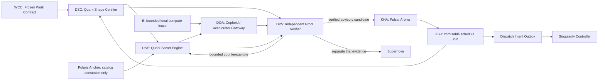

# GALAXY R3: Quark Portfolio R2 Qualified Solver Topology

> **Date:** 2026-07-14 (revision pass; supersedes the 2026-07-13 freeze)
>
> **Status:** frozen target architecture; runtime implementation remains deferred
>
> **Parents:** [GALAXY Revision 3](2026-07-14-galaxy-r3-design.md) and [Target Capability Topology](2026-07-14-galaxy-r3-qualified-capability-topology.md)
>
> **Scheduler companion:** [Pulsar R1](2026-07-14-galaxy-r3-pulsar-r1-qualified-topology.md)

## 1. Freeze decision

Quark Portfolio R2 is the proof-carrying deterministic solver substrate beneath Pulsar. It turns advanced competitive-programming algorithms into shape-certified, oracle-checked, bounded backends rather than topology decoration.

Quark adds exactly **4 purpose-distinct nodes and 12 unique typed edges**. Together with Pulsar:

| Layer | Added nodes | Added edges | Cumulative nodes | Cumulative edges |
|---|---:|---:|---:|---:|
| Existing GALAXY R3 core | - | - | 108 | 170 |
| Pulsar R1 | 19 | 68 | 127 | 238 |
| Quark Portfolio R2 | 4 | 12 | **131** | **250** |
| Disabled Voyager boundary | 3 | 6 | **134** | **256** |

The 4 Quark nodes are exactly `DSC, DSE, DOA, DPV` (§4); the 12 edges are
exactly `QK01`–`QK12` (§6). A linter must confirm 4 rows and 12 rows, each edge
with at least one Quark endpoint and no ordered pair shared with `PU01`–`PU68`.
Inherited IDs used below are defined in the parent design and annexes, not here:
`WCC/KSJ/KHA/DIO` (Pulsar), `OA` Polaris Anchor, `B` capacity ledger, `K` Singularity
controller, `CR` Supernova, `E` evidence graph, `VI` universal verifier, `SEG`
scheduling eligibility gate, `R` capability router, `PA` protected outcomes.

In this frozen architecture snapshot all four nodes are `specified`. Algorithms,
data structures, test generators, numerical kernels, and codenamed backends do
not count as additional nodes. Source maturity is immutable within one committed
manifest generation and may advance only with reviewed source evidence plus a
new generated manifest. It cannot make a backend eligible: qualification and
live activation are distinct OA-owned runtime-overlay states backed by
externally persisted receipts.

Quark uses immutable overlay-set scope `daedalus.portfolio.r2`. A pre-switch
qualification activation root binds the exact dark LKG, qualification catalog,
and rehearsal bundle, keeps eligible/active DA scopes empty, and has no live
scheduler parent. A qualification root may receive only a constrained
pre-expiry successor that preserves its catalog, passport, algorithm, scopes,
route, controller, evidence, budgets, rollback, and absence of a scheduler
parent. Expiry, revocation, or changed qualification content requires an
externally CAS-created fresh `qualification_only` root; the predecessor may be
an absent/terminal qualification root or an exact terminal live root, but the
new root is never P4 and no old artifact follows it. P4 creates a fresh live activation root—not a renewal
of the qualification root—from the exact current, unexpired, unrevoked
qualification root and retires that predecessor atomically while CAS-advancing
only the Quark scope. The live root binds
the immutable `khronos.scheduler.r1` activation root as a mandatory parent and
validates its current leaf; it never replaces the scheduler scope. A valid
Pulsar renewal or unrelated overlay-set update does not stale Quark, but
parent-root replacement, authority drift, lineage break, expiry, or revocation
makes the live Quark scope and every QK11 artifact inert.

## 2. Governing rule: proof before sophistication

An algorithm is eligible only when the problem shape that makes it correct has been proved, its numeric domain is exact and bounded, its result carries a checkable witness, and a simpler independent oracle agrees.

Quark never asks, “Which impressive algorithm can we use?” It asks:

1. What exact mathematical object and operation regime exists?
2. Which preconditions have machine-checkable proofs?
3. What is the simplest exact reference?
4. Which candidate has a sound witness and deterministic fallback?
5. At what measured workload does the candidate beat the reference end to end?

Sampling, model confidence, a benchmark on unrelated synthetic input, or an algorithm name is not a shape proof.

## 3. Authority boundary and flow



Quark has no edge to DIO, execution, mutation, effects, repository terminal truth, or policy activation. `DPV -> KHA` supplies a stale-able advisory candidate. KHA and the Singularity transaction coordinator still revalidate current feasibility, policy, capacity, revision, and fences.

The existing Singularity coordinator is the only authoritative persistence join for
QK01-QK10. Solver work occurs outside its writer transaction under immutable
cuts and B leases; the coordinator atomically records artifact references,
single-use retry-credit redemption, attempt-chain monotonicity, reservations,
and final dispositions. No Quark node writes KSJ or the scheduler database,
and no ad hoc adapter may bypass the coordinator merely because the solver path
is advisory.

Existing `OA` is the OS-installed Polaris Anchor. On `OA -> DSE`, it carries only
a protected reference to an externally sealed `qualification_only` or
`live_eligible` algorithm-catalog generation. It never supplies task utility,
chooses an algorithm, edits a solver candidate, or acts as an optimization
oracle.

## 4. Structural target node ledger

All contracts below are version `daedalus.r2.v1` and begin with source
implementation maturity `specified`.

| ID | Node | Contract and lifecycle | Authority ceiling and failure terminal |
|---|---|---|---|
| `DSC` | Quark Shape Certifier | Deterministic, stateless join of one frozen WorkContract and one immutable KSJ cut. Emits proved shape facts, bounds, numeric semantics, and unresolved assumptions. | Certifies problem shape only. Cannot select an algorithm, run code, verify implementation correctness, schedule, reserve, or dispatch. Unproved mandatory fact -> `uncertified`. |
| `DSE` | Quark Solver Engine | Stateless proposal transform. Selects an algorithm eligible under the exact `qualification_only` or `live_eligible` mode, composes a bounded algorithm DAG/closed IR, declares complexity and memory ceilings, and emits a proof-carrying candidate. | Cannot execute, verify itself, reserve, persist scheduling state, or dispatch. No mode-eligible catalog entry -> `no_candidate`. |
| `DOA` | Quark Cepheid and Accelerator Gateway | Sole bounded local-compute boundary for exact reference oracles, candidate kernels, accelerator equivalence, and resource probes. A fixed digest-pinned worker entrypoint runs out of process behind a closed IPC protocol under an expiring B-supervised local-compute lease with B-owned idempotent terminal disposition. | Cannot run a caller-supplied/in-process callable, change the problem/candidate, assert capacity release, issue a correctness verdict, use provider capacity, access network/credentials/repository/controller memory, install packages, or promote a backend. Failure -> bounded evidence plus B release convergence, or `unavailable`; fallback requires a fresh lease. |
| `DPV` | Quark Proof Verifier | Independently implemented deterministic join of shape, candidate, and separately delivered oracle/accelerator evidence. Recomputes mandatory invariants through a distinct parser, reduction, dependency set, encoding, and version digest, and emits an attestation, counterexample, or unavailable verdict. | Cannot waive a precondition, choose based on speed alone, dispatch, or promote. Disagreement/unknown -> reject or unavailable. |

### 4.1 Distinctness from existing GALAXY identities

- `DPV` checks optimization witnesses; existing `VI` verifies a repository revision.
- `DSE` proposes a deterministic solver; existing `KHA` chooses live work and `R` maps provider modes.
- `DOA` runs bounded solver kernels; existing controller `K` runs authorized work.
- `DSC` proves algorithm preconditions; existing `SEG` proves live scheduling eligibility.

## 5. Inherited artifact envelope

Every Quark artifact is closed-schema, canonical-encoded, immutable, content addressed, and append only:

```text
schema_id
schema_version
artifact_digest
run_id
repository_id
work_contract_digest
journal_cut_digest
producer_node_id
producer_contract_digest
causal_parent_digests[]
authority_class
provenance_closure_digest
idempotency_key
catalog_state?
catalog_generation?
graph_warrant_digest?
graph_warrant_revocation_generation?
created_at_utc
expires_at
```

Unknown schema versions, fields, parents, predicates, algorithms, backends, proof classes, numeric domains, or catalog generations fail closed. Default payload ceiling is 256 KiB; larger fixtures and traces are content-addressed artifacts with bounded manifests. Every edge ablation key equals its edge ID.

## 6. Exact Quark edge ledger: 12

Every QK01-QK12 row has source implementation maturity `specified`. No source
edge field, manifest row, or generated mirror supplies runtime qualification,
eligibility, or activation; those exist only in the external OA-owned overlay.

| ID | Source -> target | Closed payload | Guard and authority ceiling |
|---|---|---|---|
| `QK01` | `WCC -> DSC` | `FrozenSolverProblem` | Exact WorkContract digest, objective order, hard constraints, bounds, and required witness. |
| `QK02` | `KSJ -> DSC` | `ImmutableScheduleCut` | Same run/work/revision as QK01 plus a host-global `CohortCompletenessCertificate`; no mutable table reads during solve. Missing/unknown exclusion proof makes the cohort uncertified. |
| `QK03` | `DSC -> DSE` | `ShapeCertificate` | Only machine-proved facts count as certified; assumptions remain explicit. |
| `QK04` | `OA -> DSE` | `SealedAlgorithmCatalogAttestationRef` | Exact `qualification_only \| live_eligible` state, catalog generation/signature/expiry/revocation, and implementation/runtime digest only; no objective, score, or per-task algorithm choice. |
| `QK05` | `DSE -> DOA` | `OracleAcceleratorRequest` | Closed mode union and pinned kernel/IR; no caller-supplied executable or path. |
| `QK06` | `B -> DOA` | `BoundedLocalSolverComputeLease` | Closed B-owned lifecycle: grant plus create-or-return terminal `SolverLeaseDispositionReceipt`; CPU/RAM/process/deadline, deterministic expiry, and idempotent release key only. No Claude/Codex/provider or work-execution authority. |
| `QK07` | `DSE -> DPV` | `ProofCarryingSolverCandidate` | Candidate and claims are immutable; producer cannot observe verifier internals. |
| `QK08` | `DSC -> DPV` | `ShapeCertificateRef` | Independent provenance path; DSE cannot forge or replace it. |
| `QK09` | `DOA -> DPV` | `OracleAcceleratorEvidence` | Exact request/candidate/input/runtime dependency digests plus a terminal lease release/expiry-convergence receipt. |
| `QK10` | `DPV -> DSE` | `SolverCounterexample` | DPV issues a candidate- and parent-bound single-use retry credit. The Singularity coordinator atomically redeems its idempotency key and records a monotone attempt chain: maximum three total attempts, strictly decreasing compute budget, stale-parent rejection, and same-semantic-digest stop. DSE cannot redeem or persist credit itself. |
| `QK11` | `DPV -> KHA` | `AttestedScheduleCandidate` | Closed `certified_candidate \| no_certified_candidate \| unavailable`; DPV emission and KHA admission each freshly resolve together the current live-cutover head (`scheduler_authority_switched` or `projection_enabled`) and the unique immutable `scheduler_authority_switched` anchor in its ancestry; the switch-bound `khronos.scheduler.r1` activation root and its unique current valid leaf; the current dependency-closed `daedalus.portfolio.r2` live root and leaf referencing that parent root; and the current/unexpired/unrevoked matching P4 `live_eligible` catalog attestation and workload-scoped GraphWarrant under one `activation_binding_digest` and external join receipt. A recovery/unknown head, root replacement, lineage gap, global-set-cursor assumption, or any binding drift makes the artifact inert. The resulting candidate remains stale-able advisory input to KHA. `qualification_only` and `integration_shadow` output is structurally rejected. |
| `QK12` | `DPV -> CR` | `SolverTrialEvidence` | Separate Supernova experiment/outcome epoch under `qualification_only`; no current-run effect and no conversion into QK11. |

The 12 ordered pairs are unique, have no pair in common with PU01-PU68, and each has at least one Quark endpoint.

## 7. ShapeCertificate

```text
problem_digest
journal_cut_digest
cohort_completeness_certificate_digest
shape_claims[]:
  predicate_id
  subject_ref
  typed_parameters
  truth_value
  proof_kind
  witness_digest
  checker_id
  checker_version
size_bounds
operation_regime
algebraic_domain
numeric_semantics
resource_bounds
required_output_witness
risk_policy
unproven_assumptions[]
certificate_digest
```

Permitted proof kinds are `syntactic`, `constructive_witness`, `exact_reduction`, and `exhaustive`. A sampled, heuristic, model-inferred, or benchmark-inferred property goes only in `unproven_assumptions`.

The predicate vocabulary includes:

- static/dynamic and online/offline operation regimes;
- directed/undirected, DAG, forest, cactus, bipartite, planar-with-embedding, and bounded-treewidth shape;
- size, density, universe, alphabet, capacity, bit-width, update/query, and memory bounds;
- nonnegative, integer, binary, bounded-integer, exact fixed-point, or modular numeric domains;
- Monge, total monotonicity, quadrangle inequality, convexity, submodularity, associativity, invertibility, and monotone-optima facts;
- additive/separable objective, independence system, 2-CNF, flow integrality, and residual-cost facts;
- exact, probabilistic-with-bound, approximate, or advisory result class.

NaN, infinity, floating EPS comparisons, unknown-as-zero, and unbounded integer packing are ineligible for scheduling authority.

## 8. Sealed algorithm catalog, qualification, and passport

Every algorithm/backend version has an immutable `AlgorithmPassport`:

```text
algorithm_id
algorithm_version
source_commit_and_artifact_digests
license_evidence
family
required_shape_predicates[]
forbidden_shape_predicates[]
numeric_domain
complexity_expression
memory_expression
exactness_class
failure_probability_bound?
witness_contract
closed_ir_templates[]
eligible_backends[]
reference_oracle
deterministic_fallback
adversarial_fixture_set
crossover_workload_buckets
```

Brownfield source is evidence, not authority. Contest code is never copied into the trusted kernel without license verification, normalization, bounded contracts, independent reimplementation/review, differential tests, and a pinned passport.

The source-tree passport is build input only. The external Polaris Anchor creates
a separate protected entry:

```text
passport_digest
implementation_runtime_digest
dependency_build_receipt_digest
catalog_generation
catalog_state: qualification_only | live_eligible
activation_generation
revocation_generation
issued_at
expires_at
issuer_signature
```

It emits a signed, expiring attestation over that content-addressed entry and the
exact passport bytes. Runtime state is therefore never edited into the passport.
`qualification_only` authorizes bounded LabBaseline/Supernova trials through DOA
but can never emit QK11 or reach KHA. Only P4 may produce `live_eligible`, and
each live invocation still requires a fresh workload-scoped GraphWarrant match.

An activation root fixes the immutable catalog content entry, passport,
algorithm/version, runtime/dependency digests, catalog state, authority sets,
and parent roots. If its declared renewal policy permits renewal before expiry,
OA atomically issues the state-specific successor warrant, catalog attestation,
overlay leaf, and activation/join receipt from one derived
`activation_binding_digest`. Catalog content and every authority-bearing field
remain byte-identical; only permitted lifetime/nonce/renewal/revocation cursors
and monotone leaf/attestation generations advance. Qualification renewal and
live renewal are distinct closed operations. Partial renewal, post-expiry
revival, branching, or changed semantic content is inert. An expired/revoked
qualification lineage or changed qualification algorithm/passport/catalog
requires a fresh externally CAS-created `qualification_only` root with current
dark-LKG, rehearsal, sealed source/passport/fixture/budget/authority evidence,
and a preregistered P0-P3 protocol; it cannot depend on the Q-root-bound trial
evidence it exists to authorize. An expired/revoked live lineage must likewise
CAS first into a fresh `qualification_only` root, rerun the required Q-root-bound
P0-P3 and integration-shadow evidence, and only then enter P4 from that current
qualification root. Direct terminal-live -> live reactivation is forbidden.
Neither path revives or widens its terminal predecessor.

`integration_shadow` is a closed execution-route mode, not a third catalog
state. It consumes only a `qualification_only` catalog generation, routes
QK01-QK10 through the real coordinator under the exact rehearsal receipt, and
may then emit external shadow/trial evidence only through QK12; QK11 remains
closed. It cannot create an unledgered edge, serialize as `live_eligible`, or
reach KHA.

Real `integration_shadow` also requires an externally OA/admin-issued,
expiring governing GraphWarrant with
`authority_ceiling=qualification_only` and `route_mode=integration_shadow`.
Its canonical activation proposal binds the exact LKG, rehearsal bundle,
qualification catalog content, dependency-closed Quark qualified-scope
overlay, and explicitly empty eligible/active DA scopes. The issued warrant,
catalog and overlay attestations, and final join receipt share that
`activation_binding_digest` without circular hashes. LabBaseline and Supernova
may supply evidence/recommendation but cannot issue it. Developer fixtures that
have no external qualification warrant remain diagnostics and cannot create a
runtime-qualified overlay or traverse the real coordinator.

Before expiry, a qualification successor preserves the exact catalog content,
passport, algorithm, qualified set, empty eligible/active sets,
`integration_shadow` route, controller/contracts, evidence, budgets, rollback,
and no-scheduler-parent relation. Only its permitted lifetime and monotone
lineage cursors advance through the directional proposal -> warrant ->
attestation/leaf -> final-join chain. Renewal at or after expiry, after
revocation, or with changed content is rejected. A fresh qualification root
must instead CAS from the exact inert terminal predecessor using fresh evidence;
all predecessor warrants, leaves, receipts, and routed artifacts remain inert.
Qualification issuance evidence is limited to the current dark LKG, rehearsal,
sealed source/passport/fixture/budget/authority facts, and the preregistered
trial protocol. The bounded P0-P3 and integration-shadow results are produced
after issuance, bind that exact qualification root, and must be rerun after any
fresh qualification root; no evidence receipt may both depend on and authorize
the same root.

Eligibility uses exact tri-state `PredicateBinding` values over predicate ID,
subject, typed parameters, certified truth value, witness, checker ID/version,
and certificate digest. Every required predicate must be certified `true` and
every forbidden predicate certified `false`; missing, unknown, differently
parameterized, or merely absent facts are ineligible. When multiple passports
match, DSE uses one catalog-pinned total order over exactness class, measured
eligible crossover bucket, declared resource bound, algorithm ID, and version;
generation or discovery order is never a tie-break.

## 9. Solver candidate and verifier contract

### 9.1 ProofCarryingSolverCandidate

```text
problem_digest
journal_cut_digest
shape_certificate_digest
catalog_attestation_digest
algorithm_dag
precondition_bindings[]
closed_ir_digest
kernel_artifact_digests[]
numeric_and_overflow_policy
determinism_and_seed_policy
claimed_time_bound
claimed_memory_bound
output_witness_contract
verification_obligations[]
fallback_chain[]
attempt_number
candidate_digest
```

Every required AlgorithmPassport precondition binds to a specific certified
ShapeCertificate predicate. WorkContract assumptions are recorded for audit and
may narrow eligibility, but no assumption—typed or free text—can satisfy a
required predicate, discharge a proof obligation, or select an algorithm.

### 9.2 DOA request modes

```text
exact_oracle
candidate_execution
accelerator_equivalence
resource_probe
```

Every request binds candidate/problem/shape digests, deterministic seed, reference oracle, backend allowlist, exact numeric policy, CPU/RAM/process/output/deadline limits, B lease, fixed worker/runtime digest, closed IPC schema, and sandbox profile.

DOA permits no shell, arbitrary path, URI, network, dynamic package installation,
ambient credentials, caller-supplied executable/callable, controller import, or
unpinned import. Only a sealed worker maps a closed kernel ID or validated closed
IR to a digest-pinned implementation. B creates, registers, fences, supervises,
kills, and reconciles the process/job subtree and enforces CPU, RAM, process,
deadline, output, filesystem, network, and credential isolation. Any fallback is
a new request with a new B lease, fence, and receipt; it cannot reuse a failed or
unknown lease.

Every DOA lease binds `lease_id`, request/candidate digests, resource vector,
boot identity, monotone fence, absolute expiry, and idempotent release key. B
owns and supervises the registered DOA process subtree. Through the existing
QK06 lifecycle, B create-or-returns the terminal
`SolverLeaseDispositionReceipt` after successful evidence production, solver
failure, timeout, cancellation, or reconciled process loss; DOA never asserts
its own capacity release. QK09 cannot be emitted until it references that
B-owned receipt, so a later verifier rejection cannot leak compute capacity. B
expiry is the liveness backstop; expiry never converts an unknown live process
into reusable capacity without fenced process reconciliation. Unknown terminal
disposition keeps capacity unavailable and blocks QK09.

### 9.3 SolverAttestation

```text
candidate_digest
shape_certificate_digest
oracle_evidence_digests[]
verified_claims[]
proof_classes[]
valid_input_domain
verified_time_and_memory_bounds
unresolved_assumptions[]
risk_bound
verdict
counterexample_digest?
verifier_contract_digest
attestation_digest
```

Acceptance requires zero unresolved mandatory assumptions, every precondition
bound, exact witness validation, and resource bounds inside contract. A
probabilistic method may propose an allocation or ordering candidate only. DPV
must deterministically re-evaluate every solver-encoded hard predicate and the
complete candidate allocation witness against the frozen input before KHA can
observe it. SEG and the Singularity coordinator still revalidate live Pulsar
predicates and create the final capacity/resource reservation. A risk allowance
may qualify an explicitly advisory objective claim; it can never waive safety,
authority, cost, scope, effect, resource, deadline, or fencing predicates.
Cepheid disagreement rejects; it is never resolved by model or majority vote.

### 9.4 Verifier independence contract

DPV and DSE/DOA may share only declarative canonical schema declarations and
primitive cryptographic/hash routines. They may not share an envelope parser,
normalizer, or validation helper. DPV has a separately implemented parser,
normalizer, problem encoding, reduction path, invariant checker, dependency
lock, build artifact, and version digest. It must not import the candidate
solver's critical transform, residual graph builder, tie-break encoder, or
witness parser. The attestation records both provenance closures so correlated
implementation is machine-detectable. Cepheid-0 is a third, structurally
distinct enumeration path used for differential verification whenever its
ShapeCertificate domain holds.

Each algorithm family has a verifier-owned backend and corruption suite. The
DPV build carries its own dependency lock and externally verified build receipt;
sharing a process environment, parser, reduction helper, dependency closure, or
candidate backend invalidates independence rather than downgrading it to a
warning.

## 10. Exact reference for a certified small cohort

The current single-run configuration seam exposes `MAX_SUBTASKS = 8`, but that
is neither a host-global concurrency bound nor evidence that the simultaneously
ready cohort can never exceed eight across repositories/runs. Cepheid-0 is
eligible only when DSC proves from the actual immutable KSJ cohort that
`J <= 8`, the exact atomic-seat universe has `K <= 3`, and all interaction and
numeric predicates used by the enumeration are closed. The bound applies to the
complete certified decision cohort, not an arbitrary first-eight window: QK02
must prove every excluded host-global item is ineligible or cannot outrank,
conflict with, or change the resources/fairness/deadline of the cohort.

For actual certified `J,K`, homogeneous seats have the complete subset universe:

```text
N_hom(J,K) = sum(k=0..min(J,K)) C(J,k)
```

For `K` distinct labeled seats that may each be idle, the complete
partial-injection universe is:

```text
N_lab(J,K) = sum(k=0..min(J,K)) C(K,k) P(J,k)
```

`93` and `529` are the respective maxima at exactly `J = 8`, `K = 3`; a
smaller certified cohort enumerates its actual smaller universe and records the
formula inputs, count, and hash.

Worked check for an implementer's enumerator at `J = 8, K = 3`:
`N_hom = C(8,0)+C(8,1)+C(8,2)+C(8,3) = 1+8+28+56 = 93`;
`N_lab = 1 + C(3,1)P(8,1) + C(3,2)P(8,2) + C(3,3)P(8,3) = 1+24+168+336 = 529`.
An enumerator that produces any other count for this bound is incorrect and must
fail rather than truncate.

`Cepheid-0` exhaustively evaluates this universe using exact integer feasibility
and a deterministic lexicographic objective. It emits the universe count/hash,
every rejection reason, selected assignment, and tie-break witness. It remains
the permanent differential oracle within this ShapeCertificate-bounded domain.

This is exact for the sealed compiled scheduling surrogate and hard constraints.
It is not a claim to know objectively optimal future productivity. Outside the
certified small domain, DSE routes to a shape-qualified exact solver or a
canonical deterministic branch-and-bound baseline that must finish exhaustive
proof within its lease. If neither returns a proof, Quark emits
`no_certified_candidate` and KHA uses its simpler deterministic base policy; it
never truncates Cepheid-0 and calls the prefix exact.

## 11. Exact placement reduction and directed SSSP

The 2025 sorting-barrier result has one justified scheduler use: repeated directed SSSP inside a shape-certified successive-shortest-path min-cost-flow solver for already-feasible job-to-atomic-seat assignment.

Let:

- `J` be jobs that already satisfy all Pulsar hard predicates;
- `S` be mutually exclusive atomic seat types with integer capacities `c_s`;
- `K = sum_s c_s`;
- `U(j,s)` be exact bounded integer utility after lexicographic constraints have been safely compiled;
- `M_s >= max(0, max_j U(j,s))` be a verified bound.

Construct:

```text
source -> job_j    capacity 1, cost 0
job_j -> seat_s    capacity 1, cost M_s - U(j,s)
source -> idle     capacity K, cost 0
idle -> seat_s     capacity c_s, cost M_s
seat_s -> sink     capacity c_s, cost 0
```

Only eligible job-seat pairs receive an edge. Send exactly `K` flow units. Every unused seat is filled through `idle`, so total cost is:

```text
sum_s(c_s * M_s) - sum_selected U(j,s)
```

Minimizing cost therefore maximizes admitted utility exactly only for this
certified separable network. Multi-resource feasibility, authority, effect
safety, zero-cost status, and deadline feasibility must already have been
compiled into job-seat eligibility or disjoint concrete capacity tokens.

The identity is exact by conservation: every seat `s` receives exactly `c_s`
units to sink, so its contribution is `c_s * M_s - sum_{selected j at s} U(j,s)`
whether a unit arrives from a job or from `idle`; summing over seats gives the
formula above with the `M_s` terms constant. This holds only while seats are
mutually disjoint concrete bundles, so: Generic
cross-job conflict edges cannot be prefiltered independently into one MCF; they
require Cepheid-0/branch-and-bound enumeration of conflict-free bundles or
another proved reduction. Composite seats must be mutually disjoint concrete
resource bundles. Overlapping composite resource types, pairwise mutation/effect
conflicts, or any interaction left outside the reduction invalidate the network.

Lexicographic utility is compiled only when every lower-order range has a proved finite bound and each mixed-radix unit dominates the maximum total lower-order contribution. Otherwise DSE performs sequential constrained optimization. An ad hoc big-M constant is inadmissible.

### 11.1 Reduced-cost invariant

Residual reverse edges may have negative original costs. Quark maintains potentials:

```text
reduced_cost(u,v) = residual_cost(u,v) + pi(u) - pi(v) >= 0
```

After an SSSP call, let `R` be the source-reachable residual vertices and:

```text
D = max(d(v) for v in R)
d_hat(v) = d(v) if v in R else D
pi'(v) = pi(v) + d_hat(v)
```

This extension prevents an unreachable-to-reachable residual edge from becoming
negative when reachable potentials increase. A passport may instead use the
simpler reachable-only update only after proving every residual vertex is
source-reachable. DPV checks capacity, conservation, fixed flow, recomputed
objective, every residual edge's final reduced cost, deterministic tie-break,
and the primal/dual optimality witness; it claims a global dual certificate only
when every residual reduced cost is nonnegative.

The initial potential is zero only because the construction proves every forward cost nonnegative. Any future reduction with negative initial edges requires a separately certified initialization and is not covered by this passport.

### 11.2 Backend policy

- 0-1 BFS for certified binary reduced costs.
- Dial buckets for certified small bounded integer reduced costs.
- Radix heap only for a proved machine-width monotone integer regime.
- Indexed heap Dijkstra as the target exact reference and fallback for each qualified SSSP instance.
- The 2025 BMSSP algorithm as a research/differential backend.
- The 2026 faster directed SSSP result as a later large-sparse promotion candidate.
- Hungarian, cost scaling, network simplex, or other flow kernels only when their certified regime and measured crossover dominate.

[Duan et al. 2025](https://arxiv.org/abs/2504.17033) proves deterministic `O(m log^(2/3) n)` SSSP for directed graphs with real non-negative weights in the comparison-addition model. [Duan et al. 2026](https://arxiv.org/abs/2602.07868) gives `O(m sqrt(log n) + sqrt(m n log n log log n))`, specializing to `O(m sqrt(log n log log n))` on sparse graphs.

Neither paper proves dynamic SSSP across residual augmentations. Quark rebuilds the frontier after every augmentation. “Forest-BMSSP” is an internal experimental nickname, not a paper title or production capability claim.

For a ShapeCertificate-proved `J <= 8`, `K <= 3` cohort, Dijkstra/Cepheid-0 will almost certainly dominate engineering and wall-clock cost. The theoretical breakthrough is preserved as a research future-backend candidate, not mislabeled qualified or forced into a tiny queue.

## 12. Portfolio R2 algorithm ledger

Every status below is a frozen **target role**, not a runtime claim. All four
Quark nodes and every backend remain `specified`. Qualification may create a
`qualification_only` external catalog entry for an exact implementation
generation; it does not alter source topology state and cannot make QK11 live.

| Mechanism | Frozen status | Certified use and proof obligation |
|---|---|---|
| Cepheid-0 exhaustive assignment | `TARGET_EXACT_REFERENCE` | ShapeCertificate proves `J <= 8`, `K <= 3`; enumerate the exact `N_hom(J,K)` or `N_lab(J,K)` universe, with maxima 93/529 only at 8/3. Never retire as the differential oracle within that bounded domain. |
| Python-int feasibility/conflict bitsets | `TARGET_EXACT` | Unary predicates become masks; pairwise exclusions remain adjacency checks. Scalar-oracle equality and reason masks required. |
| Tarjan SCC condensation plus bitset closure | `TARGET_EXACT_GATED_CACHE` | Immutable directed graph revision and repeated reachability workload. Rebuild on revision; direct dependency status still controls readiness. |
| Dominator analysis | `TARGET_EXACT_OFFLINE_CONDITIONAL` | Distinguished root and valid control/alternative-path semantics. Not a readiness oracle for an AND-dependency DAG. |
| Sound Pareto/dominance pruning | `TARGET_EXACT_GATED_PREPROCESSOR` | A candidate dominates another only with no-worse resource/objective dimensions, eligibility superset, identical fairness semantics, and no extra conflicts/effects. Emit a witness. |
| Johnson-potential successive-shortest-path MCF | `TARGET_EXACT_GATED_SOLVER` | Fixed-value integral bipartite job/atomic-seat network with separable utility and no residual pair interactions. DPV verifies primal and dual invariants. |
| 0-1 BFS, Dial, radix heap, Dijkstra | `TARGET_EXACT_INTERNAL_DISPATCH` | Chosen only from a proved reduced-cost numeric domain. Any negative reduced edge rejects the result. |
| Hopcroft-Karp | `TARGET_EXACT_GATED_FEASIBILITY` | Unweighted bipartite cardinality only. Emit matching plus cover/deficiency witness; never claim weighted optimality. |
| Hungarian | `TARGET_EXACT_SHAPE_SPECIALIZATION` | Dense one-job/one-seat additive assignment without grouped capacities or coupled reservations; dual-label certificate required. |
| Maximum-weight closure/min-cut | `TARGET_EXACT_OFFLINE_CONDITIONAL` | Additive weights and implication closure only. Arbitrary conflicts invalidate pure closure unless exactly reduced. |
| Meet-in-the-middle, subset DP, bitset DP, bounded SOS | `TARGET_EXACT_GATED_SOLVER` | Finite small dimensions and genuinely subset-decomposable objective. At `K=3`, direct enumeration wins. |
| Segment-tree-over-time plus rollback DSU | `TARGET_EXACT_OFFLINE_LAB` | Complete undirected edge lifetimes over a sealed timeline. Connectivity does not prove pairwise independence or directed causality. |
| 2-SAT via SCC | `TARGET_EXACT_OFFLINE_VERIFIER` | Complete 2-CNF constraints only; emit assignment or mutually reachable contradiction paths. |
| Finite-state retrograde safety game | `TARGET_EXACT_RELATIVE_TO_ABSTRACTION` | A winning strategy supports system-level safety only with an explicit abstraction relation, initial-state mapping, total strategy, inductive invariant, and alternating-simulation proof under environment over-approximation/controller under-approximation. Abstract losses require concrete replay. |
| Constrained de Bruijn/event-order campaign | `TARGET_CONDITIONAL_SYNTACTIC_COVERAGE` | Exact `q^k` window coverage only for an unconstrained alphabet. A constrained campaign is exact only with a proved universal cycle over the legal-window graph or independent enumeration/observation of every declared legal target from a valid reset; otherwise report measured coverage and gaps. |
| 2025 BMSSP | `RESEARCH_EXACT_NOT_ELIGIBLE` | Nonnegative directed SSSP; distance/objective equality with Dijkstra and held-out real-graph crossover required. A predecessor must either follow the contract's canonical tie-break or carry an independently valid shortest-path witness. No dynamic reuse. |
| 2026 faster directed SSSP | `RESEARCH_EXACT_NOT_ELIGIBLE` | Same gate as BMSSP; large sparse candidate only. |
| NumPy, Numba, or future native kernel | `DOA_ACCELERATOR_ONLY` | Flat bounded arrays, no overflow, deterministic warm cache, exact oracle equality, cold/warm accounting, and immediate Python fallback. |
| Beam search, annealing, hill climbing | `ADVISORY_ONLY` | Large NP-hard instance after exact budget exhaustion. Candidate generation only; DPV deterministically verifies every solver-encoded hard predicate and the complete candidate allocation witness, then the Singularity coordinator revalidates live issuance predicates. Optimality is never claimed. |
| Persistent, wavelet, Mo/Hilbert, fractional-cascading indexes | `DORMANT_ANALYTICS` | Repeated immutable historical range-query workload must beat SQLite/bisect/scan end to end. Never scheduling authority. |
| Segment-tree beats, kinetic tournaments, vEB/X/Y/fusion trees | `DORMANT_SHAPE_CANDIDATE` | Requires the exact update/query algebra and measured scale. Plain heaps/sorted intervals remain default. |
| Dynamic-tree machinery, Blossom/SPQR, FFT/FPS, advanced number theory, geometry, string, counting, and game-theory families | `CAPABILITY_RESERVE_OUTSIDE_KHRONOS` | No current scheduler predicate fits. A future consumer needs a new proved model and full admission campaign; these do not become topology nodes. |

## 13. Strong combinations retained by the freeze

### 13.1 Dominator-aware criticality

SCC condensation identifies cyclic dependency units; bitset closure answers repeated reachability; dominators identify unavoidable control/recovery bottlenecks; CPS supplies latency and slack. The combination protects structurally irreplaceable paths without confusing dominators with ordinary AND-dependency readiness.

### 13.2 Bitset-to-flow pipeline

Python-int masks remove unary-ineligible job-seat pairs. Adjacency masks expose
cross-job conflicts to Cepheid-0, exact branch-and-bound, or another
shape-certified conflict-aware solver; they do not magically remove those
interactions before a single MCF. Sound dominance pruning may shrink the graph,
and the adaptive exact portfolio solves only the residue matching its proved
shape. Each stage emits a witness and may be disabled independently.

### 13.3 Temporal counterfactual replay

Content-addressed journal checkpoints and event deltas support branchable laboratory worlds. Segment-tree-over-time plus rollback DSU accelerates only sealed undirected temporal-connectivity questions. Directed reachability uses SCC/DAG methods. Live authority never reads a counterfactual branch.

### 13.4 Adversarial recovery synthesis

Red/Orange Teams and Supernova generate bounded failure/event schedules. A DSE
safety-game backend computes a winning region or counterstrategy; DPV verifies
the certificate. A winning abstract strategy supports system-level safety only
with an explicit abstraction relation, initial-state mapping, total strategy,
inductive invariant, and alternating-simulation proof. An abstract losing trace
is only a candidate counterexample until concretized and replayed; environment
over-approximation may create spurious losses. The environment chooses failures,
while the controller chooses only already-authorized drain, fence, retry, or
contain actions.

### 13.5 Proof-carrying dispatch

Every solver result binds shape proof, catalog generation/state, exact numeric
domain, complexity/memory ceiling, output witness, deterministic fallback,
oracle evidence, activation/revocation generation, and—when offered to
QK11/KHA—the current scoped GraphWarrant. A fast result without this envelope is
unusable.

## 14. Internal names, not nodes

| Name | Placement |
|---|---|
| Quark Arsenal | The activated algorithm/backend catalog inside DSE/DOA. |
| Ephemeris | B-internal capacity-calendar backend. |
| Transit | Dormant kinetic-priority backend; ordinary event recomputation remains default. |
| Worldline | Segment-tree-over-time plus rollback-DSU replay backend. |
| Lagrange | Finite safety-game backend inside DSE/DPV. |
| Roche | Adversarial event-order generator reused by Red/Orange/Supernova. |
| Everett | Content-addressed persistent counterfactual state inside Supernova/CFR/WOC/WRR. |
| Orbit | Dormant hierarchical-timing-wheel backend for Pulsar's wakeup path (§14.1). |
| Parallax | Dormant second independent exact assignment oracle inside DOA (§14.1). |

KAI, ASF, CTT, and MSV do not earn separate topology nodes in R2. Their proposed responsibilities are already contained by Pulsar/TWS/B, Red/Orange, CFR/WOC/WRR/Supernova, and DSE/DPV.

### 14.1 R3 candidate additions

Both entries below are **dormant candidates at P0**, not activations. Each is
admitted to the catalog only because it resolves a bottleneck this package names
explicitly; neither may run in any live path before completing P0–P4, and the
`>= 20%` measured-need gate at P2 applies unchanged. They add no node and no
edge. An implementing agent that activates either without its oracle evidence has
violated the governing rule.

**Orbit — hierarchical timing wheel.**

- *Named bottleneck:* Pulsar's wakeup path is a bounded rescan governed by the
  protected `max_late_wakeup_ms` constant, which this freeze leaves unassigned.
  A naive scan is `O(n)` per tick in outstanding timers; a heap is `O(log n)` per
  operation. Varghese & Lauck's wheel is `O(1)` to start, stop, and per-tick
  maintain within the wheel's range, with hierarchical wheels extending the range
  at `O(m)` start cost for `m` levels. Kafka's request purgatory is the
  best-known production instance.
- *Shape obligations (P0):* an exact bound on outstanding timers and on wheel
  memory; a fixed tick quantum and level geometry declared as protected
  constants; integer-only tick arithmetic with no floating point; and a
  deterministic fallback to the current bounded rescan on any overflow of the
  declared range.
- *Oracle (P1):* differential equality against the naive rescan over exhaustive
  small schedules and replayed production traces — identical fire order and
  identical virtual-time firing tick, not merely identical sets. Ties must break
  deterministically under the existing total order.
- *Interaction with §15.1:* the wheel is driven by virtual time in the DST
  harness, so a wheel that fires late or out of order under clock jump or
  backward time is caught by seed replay rather than in production.

**Parallax — second independent exact assignment oracle.**

- *Named gap:* Cepheid-0 is exhaustive and is therefore the permanent oracle
  **only** for the certified cohort at `J <= 8`, `K <= 3` (universe maxima
  `93 / 529`). Outside that cohort the package currently has no exact reference,
  so a differential test beyond `J = 8` has nothing to disagree with. Meanwhile
  the placement reduction is already proven exact against a certified separable
  min-cost-flow network.
- *Proposal:* implement min-cost bipartite matching by a structurally different
  algorithm (Kuhn–Munkres / Hungarian, `O(n^3)`) as a second exact oracle. Two
  independently implemented exact algorithms agreeing on the optimum is the
  differential-testing property the P1 gate already demands; the name is the
  method — one object, two independent vantage points, and the disagreement is
  the signal.
- *Why this is not complexity theatre:* it adds no capability and is never a
  production solver. Its only job is to extend oracle coverage past the
  exhaustive cohort's combinatorial ceiling, which is a stated limit of the
  current design rather than a hypothetical one.
- *Obligations:* independent parse, reduction, and build from the incumbent MCF
  path (the DPV separation rule applies); exact integer or exact-rational cost
  arithmetic with no floating-point comparison; agreement checked on optimal
  **cost**, with tie-broken assignment equality checked only under the declared
  total order, since distinct optimal assignments may share a cost.
  Disagreement rejects and is never resolved by majority or model vote.

## 15. Accelerator admission

Pure Python is the permanent semantic reference. An accelerator is considered only when the incumbent eligible workload either exceeds `250 us` p95 or consumes at least one percent of controller CPU.

Promotion then requires both:

- at least 30 percent end-to-end p95 improvement; and
- at least 100 microseconds absolute end-to-end p95 improvement.

It also requires exact output/witness equality, bounded memory, cold and warm latency, serialization/conversion cost, crash behavior, deterministic replay, version/dependency digests, and immediate fallback. A microbenchmark that omits graph construction, updates, receipts, persistence, or verification cannot earn promotion.

## 16. Brownfield map

The first implementation should extend verified seams rather than import an alternate authority stack:

- iterative Tarjan SCC in [code_graph.py](../../../platform_core/orchestration/code_graph.py);
- rollback DSU in [conflict_sim.py](../../../platform_core/orchestration/conflict_sim.py);
- maximum closure in [portfolio_optimizer.py](../../../platform_core/orchestration/portfolio_optimizer.py);
- current float/EPS SPFA allocation seam in [emitter_scheduler.py](../../../platform_core/orchestration/emitter_scheduler.py), reusable for graph construction and fixtures but not authority-grade numeric semantics;
- Aho-Corasick in [evidence_extract.py](../../../platform_core/orchestration/evidence_extract.py);
- Python-int bitsets in [affected_tests.py](../../../tools/affected_tests.py).

The canonical external quarry is
[Brownfield and Frontier Evidence Registry R1](2026-07-14-galaxy-r3-brownfield-frontier-registry.md).
Quark projects BR02, BR04-BR06, BR10, BR33-BR34, and BR44-BR50. BR02
corrects the stale `alphastrata/fast_sssp` repository name to
`alphastrata/DunMaoSSSP`; no old link is authoritative.

| Quarry role | Canonical IDs | Required Quark use |
|---|---|---|
| readable/simple graph oracles | BR05, BR10 | differential results, fixture construction, and small-case explanations |
| frontier SSSP research | BR02, BR06 | research backend, negative cases, and rebuild-cost measurement only |
| exact solver oracles | BR33-BR34 | small-cohort optimum/witness checks; solver output never self-verifies |
| contest algorithm implementations | BR04, BR47-BR50 | layouts and independent cross-implementations for named, bounded consumers |
| generators, validators, and checkers | BR44-BR46 | adversarial instance generation, shrinking, input validation, and witness checking |

Every ICPC/IOI-grade candidate must state input bounds, latency target,
correctness invariant, simple oracle, benchmark distribution, crossover threshold,
and immediate fallback. KACTL remains concepts-only because no repository license
was detected; `cp-algorithms` remains explanation-only under CC-BY-SA-4.0.
Contest prestige, repository stars, and passing upstream tests grant no authority.

## 17. Promotion protocol

Gate overview (each row's full obligations are normative in the prose below; a
backend advances only when the prior gate has receipts and never skips):

| Gate | Proves | Blocking prerequisite |
|---|---|---|
| P0 | shape proof: ShapeCertificate, exact bounds, numeric domain, fallback | — |
| P1 | exactness vs. independent oracle over exhaustive/replayed/hidden fixtures | P0 |
| P2 | measured need + end-to-end crossover clears both improvement thresholds | P1 |
| P3 | Supernova trial under the current `qualification_only` root (rerun after any fresh root) | P2 + qualification root |
| P4 | scoped `live_eligible` activation under a fresh per-workload GraphWarrant | P3 + live-cutover head + valid qualification root |

Every backend passes the same sequence:

1. **P0 - shape proof:** complete ShapeCertificate, exact bounds, numeric domain, input digest, and deterministic fallback.
2. **P1 - exactness:** exhaustive tiny instances, property-generated boundaries, stored replays, crash/retry permutations, hidden fixtures, and an independent oracle.
3. **P2 - measured need/crossover:** incumbent workload clears the admission floor and the candidate clears both improvement thresholds end to end.
4. **P3 - Supernova trial:** preregister endpoint, hard-first rule, equal budgets, temporal holdout, multiplicity control, and rollback. Sealed prequalification source/passport/fixture/budget/authority checks and the preregistered protocol may precede qualification issuance, but authoritative P0-P3 trial evidence executes only under the exact current external `qualification_only` root. Real coordinator shadow additionally requires its qualification GraphWarrant and qualified-scope overlay. Every result binds that root, must be rerun after a fresh qualification root, and cannot authorize its own root or reach QK11/KHA.
5. **P4 - scoped activation:** only after a current live-cutover head of `scheduler_authority_switched` or `projection_enabled` with the exact immutable switch anchor in its ancestry, and only from the exact current, valid, unexpired, unrevoked qualification root, Supernova emits sealed trial evidence and a promotion recommendation with no production-state authority. An expired/revoked qualification lineage must first be replaced by a fresh `qualification_only` root; it cannot jump directly to live. The external Polaris Anchor/admin authority alone creates a new protected `live_eligible` catalog generation and issues or revokes an expiring per-workload GraphWarrant satisfying the complete governing topology schema (graph, node/edge contracts, controller/runtime overlay set, workloads, budgets, estimates, evidence, rollback, expiry, renewal, and revocation) plus algorithm/version, exact shape and subject parameters, resources, fallback, scheduler-switch digest, and catalog/activation generations. OA first canonicalizes a non-circular P4 `ActivationProposal` over the immutable catalog content, current qualification predecessor, current Pulsar parent root and leaf, exact Quark overlay payload, authority envelope, evidence, and nonce. The warrant references its binding and content digests; the catalog and child-overlay attestations reference the same binding and issued warrant; and one atomic P4 activation/join receipt retires the qualification predecessor, records every resulting artifact digest, and CAS-advances only the Quark scope. It never replaces the parent. Failure leaves the DA scope inactive. Catalog state, warrant bytes, source maturity, or an activation receipt alone cannot make a node/edge active. Target Quark code validates; it never issues or promotes.

Negative evidence is fast: one sound mismatch quarantines the backend. Positive evidence is slow: success creates a new protected generation and never mutates the current catalog in place.

Production QK01/QK02 ingestion, coordinator-routed DOA integration,
`integration_shadow`, and pre-P4 Supernova trials additionally
require the exact current external LKG controller/runtime activation receipt
covering every installed Quark integration byte, the transactional-kernel
completion receipt for that controller/runtime manifest, and at least the
current Pulsar `SchedulerCutoverRehearsalBundle`: externally issued,
persisted/re-read `prepared -> quiesced -> reconciled` phase receipts from one
`rehearsal` generation over copied fixtures with matching
controller/schema/store/field-matrix and
fixture/input digests plus a cursor-bound proof that the phase-ledger head is
exactly `reconciled`, with no abort, recovery, unknown terminal, switch, or later
phase. Isolated
`qualification_only` DSC/DSE/DPV and
Cepheid-0 work may precede that rehearsal; any spawned DOA worker still requires
the exact kernel receipt and B's qualification namespace. Pre-switch
`integration_shadow` re-resolves the current no-switch rehearsal bundle. Live
P4 retains the exact LKG/kernel prerequisites but instead resolves a current
live-cutover head of `scheduler_authority_switched` or `projection_enabled` and
the unique immutable `SchedulerCutoverPhaseReceipt(phase=scheduler_authority_switched)`
anchor in its ancestry. It verifies that the anchor's causal parents are the
exact `prepared`, `quiesced`, and `reconciled` digests from the same
`live_cutover` generation, that every permitted descendant preserves the same
controller/runtime/store/field-matrix/live-state and Pulsar activation-root
bindings, and that the switch binds the prior successful
`SchedulerCutoverRehearsalBundle` digest. A `recovery_required` or unknown head
is inert. P4 does not demand a simultaneously current no-switch proof. Source manifests,
developer test
output, and an older active controller
receipt cannot substitute for them.

## 18. Failure closure

| Failure | Required result |
|---|---|
| QK01/QK02 revision or digest mismatch | No certificate; return `uncertified`. |
| Shape precondition unknown | Preserve as unresolved assumption; candidate ineligible if mandatory. |
| Catalog missing, expired, or revoked | `no_candidate`; KHA's simpler deterministic base policy remains. |
| DOA lease unavailable | `unavailable`; no provider-capacity substitution. Any prior lease must converge through expiry or idempotent release. |
| Kernel timeout, crash, overflow, malformed output, or resource breach | Evidence plus candidate rejection/quarantine; deterministic fallback. |
| Cepheid and candidate disagree | Counterexample; no majority/model adjudication. |
| DPV unavailable | Candidate unavailable; never optimistic acceptance. |
| QK10 credits exhausted or same digest repeats | Terminal `no_certified_candidate`. |
| Duplicate, concurrent, restarted, or stale-parent QK10 redemption | Coordinator create-or-returns the one authoritative disposition; no additional attempt or compute budget is created. |
| GraphWarrant expires or is revoked after candidate creation | Candidate becomes inert; QK11/KHA admission closes. No source-manifest or prior-generation fallback. |
| Accelerator mismatch after activation | Immediate quarantine and pure-Python fallback under a new receipt. |
| Solver snapshot becomes stale before KHA use | Inert advisory artifact; recompute from a new cut. |
| Probabilistic result is offered as hard feasibility or final allocation authority | Reject. Probabilistic methods are proposal-only; DPV deterministically verifies every solver-encoded hard predicate and complete candidate witness, then the Singularity coordinator revalidates live issuance predicates. An advisory objective-risk claim also requires an explicit bounded allowance. |

## 19. Frozen non-goals

- No runtime implementation is authorized by this document.
- No algorithm is activated for prestige, visual graph growth, or “creative use” without its predicates.
- No floating-point/EPS scheduling authority is accepted.
- No model chooses algorithms or certifies proofs in the live path.
- No native/JIT expansion occurs before a measured crossover.
- No Quark node receives mutation, execution, effect, terminal, or promotion authority.
- No advanced backend displaces Cepheid-0 inside a ShapeCertificate-proved eight-job/three-seat cohort without evidence; no host-global bound is inferred from the per-run configuration seam.

The companion implementation plan is now frozen as an architecture artifact.
Runtime code remains out of scope until that plan is separately approved for
execution.
